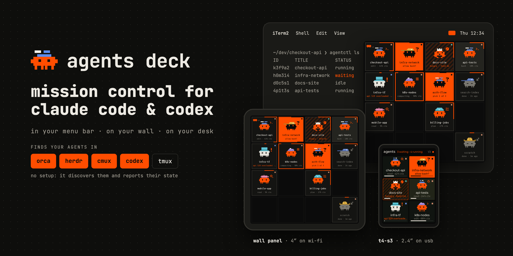
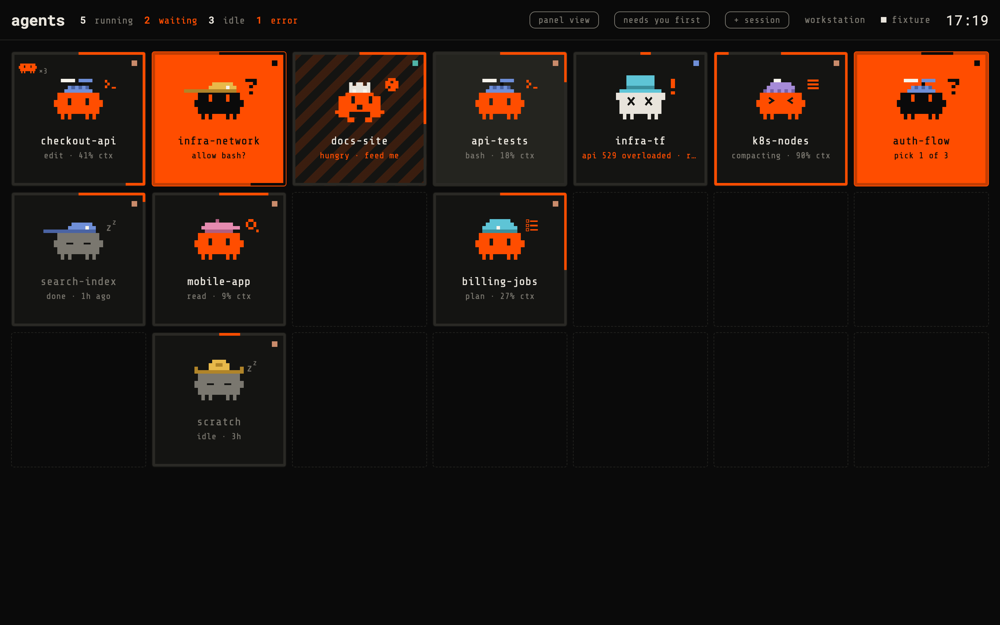
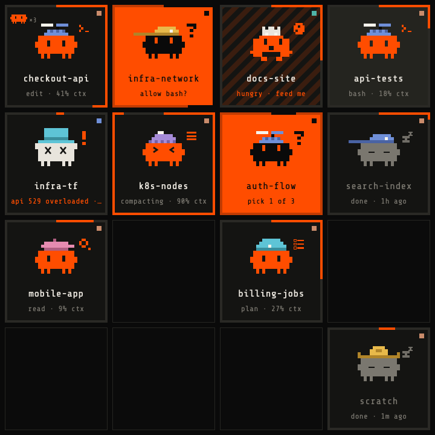
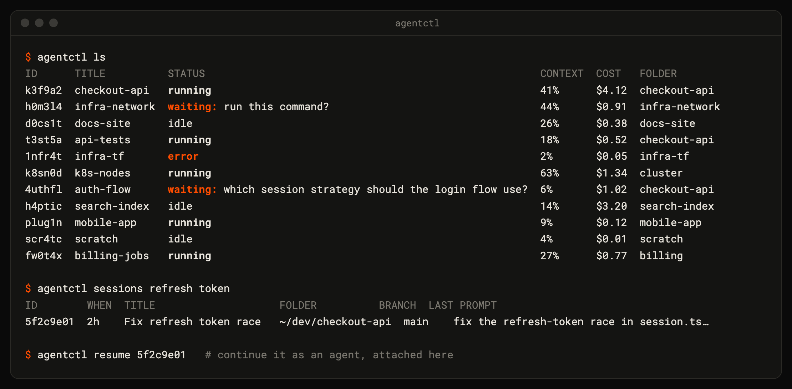
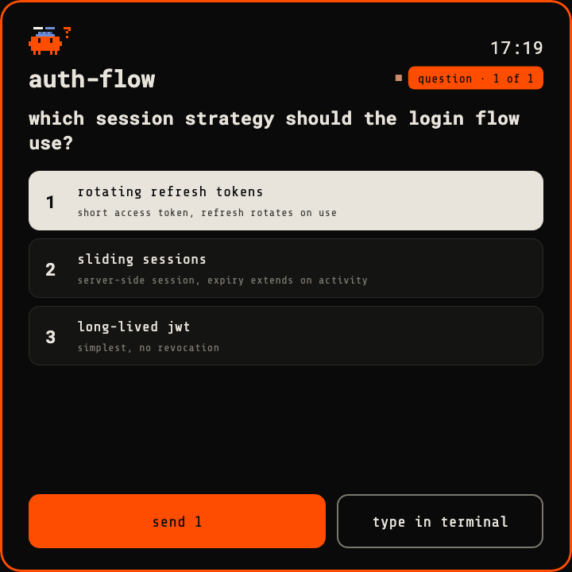
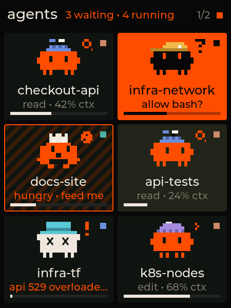
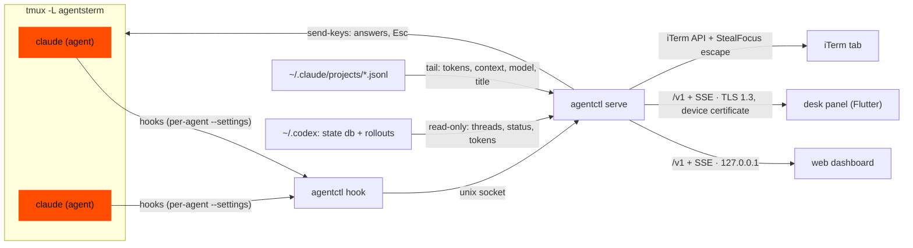

<p align="center"></p>

<p align="center">
  <a href="https://github.com/brushknight/agents-deck/actions/workflows/ci.yml"></a>
  <a href="https://github.com/brushknight/agents-deck/releases/latest"></a>
  
</p>

# agents deck

**Mission control for your Claude Code and Codex agents**: in your menu bar, on your desk, in the browser and in your terminal.

It's self-contained on your laptop: a small Go daemon tracks every agent (who's working, who needs you, what each one is doing, its context and cost), a deck drops down from the menu bar, and a web dashboard works on your phone too. Answer permission prompts and questions from any of them, or jump straight to the agent's terminal. A 4″ wall panel and a pocket-sized AMOLED board are optional companions.

Run agents however you like: in [Orca](https://github.com/stablyai/orca), [herdr](https://herdr.dev), [cmux](https://cmux.com), the Codex app, or in tmux with `agentctl new`. The deck finds them on its own and shows their state, with nothing to set up.

## Where it shows up

| | |
|---|---|
|  |  |
| **Menu bar.** Click the critter and the deck drops down; it turns orange when an agent needs you. | **Browser.** The same board, a panel view, and every agent's card. |
|  |  |
| **Wall panel.** A 4″ touch panel on Wi-Fi, as a companion. | **Terminal.** `agentctl` starts, lists, resumes and restores agents. |

## Works with your harness

agents deck is a status board, not a harness. If you already run your agents in one of these, there's nothing to set up: the deck finds them on your Mac, shows each agent's state (working, needs you, done) next to the rest, and lets you answer, interrupt and jump to them from any screen.

| Runs your agents | What the deck shows |
|---|---|
| [Orca](https://github.com/stablyai/orca) | agents in Orca's worktrees, while Orca is open |
| [herdr](https://herdr.dev) | agents in herdr's panes, in every herdr session that's running |
| [cmux](https://cmux.com) | Claude agents in cmux's terminals, while cmux is open (answering from the deck needs one cmux setting, see [features](docs/features.md#cmux)) |
| Codex app and Codex CLI | threads from the last 6 hours, read-only |
| agentctl (built in) | agents it starts with `agentctl new`, each in a tmux session with a status header |
| Claude Code on its own | sessions you started by hand in any terminal, once you add them |

Details for each are in [docs/features.md](docs/features.md#agents-in-other-harnesses).

**Your harness missing?** Open a pull request ([docs/harnesses.md](docs/harnesses.md) walks through adding one), or name it in the [harness tracking issue](https://github.com/brushknight/agents-deck/issues/7) so we know what to add next.

## Hardware

Both are optional: the menu bar and the browser show the same deck.

| | |
|---|---|
|  |  |
| **[Wall Panel](https://github.com/dotstartech/wall-panel)**: a 4″ 720×720 touch panel with a Raspberry Pi CM4 inside, running the deck's Flutter app. It talks to the daemon over Wi-Fi, with TLS 1.3 and its own device certificate (`agentctl pair`). | **[LilyGo T4-S3](https://lilygo.cc/products/t4-s3)**: a 2.41″ AMOLED touch board on USB, with no wiring. Flash [t4s3-panel](firmware/devices/t4s3-panel) and it shows your agents in a scrolling grid, with cards you can answer from. |

**Build your own.** Any board with a USB serial port (ESP32 and friends) gets the same agents, prompts and actions through [Deck Link](docs/link/protocol.md); the [firmware kit](firmware/deck-link) has a status LED, an OLED tile and a knob to start from, and [docs/link/new-device.md](docs/link/new-device.md) says how to add a device.

Each critter shows what its agent is doing: thinking, reading, editing, running commands, compacting, waiting for you, or hungry for review once it's done. It wears a pixel hat picked by its working folder, so a project's agents look alike; tap the critter to pick another. The full tour is in [docs/features.md](docs/features.md).

## Quick start

Requirements: macOS on Apple Silicon, and tmux (`brew install tmux`) for agents you start with `agentctl new`. iTerm2 is optional (it lets the deck jump to an agent's tab).

```bash
curl -fsSL https://raw.githubusercontent.com/brushknight/agents-deck/main/install.sh | sh -s -- --app
```

It downloads the latest release, checks it against the release's `SHA256SUMS`, installs `agentctl` to `~/.local/bin`, starts the daemon at login and puts the menu bar app in `~/Applications` (drop `--app` to skip it).

Or from a clone, which builds the same from the code (Go 1.24+, and Flutter 3.44+ for the app):

```bash
git clone https://github.com/brushknight/agents-deck && cd agents-deck
./install.sh --source --app
```

Your agents in Orca, herdr, cmux and Codex show up right away. Then, for agents of your own:

```bash
source <(agentctl completion zsh) # tab completion (add to ~/.zshrc)
cd ~/dev/my-project
agentctl new                      # a Claude agent for this folder (ctrl-q detaches)
agentctl web                      # the dashboard (one-time login link)
```

Want a full board without spending tokens? `agentctl sim start --root ~/dev --slots 12`.

**Linux and Windows** aren't supported yet. `agentctl` already compiles for Linux; it still needs a systemd unit and terminal focus without iTerm, and each needs its own tray app. macOS comes first; see [docs/releasing.md](docs/releasing.md#platforms) for where each platform stands.

## Commands

```text
agentctl new [dir] [-t title] [-c claude|codex|gemini|shell] [-a account] [-d]   start an agent and attach (-d: stay detached)
agentctl attach <id|title>          show an agent in this terminal (ctrl-q detaches)
agentctl reopen                     iTerm tabs for every agent no terminal shows (after iTerm quits or crashes)
agentctl hats                       the hats agents wear (one per working folder)
agentctl set hat <agent|folder> <shape> [colour] | auto
agentctl accounts                   your Claude accounts (account add <name> <folder> <colour> | default | rm)
agentctl handoff <id|title> <account>  out of usage? continue the conversation in another account
agentctl live                       Claude sessions started by hand in other terminals
agentctl add <session>              put one of them on the deck (watched; or tap a free cell)
agentctl restore                    bring back agents lost with the tmux server (crash, reboot), each in its old spot
agentctl set restore ask|auto       keep lost agents for `restore` (default), or bring them back right away
agentctl ls                         the fleet at a glance
agentctl rm <id|title>              stop and forget an agent
agentctl move <id|title> <n>        put an agent at position n (free spots are fine)
agentctl sessions [words]           look up any Claude session by id, title, folder, branch or last prompt
agentctl resume <id-prefix>         continue a Claude session as an agent
agentctl web                        open the dashboard
agentctl pair <name> [--bundle F]   pair a device (the panel): its own certificate, scope view|act|admin
agentctl devices [revoke <name>]    paired devices and serial boards; cut one off
agentctl set term iterm|tmux|window how "focus" shows an agent
agentctl set mouse tmux|native      who owns the mouse in agent terminals
agentctl sim start|stop             simulated agents for demos
```

## How it works




Each agent gets its own hook settings, so your global `~/.claude/settings.json` is never touched. Hooks report prompts, tool calls, permission requests, compaction and stops; Claude's transcripts give tokens, context, model and title; dialogs without a hook are read off the screen. Answers are typed into the agent's tmux session. The web UI, the menu bar app and the panel all speak one small JSON API ([docs/protocol.md](docs/protocol.md)).

## Security & privacy

- **Nothing leaves your machine:** no telemetry, no update checks. The only Go dependency is Google's protobuf module.
- **The web dashboard is loopback-only,** behind a one-time login link, a strict CSP and host and origin checks.
- **The menu bar app** uses the daemon's unix socket: nothing crosses the network.
- **The desk panel** connects over TLS 1.3 with its own client certificate, signed by the deck's local CA (its key is in the macOS Keychain). Each device has a scope (view, act or admin), shows up in `agentctl devices`, can be revoked on its own, and every action it takes lands in an audit log.
- **Serial boards** have to be registered (`agentctl link add`) and approved once (`agentctl devices approve`), start with view-only access, and are logged and revocable like the panel.
- **Codex files are only read.** App control is a single Apple event (asking iTerm for its API cookie): no synthetic keystrokes, no screen reading.
- **Secrets** live in `~/.local/share/agents-terminal/` (`0700` / `0600`).

## Credits

The per-project pixel hats were inspired by [“9 NEW Claude Mods that can truly change how you work”](https://www.youtube.com/watch?v=lDrAZ1wAyVs) by Jay E ([RoboNuggets](https://www.youtube.com/@RoboNuggets)).

## Docs

[Features](docs/features.md) · [Protocol](docs/protocol.md) · [Deck Link](docs/link/protocol.md) · [New device](docs/link/new-device.md) · [Releasing](docs/releasing.md) · [Roadmap](docs/roadmap.md)

| path | |
|---|---|
| `backend/` | Go daemon and CLI (`agentctl`), with the web UI embedded. `go test -race ./...` |
| `clients/flutter/agents_ui` | The deck UI as a Flutter package, shared by the desk panel and the menu bar app. |
| `clients/macos` | The menu bar app (Flutter + a small Swift shell). |
| `proto/` | `link.proto`: the Deck Link contract for serial boards. |
| `firmware/deck-link` | The C firmware kit for Deck Link boards (ESP32), with examples. |
| `firmware/devices` | Firmware for specific boards, built on the kit (`t4s3-panel`, and the Waveshare panels `waveshare-lcd-147`, `waveshare-touch-lcd-4`, `waveshare-touch-amoled-18`). |
| `firmware/panel-core` | The Waveshare panels' shared core: Deck Link adapter, critters, font, layouts. |
| `docs/fixtures/state.json` | The sample fleet behind demo mode, the web fixture view and the tests. |
