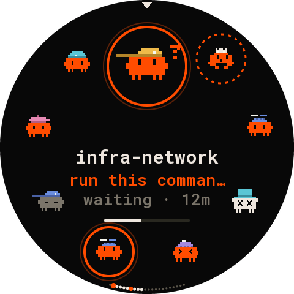
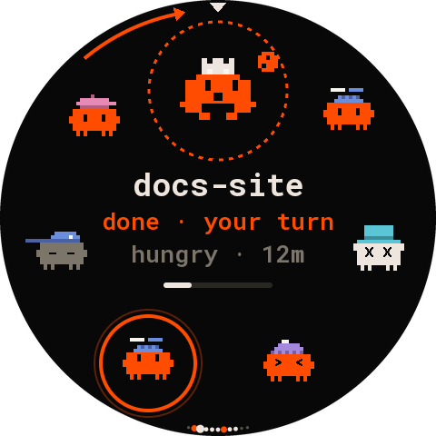
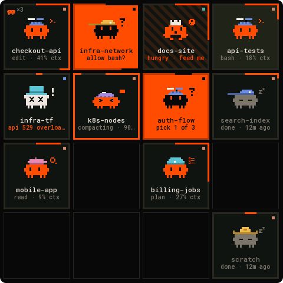
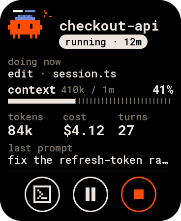
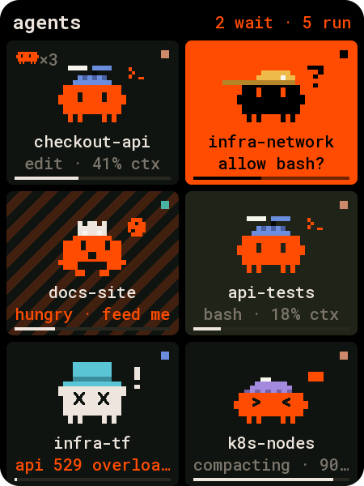
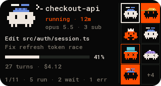
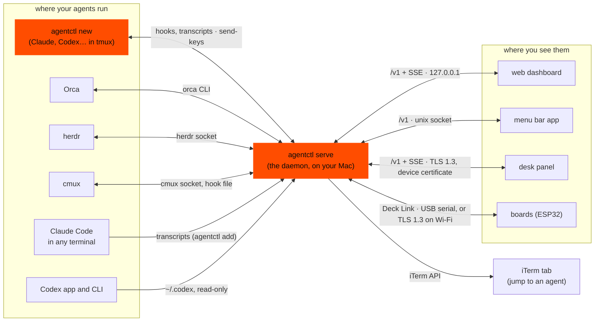

<p align="center"></p>

<p align="center">
  <a href="https://github.com/brushknight/agents-deck/actions/workflows/ci.yml"></a>
  <a href="https://github.com/brushknight/agents-deck/releases/latest"></a>
  
</p>

# agents deck

**Mission control for your Claude Code and Codex agents**: in your menu bar, in the browser, on your
desk, and on a little screen you flash yourself.

A small program on your Mac (the daemon, `agentctl`) keeps track of every coding agent you run: who's
working, who needs you, what each one is doing, its context and cost. You see them all as a deck of
tiles, each agent a pixel critter, and you can answer an agent's question or permission prompt, stop
it, or jump to its terminal from any screen. Everything stays on your Mac. The boards are optional
and cheap: plug one in with a USB cable and it shows the same deck; give it your Wi-Fi once and it
works from anywhere on your desk.

- [What you need](#what-you-need)
- [Quick start](#quick-start-the-mac-part)
- [Pick a display](#pick-a-display) · [Flash a board](#flash-a-board) · [Wi-Fi](#wi-fi)
- [Set it up with an AI agent](#set-it-up-with-an-ai-agent)
- [Where else it shows up](#where-else-it-shows-up) · [Harnesses](#works-with-your-harness) · [Commands](#commands) · [How it works](#how-it-works) · [Security](#security--privacy) · [Docs](#docs)

## What you need

- **A Mac with Apple Silicon.** Linux works when built from source ([below](#on-linux)); Windows isn't
  supported yet ([where each platform stands](docs/releasing.md#platforms)).
- **Claude Code or Codex**, however you like to run them. Optional: tmux (`brew install tmux`) for
  agents you start with `agentctl new`, and iTerm2 so the deck can jump to an agent's tab.
- **Optional: a board.** One of the [displays below](#pick-a-display) and a USB-C cable that carries
  data. No soldering, no wiring: the screen, touch and USB are all on the board.

## Quick start (the Mac part)

```bash
curl -fsSL https://raw.githubusercontent.com/brushknight/agents-deck/main/install.sh | sh -s -- --app
```

That downloads the latest release, checks it against the release's `SHA256SUMS`, installs `agentctl` to
`~/.local/bin`, starts the daemon at login, and puts the menu bar app in `~/Applications` (leave out
`--app` to skip it).

Or build the same from a clone (needs Go 1.24+, and Flutter 3.44+ for the app). Do this if you want
the newest board features before they're in a release:

```bash
git clone https://github.com/brushknight/agents-deck && cd agents-deck
./install.sh --source --app
```

### On Linux

There are no Linux release archives yet, so build from a clone (Go 1.24+; for the tray app, Flutter
3.44+ and its Linux build tools: `sudo apt-get install clang cmake ninja-build pkg-config libgtk-3-dev`):

```bash
git clone https://github.com/brushknight/agents-deck && cd agents-deck
./install.sh --source --app --autostart
```

The daemon runs as a systemd user service (`agents-deck`). `--app` builds the tray app: the menu bar
app's deck in your system tray, installed to `~/.local/share/agents-deck` with an entry in your app
menu; `--autostart` starts it at login. KDE Plasma, XFCE, Cinnamon and MATE show tray icons as they
are; GNOME needs the AppIndicator extension (Ubuntu has it on). More in
[clients/macos/README.md](clients/macos/README.md#linux).

Agents you already run in Orca, herdr, cmux or Codex show up right away. To start your own:

```bash
cd ~/dev/my-project
agentctl new         # a Claude agent for this folder, in tmux (ctrl-q detaches)
agentctl web         # the dashboard in your browser (a one-time login link)
```

Want a full deck without spending tokens? `agentctl sim start --root ~/dev --slots 12` fills it with
pretend agents; `agentctl sim stop` clears them.

## Pick a display

All of these are small ESP32-S3 boards: a microcontroller (a tiny computer that runs one program,
the "firmware") with a screen on it. You put our firmware on it once, over USB ("flashing"), and from
then on it's a little deck. Pick by size and shape; the [devices page](docs/devices.md) has every
screen of every board.

<table>
<tr>
<td align="center" width="180"></td>
<td><b>Waveshare ESP32-S3-Touch-LCD-2.8C</b><br>2.8″ round · touch · Wi-Fi<br>Agents on a ring you turn with a finger, 9 to a turn.<br>Buy: <a href="https://www.waveshare.com/esp32-s3-touch-lcd-2.8c.htm">Waveshare</a>, about $40 · firmware: <a href="firmware/devices/waveshare-touch-lcd-28c"><code>waveshare-touch-lcd-28c</code></a></td>
</tr>
<tr>
<td align="center" width="180"></td>
<td><b>Waveshare ESP32-S3-Touch-LCD-2.1</b><br>2.1″ round · touch · Wi-Fi<br>The same ring, 7 to a turn.<br>Buy: <a href="https://www.waveshare.com/esp32-s3-touch-lcd-2.1.htm">Waveshare</a>, about $33 · firmware: <a href="firmware/devices/waveshare-touch-lcd-21"><code>waveshare-touch-lcd-21</code></a></td>
</tr>
<tr>
<td align="center" width="180"></td>
<td><b>Waveshare ESP32-S3-Touch-LCD-4</b><br>4″ square · touch · Wi-Fi experimental<br>The full 4×4 deck, like the desk panel.<br>Buy: <a href="https://www.waveshare.com/esp32-s3-touch-lcd-4.htm">Waveshare</a>, about $33 · firmware: <a href="firmware/devices/waveshare-touch-lcd-4"><code>waveshare-touch-lcd-4</code></a></td>
</tr>
<tr>
<td align="center" width="180"></td>
<td><b>Waveshare ESP32-S3-Touch-AMOLED-1.8</b><br>1.8″ AMOLED · touch · Wi-Fi<br>2×2 tiles you scroll, and a card for each agent.<br>Buy: <a href="https://www.waveshare.com/esp32-s3-touch-amoled-1.8.htm">Waveshare</a>, about $28 · firmware: <a href="firmware/devices/waveshare-touch-amoled-18"><code>waveshare-touch-amoled-18</code></a></td>
</tr>
<tr>
<td align="center" width="180"></td>
<td><b>LilyGO T4-S3</b><br>2.41″ AMOLED, tall · touch · Wi-Fi<br>2×3 tiles you scroll, and a card for each agent.<br>Buy: <a href="https://lilygo.cc/products/t4-s3">LilyGO</a>, about $59 · firmware: <a href="firmware/devices/lilygo-t4-s3"><code>lilygo-t4-s3</code></a></td>
</tr>
<tr>
<td align="center" width="180"></td>
<td><b>Waveshare ESP32-S3-LCD-1.47B</b><br>1.47″ strip · no touch · USB only<br>One agent and a mini-board; look only.<br>Buy: <a href="https://www.waveshare.com/esp32-s3-lcd-1.47b.htm">Waveshare</a>, about $13 · firmware: <a href="firmware/devices/waveshare-lcd-147"><code>waveshare-lcd-147</code></a></td>
</tr>
<tr>
<td align="center" width="180"></td>
<td><b>Wall Panel (Raspberry Pi CM4)</b><br>4″ 720×720 · touch · Wi-Fi<br>The full deck app.<br>Buy: <a href="https://github.com/dotstartech/wall-panel">project page</a> · firmware: <a href="clients/flutter/agents_ui"><code>clients/flutter</code></a></td>
</tr>
</table>

Prices are from the maker's own shop (Waveshare, LilyGO) in October 2026, for the version to buy:
**with touch** where there's a choice, without a battery for the 1.8″ AMOLED, the standard "B" for
the 1.47″, and the LilyGO with its shell. They change, and shipping and tax are extra. Not sure? The
**2.8″ round** is the nicest to use; the **1.8″ AMOLED** is the smallest touch board with a
rectangular screen.

**Want another board?** Ask for it in a [hardware request](https://github.com/brushknight/agents-deck/issues/new?title=Hardware+requests%3A+which+display+should+agents+deck+support+next%3F&body=agents+deck+runs+on+these+boards+today+%28see+%5Bdocs%2Fdevices.md%5D%28..%2Fblob%2Fmain%2Fdocs%2Fdevices.md%29%29%3A%0A%0A-+Waveshare+ESP32-S3-Touch-LCD-2.1+%28round%29%0A-+Waveshare+ESP32-S3-Touch-LCD-2.8C+%28round%29%0A-+Waveshare+ESP32-S3-Touch-LCD-4+%28square%2C+desk-panel+layout%29%0A-+Waveshare+ESP32-S3-Touch-AMOLED-1.8+%28small+square%29%0A-+LilyGO+T4-S3+2.41%E2%80%B3+AMOLED%0A-+Waveshare+ESP32-S3-LCD-1.47+%28strip%29%0A%0A%2A%2AWant+another+one%3F%2A%2A+Comment+here+with%3A%0A%0A1.+%2A%2ABoard%2A%2A+%E2%80%94+exact+name+and+a+link+to+the+maker%27s+product+page%0A2.+%2A%2AScreen%2A%2A+%E2%80%94+size%2C+resolution%2C+shape+%28round+%2F+square+%2F+bar%29%2C+touch+or+buttons%0A3.+%2A%2AChip%2A%2A+%E2%80%94+ESP32-S3+boards+are+easiest+%28USB%2C+PSRAM%2C+Wi-Fi%29%3B+others+are+welcome+but+take+longer%0A4.+%2A%2AHow+you%27d+use+it%2A%2A+%E2%80%94+on+the+desk%2C+on+the+wall%2C+in+a+keyboard%2C+as+a+status+light%E2%80%A6%0A%0A%F0%9F%91%8D+the+requests+you%27d+like+too%3A+the+most-wanted+boards+get+built+first.%0A%0AWriting+firmware+yourself%3F+Follow+%5Bdocs%2Flink%2Fnew-device.md%5D%28..%2Fblob%2Fmain%2Fdocs%2Flink%2Fnew-device.md%29+%E2%80%94+a+coding+agent+can+follow+it+too.&labels=hardware): say which board, its
screen, and how you'd use it. 👍 the requests you'd like too: the most-wanted boards get built first.

## Flash a board

You do this once per board. Plug it into the Mac with a USB-C cable that carries data (many cables
that come with chargers only carry power), then:

**1. Put the firmware on it.** The quick way is the **web flasher (coming soon)**: open it in Chrome
or Edge on your Mac, pick your board, click **Connect**, choose the board's USB port, and click
**Install**. It writes the ready-made image from the latest release; nothing to install, about a
minute. (It uses Web Serial, which Safari and Firefox don't have.)

Until it's online, or to run the newest code, build and flash it yourself with PlatformIO:
[docs/flashing.md](docs/flashing.md) takes you through it, about 15 minutes the first time.

**2. Let the deck talk to it.** The deck only ever opens USB ports you register:

```bash
agentctl link ports                          # lists USB serial ports, e.g. /dev/cu.usbmodem1101
agentctl link add /dev/cu.usbmodem1101       # once per port
```

**3. Watch it come up.** The board says "connecting", and a few seconds later shows your agents. On a
registered port a new board is approved at once and can answer prompts, focus a terminal and
interrupt an agent (scope `act`). To let it stop agents too:

```bash
agentctl devices                                   # every board and device, with its name
agentctl devices scope <board-name> admin          # admin adds stop
```

Prefer to approve each board by hand? `agentctl devices auto-approve usb off`; a new board then shows
"waiting for approval" with the exact `agentctl devices approve …` command on its screen. Something
not working? See [troubleshooting](docs/flashing.md#troubleshooting).

## Wi-Fi

Every touch board except the 4″ (for now) can leave the Mac and run from any USB charger.

```bash
agentctl link wifi --default --ssid "my network"    # asks for the password; kept in your Keychain
```

You set it once. Every approved board that's plugged into the Mac gets the network by itself (a toast
says "trying Wi-Fi…", then whether it worked), and so does every board you plug in later. Then unplug
it, power it anywhere on the same network, and it finds the deck. Plug it back into the Mac and it's on
USB again at once. `agentctl link` shows how each board is connected.

Security in one sentence: a board on Wi-Fi talks to your Mac only over TLS 1.3 with a certificate of
its own, made over the USB cable when you first plugged it in, and `agentctl devices revoke <board>`
cuts it off. The details are in [docs/protocol.md](docs/protocol.md) and
[docs/link/protocol.md](docs/link/protocol.md#pairing-and-wi-fi).

## Set it up with an AI agent

Every board's README is written so a coding agent can follow it step by step, and they're
independent, so you can give each board to its own subagent and flash several in parallel. Paste this
into Claude Code or Codex in a fresh clone of this repository (fill in your board):

````text
Set up agents deck on this Mac from this clone, and get my <board name, e.g. Waveshare
ESP32-S3-Touch-LCD-2.8C> working on it, first over USB, then over Wi-Fi.

1. Read AGENTS.md, README.md ("Flash a board" and "Wi-Fi"), docs/flashing.md, docs/devices.md, and
   the README in the board's folder under firmware/devices/. Follow the board README where it is
   more specific.
2. Check prerequisites and install what's missing with Homebrew, telling me before each install:
   Go 1.24+, PlatformIO (`pio`), tmux. Flutter only if I want the menu bar app.
3. Build and install agentctl from this clone: `./install.sh --source` (add `--app` for the menu bar
   app). Check the daemon is up with `agentctl ls`.
4. Ask me to plug the board in with a data USB-C cable. Run `agentctl link ports`, and if no new port
   appears, tell me to try another cable (charge-only cables are common). Register the port with
   `agentctl link add <port>`.
5. Build and flash from source as docs/flashing.md says, with the env it lists for this board and
   `--upload-port <port>`. If the upload can't connect, ask me to hold BOOT, press RST, release
   BOOT, and try again. Don't edit firmware source or build flags to make it work; tell me what
   failed instead.
6. Verify: `agentctl link status` shows the board on that port, and `agentctl devices` lists it as
   approved (scope act). Ask me whether I want scope admin (it adds stop) before setting it.
7. Wi-Fi (skip for boards without it): ask me for the network name only, then tell me to run
   `agentctl link wifi --default --ssid "<name>"` myself in a terminal and type the password at its
   prompt. Never ask me for the password, never put it on a command line, in a file or in your
   notes. Then check `agentctl link` for the result.
8. Tell me what to check by eye: the board shows my agents (or `agentctl sim start --root ~/dev
   --slots 6` for pretend ones); tapping an agent opens its card; a waiting agent has orange on it;
   after I unplug it and power it from a charger it comes back with a small Wi-Fi mark.
9. Finish with a short report: what you installed, the board's name, its port, its scope, and how it
   is connected now.
````

## Where else it shows up

| | |
|---|---|
|  |  |
| **Menu bar.** Click the critter and the deck drops down; it turns orange when an agent needs you. On Linux the same app sits in the system tray. | **Browser.** The same board, a panel view, and every agent's card. It works on your phone too ([docs/phone.md](docs/phone.md)). |
|  |  |
| **Desk panel.** A 4″ touch panel on Wi-Fi ([Wall Panel](https://github.com/dotstartech/wall-panel)), paired with `agentctl pair`. | **Terminal.** `agentctl` starts, lists, resumes and restores agents. |

Each critter shows what its agent is doing: thinking, reading, editing, running commands, compacting,
waiting for you, or hungry for review once it's done. It wears a pixel hat picked by its working
folder, so a project's agents look alike. The full tour is in [docs/features.md](docs/features.md).

## Works with your harness

agents deck is a status board, not a harness. If you already run your agents in one of these, there's
nothing to set up: the deck finds them and lets you answer, interrupt and jump to them from any screen.

| Runs your agents | What the deck shows |
|---|---|
| [Orca](https://github.com/stablyai/orca) | agents in Orca's worktrees, while Orca is open |
| [herdr](https://herdr.dev) | agents in herdr's panes, in every herdr session that's running |
| [cmux](https://cmux.com) | Claude agents in cmux's terminals, while cmux is open (answering needs one cmux setting, see [features](docs/features.md#cmux)) |
| Codex app and Codex CLI | threads from the last 6 hours, read-only |
| agentctl (built in) | agents it starts with `agentctl new`, each in a tmux session with a status header |
| Claude Code on its own | sessions you started by hand in any terminal, once you add them (`agentctl live`, `agentctl add`) |

**Your harness missing?** Open a pull request ([docs/harnesses.md](docs/harnesses.md) walks through
adding one), or name it in the [harness tracking issue](https://github.com/brushknight/agents-deck/issues/7).

## Commands

```text
agentctl new [dir] [-t title] [-c claude|codex|gemini|shell] [-a account] [-d]   start an agent and attach (-d: stay detached)
agentctl attach <id|title>          show an agent in this terminal (ctrl-q detaches)
agentctl ls                         the fleet at a glance
agentctl web                        open the dashboard
agentctl live / add <session>       Claude sessions started by hand; put one on the deck
agentctl sessions [words]           look up any Claude session by id, title, folder, branch or last prompt
agentctl resume <id-prefix>         continue a Claude session as an agent
agentctl restore                    bring back agents lost with the tmux server (crash, reboot)
agentctl rm <id|title>              stop and forget an agent
agentctl link [ports | add <port>]  boards: how each is connected, find ports, register one
agentctl link wifi --default --ssid NAME   the Wi-Fi network every board gets (asks for the password)
agentctl devices [approve | scope | revoke <name>]   boards and paired devices
agentctl pair <name> [--bundle F]   pair the desk panel: its own certificate, scope view|act|admin
agentctl sim start|stop             pretend agents for demos
```

`agentctl help` lists the rest (accounts, hats, handoff, terminal and mouse settings).

## How it works



On the left, wherever your agents run; on the right, every screen that shows them; in the middle, one
daemon. Agents started with `agentctl new` run in their own tmux server (`tmux -L agentsterm`), each
with its own hook settings, so your global `~/.claude/settings.json` is never touched. Hooks report
prompts, tool calls, permission requests, compaction and stops; Claude's transcripts
(`~/.claude/projects/*.jsonl`) give tokens, context, model and title. Answers are typed into the
agent's tmux session, or sent through the harness that runs it (Orca, herdr, cmux); Codex is only
read. The web UI, the menu bar app and the panel speak one small JSON API
([docs/protocol.md](docs/protocol.md)); boards speak [Deck Link](docs/link/protocol.md), a compact
protobuf version of it.

## Security & privacy

- **Nothing leaves your machine:** no telemetry, no update checks. The only Go dependency is Google's protobuf module.
- **The web dashboard is loopback-only,** behind a one-time login link, a strict CSP and host and origin checks.
- **The menu bar app** (and the Linux tray app) uses the daemon's unix socket: nothing crosses the network.
- **The desk panel and boards on Wi-Fi** connect over TLS 1.3 with their own client certificate,
  signed by the deck's local CA (its key is in the macOS Keychain). Each device has a scope (view, act
  or admin), shows up in `agentctl devices`, can be revoked on its own, and every action it takes lands
  in an audit log.
- **Boards on USB** are only heard on ports you registered (`agentctl link add`). A new board plugged
  into one is approved at once with scope `act`: physical USB on your Mac counts as your consent
  (`agentctl devices auto-approve usb off` makes them wait for `agentctl devices approve`). Never over
  Wi-Fi, never a revoked board; `admin` is always given by hand. A board's certificate is only ever
  issued over USB.
- **Codex files are only read.** App control is a single Apple event (asking iTerm for its API cookie): no synthetic keystrokes, no screen reading.
- **Secrets** live in `~/.local/share/agents-terminal/` (`0700` / `0600`); the default Wi-Fi password in the Keychain.

## Docs

[Devices](docs/devices.md) · [Flashing](docs/flashing.md) · [Features](docs/features.md) · [Protocol](docs/protocol.md) · [Deck Link](docs/link/protocol.md) · [New device](docs/link/new-device.md) · [Harnesses](docs/harnesses.md) · [Releasing](docs/releasing.md) · [Roadmap](docs/roadmap.md)

| path | |
|---|---|
| `backend/` | Go daemon and CLI (`agentctl`), with the web UI embedded. `go test -race ./...` |
| `clients/flutter/agents_ui` | The deck UI as a Flutter package, shared by the desk panel and the menu bar app. |
| `clients/macos` | The menu bar app (Flutter + a small Swift shell), and the Linux tray app (the same Flutter app + a small GTK shell). |
| `proto/` | `link.proto`: the Deck Link contract for boards. |
| `firmware/deck-link` | The C firmware kit for Deck Link boards (ESP32), with examples. |
| `firmware/devices` | Firmware for each board, one folder each ([devices](docs/devices.md)). |
| `firmware/panel-core` | The boards' shared core: Deck Link, Wi-Fi, critters, fonts, and the round, square and big layouts. |
| `docs/fixtures/state.json` | The sample fleet behind demo mode, the web fixture view, the tests and the screenshots. |

## Credits

The per-project pixel hats were inspired by [“9 NEW Claude Mods that can truly change how you work”](https://www.youtube.com/watch?v=lDrAZ1wAyVs) by Jay E ([RoboNuggets](https://www.youtube.com/@RoboNuggets)).
The 1.47″ board's original drawing, mascots and font are by **belidor**.
