<p align="center">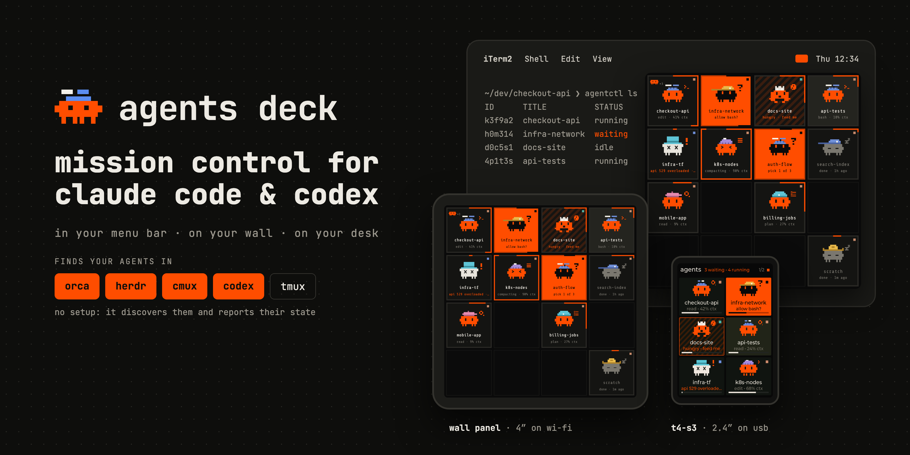</p>

<p align="center">
  <a href="https://github.com/brushknight/agents-deck/actions/workflows/ci.yml"></a>
  <a href="https://github.com/brushknight/agents-deck/releases/latest"></a>
  
  
  
</p>

# agents deck

**Mission control for your Claude Code and Codex agents**: in your menu bar, in the browser, on your
desk, and on a little screen you flash yourself.

A small program on your computer keeps track of every coding agent you run: who's working, who needs
you, what each one is doing, its context and cost. You see them all as a deck of tiles, each agent a
pixel critter, and you can answer an agent's question or permission prompt, stop it, or jump to its
terminal from any screen. Everything stays on your computer. The boards are optional and cheap: plug
one in with a USB cable and it shows the same deck; give it your Wi-Fi once and it works from anywhere
on your desk.

- [What you need](#what-you-need) · [Quick start](#quick-start)
- [Pick a display](#pick-a-display) · [Flash a board](#flash-a-board) · [Wi-Fi](#wi-fi)
- [What works where](#what-works-where) · [Where else it shows up](#where-else-it-shows-up) · [Harnesses](#works-with-your-harness)
- [For the terminal](#for-the-terminal) · [How it works](#how-it-works) · [Security](#security--privacy) · [Docs](#docs)

## What you need

- **A Mac, a Linux PC or a Windows PC.** macOS 13 or later (Apple Silicon or Intel); Linux on x64 or
  arm64 with a desktop that shows tray icons; Windows 10 or 11, 64-bit, as a
  [preview](#what-works-where).
- **Claude Code or Codex**, however you like to run them.
- **Optional: a board.** One of the [displays below](#pick-a-display) and a USB-C cable that carries
  data. No soldering, no wiring: the screen, touch and USB are all on the board.

## Quick start

**1. Download the app for your computer** from the
[latest release](https://github.com/brushknight/agents-deck/releases/latest) (under **Assets**):

| your computer | the file | then |
|---|---|---|
| **Mac** | `agents-deck_<version>_macos_universal.dmg` | open it, drag **agents deck** to Applications, open it from there |
| **Windows** (preview) | `agents-deck_<version>_windows_amd64_setup.exe` | run it; no administrator password needed |
| **Linux**, Debian or Ubuntu | `agents-deck_<version>_linux_amd64.deb` (`arm64` for ARM) | open it with your software installer, then **agents deck** from the app menu |
| **Linux**, anything else | `agents-deck_<version>_linux_amd64.tar.gz` (`arm64` for ARM) | see [install.md](docs/install.md#other-distributions-the-targz) |

The app brings everything with it and starts it when you log in. A critter appears in the menu bar
(the system tray on Linux); click it and the deck opens. On Windows, for now, **agents deck** in the
Start menu opens the deck in your browser. Agents you already run in Claude Code, Codex, Orca, herdr
or cmux show up on it right away. The gear under the deck opens **Settings**.

**2. Plug in a board** (optional). Open Settings, **Boards**: a new board on USB shows up there.
Say it's yours, pick which board it is, and click **Install firmware**. About a minute later it shows
your agents. [Flash a board](#flash-a-board) has the details.

What each download puts where, how to update and how to remove it: [docs/install.md](docs/install.md).

**Warnings you may see the first time:**

- **Windows** says **Windows protected your PC**, because the preview installer isn't signed yet.
  Click **More info**, then **Run anyway**.
- **macOS**, for a build that isn't notarized by Apple, says it could not verify the app. Click
  **Done**, then System Settings, Privacy & Security, **Open Anyway**. Notarized releases open without
  it. Either way, macOS then tells you a background item was added: that's the agents deck service,
  which watches your agents and boards even when the app is closed. Leave it on.

## Pick a display

All of these are small ESP32-S3 boards: a microcontroller (a tiny computer that runs one program,
the "firmware") with a screen on it. You put our firmware on it once, over USB ("flashing"), and from
then on it's a little deck. Pick by size and shape; the [devices page](docs/devices.md) has every
screen of every board.

<table>
<tr>
<td align="center" width="180">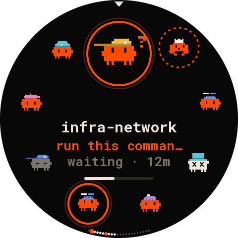</td>
<td><b>Waveshare ESP32-S3-Touch-LCD-2.8C</b><br>2.8″ round · touch · Wi-Fi<br>Agents on a ring you turn with a finger, 9 to a turn.<br>Buy: <a href="https://www.waveshare.com/esp32-s3-touch-lcd-2.8c.htm">Waveshare</a>, about $40 · firmware: <a href="firmware/devices/waveshare-touch-lcd-28c"><code>waveshare-touch-lcd-28c</code></a></td>
</tr>
<tr>
<td align="center" width="180">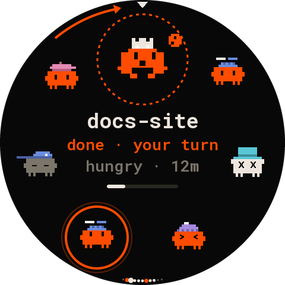</td>
<td><b>Waveshare ESP32-S3-Touch-LCD-2.1</b><br>2.1″ round · touch · Wi-Fi<br>The same ring, 7 to a turn.<br>Buy: <a href="https://www.waveshare.com/esp32-s3-touch-lcd-2.1.htm">Waveshare</a>, about $33 · firmware: <a href="firmware/devices/waveshare-touch-lcd-21"><code>waveshare-touch-lcd-21</code></a></td>
</tr>
<tr>
<td align="center" width="180">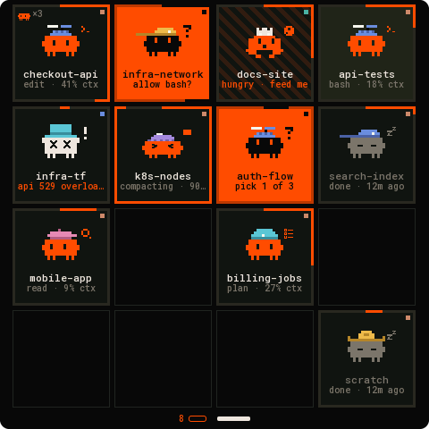</td>
<td><b>Waveshare ESP32-S3-Touch-LCD-4</b><br>4″ square · touch · Wi-Fi experimental<br>The full 4×4 deck, like the desk panel.<br>Buy: <a href="https://www.waveshare.com/esp32-s3-touch-lcd-4.htm">Waveshare</a>, about $33 · firmware: <a href="firmware/devices/waveshare-touch-lcd-4"><code>waveshare-touch-lcd-4</code></a></td>
</tr>
<tr>
<td align="center" width="180">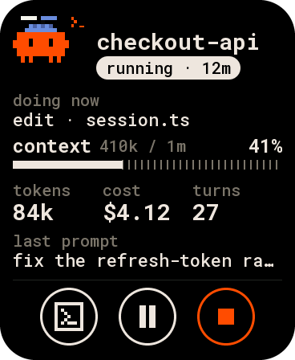</td>
<td><b>Waveshare ESP32-S3-Touch-AMOLED-1.8</b><br>1.8″ AMOLED · touch · Wi-Fi<br>2×2 tiles you scroll, and a card for each agent.<br>Buy: <a href="https://www.waveshare.com/esp32-s3-touch-amoled-1.8.htm">Waveshare</a>, about $28 · firmware: <a href="firmware/devices/waveshare-touch-amoled-18"><code>waveshare-touch-amoled-18</code></a></td>
</tr>
<tr>
<td align="center" width="180">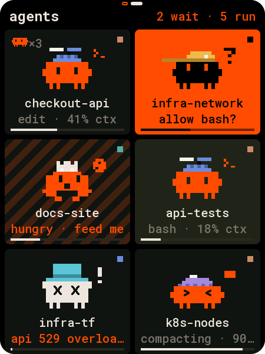</td>
<td><b>LilyGO T4-S3</b><br>2.41″ AMOLED, tall · touch · Wi-Fi<br>2×3 tiles you scroll, and a card for each agent.<br>Buy: <a href="https://lilygo.cc/products/t4-s3">LilyGO</a>, about $59 · firmware: <a href="firmware/devices/lilygo-t4-s3"><code>lilygo-t4-s3</code></a></td>
</tr>
<tr>
<td align="center" width="180">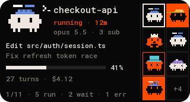</td>
<td><b>Waveshare ESP32-S3-LCD-1.47B</b><br>1.47″ strip · no touch · USB only<br>One agent and a mini-board; look only.<br>Buy: <a href="https://www.waveshare.com/esp32-s3-lcd-1.47b.htm">Waveshare</a>, about $13 · firmware: <a href="firmware/devices/waveshare-lcd-147"><code>waveshare-lcd-147</code></a></td>
</tr>
<tr>
<td align="center" width="180">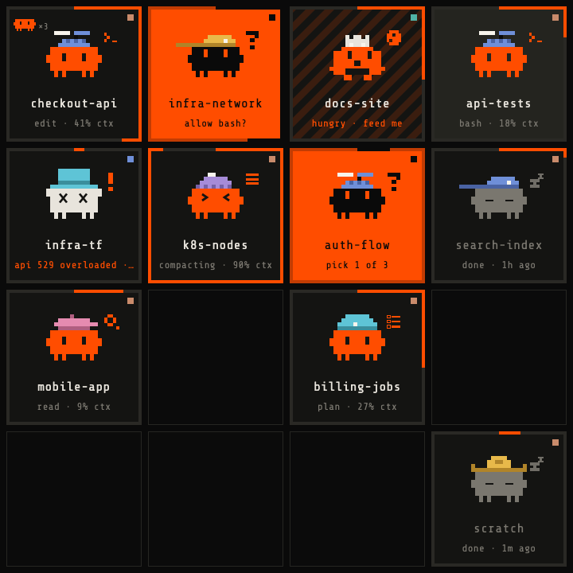</td>
<td><b>Wall Panel (Raspberry Pi CM4)</b><br>4″ 720×720 · touch · Wi-Fi<br>The full deck app.<br>Buy: <a href="https://github.com/dotstartech/wall-panel">project page</a> · firmware: <a href="clients/flutter/agents_ui"><code>clients/flutter</code></a></td>
</tr>
</table>

Prices are from the maker's own shop (Waveshare, LilyGO) in October 2026, for the version to buy:
**with touch** where there's a choice, without a battery for the 1.8″ AMOLED, the standard "B" for
the 1.47″, and the LilyGO with its shell. They change, and shipping and tax are extra. Not sure? The
**2.8″ round** is the nicest to use; the **1.8″ AMOLED** is the smallest touch board with a
rectangular screen.

**Want another board?** Ask for it in a [hardware request](https://github.com/brushknight/agents-deck/issues/new?title=Hardware+requests%3A+which+display+should+agents+deck+support+next%3F&body=agents+deck+runs+on+these+boards+today+%28see+%5Bdocs%2Fdevices.md%5D%28..%2Fblob%2Fmain%2Fdocs%2Fdevices.md%29%29%3A%0A%0A-+Waveshare+ESP32-S3-Touch-LCD-2.1+%28round%29%0A-+Waveshare+ESP32-S3-Touch-LCD-2.8C+%28round%29%0A-+Waveshare+ESP32-S3-Touch-LCD-4+%28square%2C+desk-panel+layout%29%0A-+Waveshare+ESP32-S3-Touch-AMOLED-1.8+%28small+square%29%0A-+LilyGO+T4-S3+2.41%E2%80%B3+AMOLED%0A-+Waveshare+ESP32-S3-LCD-1.47+%28strip%29%0A%0A%2A%2AWant+another+one%3F%2A%2A+Comment+here+with%3A%0A%0A1.+%2A%2ABoard%2A%2A+%E2%80%94+exact+name+and+a+link+to+the+maker%27s+product+page%0A2.+%2A%2AScreen%2A%2A+%E2%80%94+size%2C+resolution%2C+shape+%28round+%2F+square+%2F+bar%29%2C+touch+or+buttons%0A3.+%2A%2AChip%2A%2A+%E2%80%94+ESP32-S3+boards+are+easiest+%28USB%2C+PSRAM%2C+Wi-Fi%29%3B+others+are+welcome+but+take+longer%0A4.+%2A%2AHow+you%27d+use+it%2A%2A+%E2%80%94+on+the+desk%2C+on+the+wall%2C+in+a+keyboard%2C+as+a+status+light%E2%80%A6%0A%0A%F0%9F%91%8D+the+requests+you%27d+like+too%3A+the+most-wanted+boards+get+built+first.%0A%0AWriting+firmware+yourself%3F+Follow+%5Bdocs%2Flink%2Fnew-device.md%5D%28..%2Fblob%2Fmain%2Fdocs%2Flink%2Fnew-device.md%29+%E2%80%94+a+coding+agent+can+follow+it+too.&labels=hardware): say which board, its
screen, and how you'd use it. 👍 the requests you'd like too: the most-wanted boards get built first.

## Flash a board

You do this once per board. Plug it in with a USB-C cable that carries data (many cables that come
with chargers only carry power). Then pick one way:

- **From the app.** Settings, **Boards** shows the new board. Click **Yes, it's mine**, pick the board
  from the pictures, and click **Install firmware**. The app downloads the image from the latest
  release, checks its signature, writes and verifies it. When it's done the board restarts, pairs and
  shows your agents. Later firmware updates are a button on the same page; a board on Wi-Fi updates
  over the air.
- **From the web flasher (coming soon)**, if you haven't installed anything: open it in Chrome or
  Edge, pick your board, click **Connect**, choose the board's USB port, and click **Install**. (It
  uses Web Serial, which Safari and Firefox don't have.)
- **From a terminal**, with `agentctl flash`, or by building the firmware yourself with PlatformIO
  to run the newest code.

All of them, step by step, with the BOOT and RST rescue for a board that doesn't answer:
[docs/flashing.md](docs/flashing.md).

A board you confirm in Settings is approved at once and can answer prompts, focus a terminal and
interrupt an agent (scope `act`): plugging it into your computer counts as your consent. Giving it
**admin** (it adds stop), approving boards by hand, renaming or removing one: all in Settings,
Boards. Something not working? See [troubleshooting](docs/flashing.md#troubleshooting).

## Wi-Fi

Every touch board except the 4″ (for now) can leave your computer and run from any USB charger. Set
your Wi-Fi network once in Settings, **Network**; every board that's plugged in gets it, and so does
every board you plug in later. Then unplug it, power it anywhere on the same network, and it finds
the deck. Plug it back in and it's on USB again at once. Boards use 2.4 GHz Wi-Fi only.

**Bluetooth.** The touch boards on their `idf5` firmware can also reach a Mac over Bluetooth: next to
a laptop with no Wi-Fi and no cable, or to set up a new board without plugging it in. In Settings,
**Boards**, turn on **Look for boards**, click **Add** next to the board's name (`deck-` and six
characters, shown on its screen) and type the 6-digit code the board shows into the window macOS
opens. The board then pairs for Wi-Fi and gets your network over Bluetooth, and each board's
**uplink** (Auto: USB, else Wi-Fi, else Bluetooth) says which way it prefers. Firmware updates still
need Wi-Fi or the cable. macOS (the app) only, for now.

Security in one sentence: a board on Wi-Fi talks to your computer only over TLS 1.3 with a
certificate of its own, made over the USB cable (or a Bluetooth link paired with the code on its
screen) when you first set it up, and removing it in Settings, Boards cuts it off. The details are in [docs/protocol.md](docs/protocol.md) and
[docs/link/protocol.md](docs/link/protocol.md#pairing-and-wi-fi).

## What works where

| | macOS | Linux | Windows (preview) |
|---|---|---|---|
| see Claude Code and Codex sessions, answer prompts | yes | yes | yes, where the tool has hooks |
| the deck next to an icon (menu bar or tray) | yes | yes ([desktops](clients/macos/README.md#where-it-works)) | not yet: the deck and Settings open in your browser |
| Settings, web dashboard | yes | yes | yes, in the browser |
| boards on USB and Wi-Fi, flashing, updates | yes | yes | yes |
| boards over Bluetooth | yes (the app) | not yet | not yet |
| start agents with `agentctl new`, restore after a restart | yes (needs tmux) | yes (needs tmux) | not yet: needs tmux |
| jump to the agent's terminal | iTerm2, Orca, cmux, Codex app | where the harness supports it | not yet |
| updates itself | yes | yes (the `.deb` tells you; your package manager installs) | yes |
| signed by the platform | notarized by Apple, once the project's certificate is set up | no platform signing | not yet: SmartScreen warns |

Every release, on every platform, also carries our own signature, and agents deck installs no update
or firmware without it.

## Where else it shows up

| | |
|---|---|
|  | 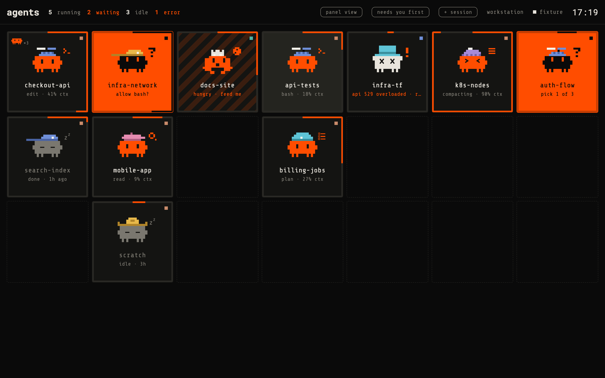 |
| **Menu bar.** Click the critter and the deck drops down; it turns orange when an agent needs you. On Linux the same app sits in the system tray; on Windows, for now, the deck opens in the browser. | **Browser.** The same board, a panel view, and every agent's card. It works on your phone too ([docs/phone.md](docs/phone.md)). |
| 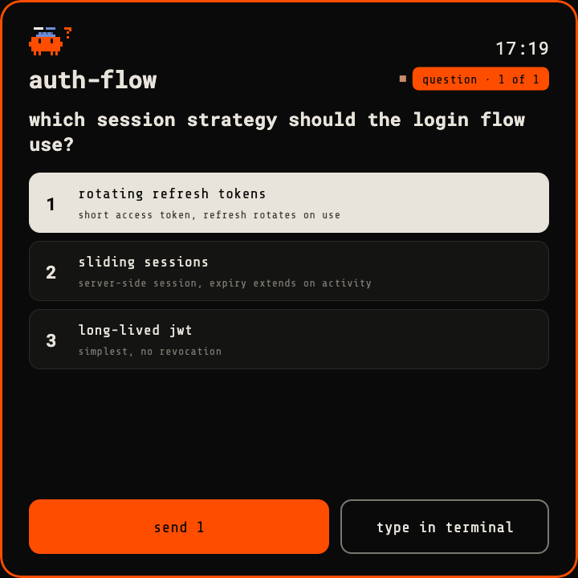 | 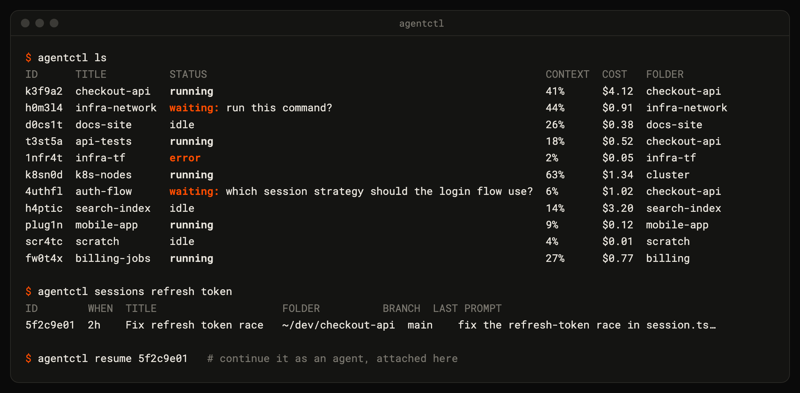 |
| **Desk panel.** A 4″ touch panel on Wi-Fi ([Wall Panel](https://github.com/dotstartech/wall-panel)), paired with `agentctl pair`. | **Terminal.** `agentctl` starts, lists, resumes and restores agents. |

Each critter shows what its agent is doing: thinking, reading, editing, running commands, compacting,
waiting for you, or hungry for review once it's done. It wears a pixel hat picked by its working
folder, so a project's agents look alike. The full tour is in [docs/features.md](docs/features.md).

## Works with your harness

agents deck is a status board, not a harness. If you already run your agents in one of these, there's
nothing to set up: the deck finds them and lets you answer, interrupt and jump to them from any screen.

| Runs your agents | What the deck shows |
|---|---|
| [Orca](https://github.com/stablyai/orca) | agents in Orca's worktrees, while Orca is open |
| [herdr](https://herdr.dev) | agents in herdr's panes, in every herdr session that's running |
| [cmux](https://cmux.com) | Claude agents in cmux's terminals, while cmux is open (answering needs one cmux setting, see [features](docs/features.md#cmux)) |
| Codex app and Codex CLI | threads from the last 6 hours, read-only |
| agentctl (built in) | agents it starts with `agentctl new`, each in a tmux session with a status header |
| Claude Code on its own | sessions you started by hand in any terminal, once you add them (`agentctl live`, `agentctl add`) |

**Your harness missing?** Open a pull request ([docs/harnesses.md](docs/harnesses.md) walks through
adding one), or name it in the [harness tracking issue](https://github.com/brushknight/agents-deck/issues/7).

## For the terminal

Everything in the app is also a command, and you don't need the app at all if you'd rather not.

**Install from a terminal** (macOS or Linux): the service and `agentctl`, with `--app` the menu bar or
tray app as well:

```bash
curl -fsSL https://raw.githubusercontent.com/brushknight/agents-deck/main/install.sh | sh -s -- --app
```

That downloads the latest release, checks it against the release's `SHA256SUMS`, installs `agentctl`
to `~/.local/bin`, and starts the service at login. On Linux, `--autostart` starts the tray app at
login too.

**From a clone** (Go 1.24+; Flutter 3.44+ for `--app`), for the newest code before it's in a
release. A build from source never updates itself:

```bash
git clone https://github.com/brushknight/agents-deck && cd agents-deck
./install.sh --source --app
```

On Linux the tray app needs Flutter's Linux build tools:
`sudo apt-get install clang cmake ninja-build pkg-config libgtk-3-dev libwebkit2gtk-4.1-dev`.
More in [clients/macos/README.md](clients/macos/README.md#linux).

**Start agents of your own** (macOS and Linux, needs tmux):

```bash
cd ~/dev/my-project
agentctl new         # a Claude agent for this folder, in tmux (ctrl-q detaches)
agentctl web         # the dashboard in your browser (a one-time login link)
```

Want a full deck without spending tokens? `agentctl sim start --root ~/dev --slots 12` fills it with
pretend agents; `agentctl sim stop` clears them.

**Boards from the terminal:**

```bash
agentctl link ports                              # USB serial ports, with their USB ids
agentctl flash /dev/cu.usbmodem1101 agents-deck-<board>-<version>.bin   # write a release image
agentctl link add /dev/cu.usbmodem1101           # let the deck open this port (once per port)
agentctl devices scope <board-name> admin        # admin adds stop
agentctl link wifi --default --ssid "my network" # the Wi-Fi every board gets (asks for the password)
```

The deck only ever opens USB ports you register (that's what **Yes, it's mine** in Settings does).
Prefer to approve each board by hand? `agentctl devices auto-approve usb off`; a new board then shows
"waiting for approval" with the exact `agentctl devices approve …` command on its screen.

### Commands

```text
agentctl new [dir] [-t title] [-c claude|codex|gemini|shell] [-a account] [-d]   start an agent and attach (-d: stay detached)
agentctl attach <id|title>          show an agent in this terminal (ctrl-q detaches)
agentctl ls                         the fleet at a glance
agentctl web                        open the dashboard
agentctl live / add <session>       Claude sessions started by hand; put one on the deck
agentctl sessions [words]           look up any Claude session by id, title, folder, branch or last prompt
agentctl resume <id-prefix>         continue a Claude session as an agent
agentctl restore                    bring back agents lost with the tmux server (crash, reboot)
agentctl rm <id|title>              stop and forget an agent
agentctl link [ports | add <port>]  boards: how each is connected, find ports, register one
agentctl link wifi --default --ssid NAME   the Wi-Fi network every board gets (asks for the password)
agentctl flash <port> <image.bin>   write a board's firmware over USB (--probe: only read the chip)
agentctl devices [approve | scope | revoke <name>]   boards and paired devices
agentctl pair <name> [--bundle F]   pair the desk panel: its own certificate, scope view|act|admin
agentctl install | uninstall        start the service at login, or stop that
agentctl status                     is the service running, where are its files
agentctl update [--check]           check for a new version and install it
agentctl sim start|stop             pretend agents for demos
```

`agentctl help` lists the rest (accounts, hats, handoff, terminal and mouse settings). Building and
flashing boards with a coding agent's help: [docs/flashing.md](docs/flashing.md#let-a-coding-agent-do-it).

## How it works

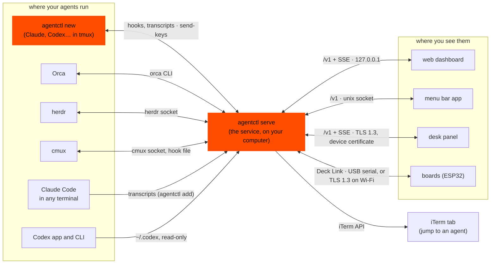

On the left, wherever your agents run; on the right, every screen that shows them; in the middle, one
service. Agents started with `agentctl new` run in their own tmux server (`tmux -L agentsterm`), each
with its own hook settings, so your global `~/.claude/settings.json` is never touched. Hooks report
prompts, tool calls, permission requests, compaction and stops; Claude's transcripts
(`~/.claude/projects/*.jsonl`) give tokens, context, model and title. Answers are typed into the
agent's tmux session, or sent through the harness that runs it (Orca, herdr, cmux); Codex is only
read. The web UI, the menu bar app and the panel speak one small JSON API
([docs/protocol.md](docs/protocol.md)); boards speak [Deck Link](docs/link/protocol.md), a compact
protobuf version of it.

## Security & privacy

- **Nothing about you leaves your computer:** no telemetry. The only thing agents deck fetches is this
  project's GitHub releases, to check for updates and download firmware, and it installs nothing
  whose signature doesn't match the key built into it. The only Go dependency is Google's protobuf
  module.
- **The web dashboard and Settings are loopback-only** (`127.0.0.1`), behind a one-time login link, a
  strict CSP and host and origin checks. Settings is never reachable from the network, by a board or
  by anyone else.
- **The menu bar app** (and the Linux tray app) uses the service's local socket: nothing crosses the
  network.
- **The desk panel and boards on Wi-Fi** connect over TLS 1.3 with their own client certificate,
  signed by the deck's local CA (its key is in the macOS Keychain, or the data folder elsewhere). Each
  device has a scope (view, act or admin), shows up in Settings, Boards and `agentctl devices`, can be
  revoked on its own, and every action it takes lands in an audit log. Updates over Wi-Fi travel on
  the same connection, and a board refuses firmware made for another board.
- **Boards on USB** are only heard on ports you confirmed (Settings, Boards, or `agentctl link add`);
  a new port is listed from its USB id alone, without opening it. A new board on a confirmed port is
  approved at once with scope `act`: physical USB on your computer counts as your consent
  (`agentctl devices auto-approve usb off` makes them wait). Never over Wi-Fi, never a revoked board;
  `admin` is always given by hand. A board's certificate is only ever issued over USB.
- **Codex files are only read.** App control on a Mac is a single Apple event (asking iTerm for its API cookie): no synthetic keystrokes, no screen reading.
- **Secrets** live in your data folder (`~/.local/share/agents-terminal/` on macOS and Linux,
  `%LOCALAPPDATA%\agents-deck` on Windows; `0700` / `0600`), and on a Mac the deck's key and the
  default Wi-Fi password in the Keychain.

## Docs

[Install](docs/install.md) · [Devices](docs/devices.md) · [Flashing](docs/flashing.md) · [Features](docs/features.md) · [Protocol](docs/protocol.md) · [Deck Link](docs/link/protocol.md) · [New device](docs/link/new-device.md) · [Harnesses](docs/harnesses.md) · [Releasing](docs/releasing.md) · [Roadmap](docs/roadmap.md)

| path | |
|---|---|
| `backend/` | Go daemon and CLI (`agentctl`), with the web UI embedded. `go test -race ./...` |
| `clients/flutter/agents_ui` | The deck UI as a Flutter package, shared by the desk panel and the menu bar app. |
| `clients/macos` | The menu bar app (Flutter + a small Swift shell), and the Linux tray app (the same Flutter app + a small GTK shell). |
| `packaging/`, `install.sh` | The installers: the macOS `.dmg`, the Linux `.deb` and archive, the Windows setup, and the install script ([releasing](docs/releasing.md)). |
| `proto/` | `link.proto`: the Deck Link contract for boards. |
| `firmware/deck-link` | The C firmware kit for Deck Link boards (ESP32), with examples. |
| `firmware/devices` | Firmware for each board, one folder each ([devices](docs/devices.md)). |
| `firmware/panel-core` | The boards' shared core: Deck Link, Wi-Fi, critters, fonts, and the round, square and big layouts. |
| `docs/fixtures/state.json` | The sample fleet behind demo mode, the web fixture view, the tests and the screenshots. |

## Credits

The per-project pixel hats were inspired by [“9 NEW Claude Mods that can truly change how you work”](https://www.youtube.com/watch?v=lDrAZ1wAyVs) by Jay E ([RoboNuggets](https://www.youtube.com/@RoboNuggets)).
The 1.47″ board's original drawing, mascots and font are by **belidor**.
