# Devices

The deck runs on your Mac (the menu bar and the browser) and, if you like, on a screen on your desk.
This page is the tour of every screen it supports: what each one looks like, what's special about it,
how you use it, which build to flash, and what isn't finished yet.

New to microcontrollers? Start with the [README](../README.md#flash-a-board-from-zero): it walks through
flashing a board from zero. Each board's own README (linked below) has the full detail: every screen,
every build option, pins, tests.

The screenshots come from the host renderer (`firmware/panel-core/tools/render_overview.py`), which
draws the same pixels as the boards, from the made-up fleet in
[`docs/fixtures/state.json`](fixtures/state.json).

| | board | screen | home | touch | Wi-Fi | folder |
|---|---|---|---|---|---|---|
|  | [Waveshare ESP32-S3-Touch-LCD-2.8C](#waveshare-esp32-s3-touch-lcd-28c-round-28) | 2.8″ round, 480×480 | the spring: 9 agents round the ring | yes, multi-touch | yes | [`waveshare-touch-lcd-28c`](../firmware/devices/waveshare-touch-lcd-28c) |
| 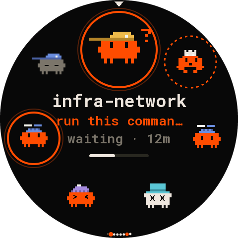 | [Waveshare ESP32-S3-Touch-LCD-2.1](#waveshare-esp32-s3-touch-lcd-21-round-21) | 2.1″ round, 480×480 | the spring: 7 agents round the ring | yes | yes | [`waveshare-touch-lcd-21`](../firmware/devices/waveshare-touch-lcd-21) |
|  | [Waveshare ESP32-S3-Touch-LCD-4](#waveshare-esp32-s3-touch-lcd-4-square-4) | 4″ square, 480×480 | the deck's 4×4 grid, like the desk panel | yes | experimental | [`waveshare-touch-lcd-4`](../firmware/devices/waveshare-touch-lcd-4) |
| 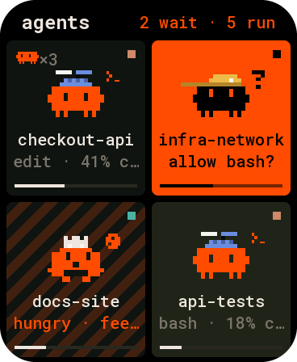 | [Waveshare ESP32-S3-Touch-AMOLED-1.8](#waveshare-esp32-s3-touch-amoled-18) | 1.8″ AMOLED, 368×448 | 2×2 tiles in a scrolling list | yes | yes | [`waveshare-touch-amoled-18`](../firmware/devices/waveshare-touch-amoled-18) |
|  | [LilyGO T4-S3](#lilygo-t4-s3-241-amoled) | 2.41″ AMOLED, 450×600 | 2×3 tiles in a scrolling list | yes | yes | [`lilygo-t4-s3`](../firmware/devices/lilygo-t4-s3) |
|  | [Waveshare ESP32-S3-LCD-1.47B](#waveshare-esp32-s3-lcd-147b-strip) | 1.47″ strip, 320×172 | one agent in detail and a mini-board | no (one button) | no, USB only | [`waveshare-lcd-147`](../firmware/devices/waveshare-lcd-147) |
|  | [Desk panel](#desk-panel-4-720720) | 4″ square, 720×720 | the full deck (Flutter app) | yes | yes (that's how it connects) | [`clients/flutter`](../clients/flutter/agents_ui) |

## What every board has in common

- **One deck.** Every board shows the same agents as the web dashboard and the menu bar: who's
  working, who needs you, who's done, with the same critters, hats and colours. Orange means an
  agent needs you; a finished agent you haven't looked at yet is "hungry".
- **Plugged in, it just works.** Register the USB port once (`agentctl link add`) and any board you
  plug into it is approved at once and can answer prompts, focus an agent's terminal and interrupt it
  (scope `act`). Stopping an agent takes scope `admin`, which you give by hand
  (`agentctl devices scope <board> admin`).
- **Wi-Fi when you unplug it** (every touch board except where noted). Set your network once on the
  Mac (`agentctl link wifi --default --ssid "my network"`); every board you plug in gets it. Unplug it,
  power it from any USB charger, and it reaches the deck over Wi-Fi: TLS 1.3 with a certificate of its
  own, made over the USB cable when you first plugged it in. Plug it back into the Mac and it's on USB
  again at once.
- **Revocable.** `agentctl devices` lists every board; `agentctl devices revoke <board>` cuts one off,
  on USB and Wi-Fi.
- **AMOLED and LCD care.** The screens dim when every agent is idle and nobody touched them for a
  while.

Builds: every touch board has two PlatformIO projects. The one in the board's folder is
arduino-esp32 2.0.17 and talks over USB only. The one in its `idf5/` folder is arduino-esp32 3.x
(ESP-IDF 5), which has the TLS 1.3 the Wi-Fi link needs; it's the one to flash on every board except
the 4″ (see [below](#waveshare-esp32-s3-touch-lcd-4-square-4)). The first `idf5` build downloads about
1 GB and takes about five minutes.

---

## Waveshare ESP32-S3-Touch-LCD-2.8C (round 2.8″)

A round 2.8″ touch screen: your agents sit on a spring round the edge, the selected one large at the
top, and its name, what it's doing and its context in the middle. Turn the ring with a finger like a
dial.

| home | detail | question | on Wi-Fi |
|---|---|---|---|
|  | 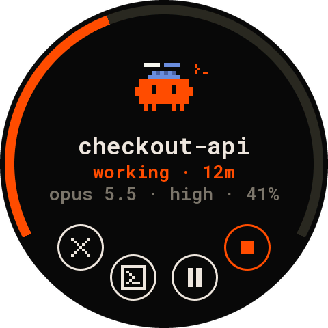 | 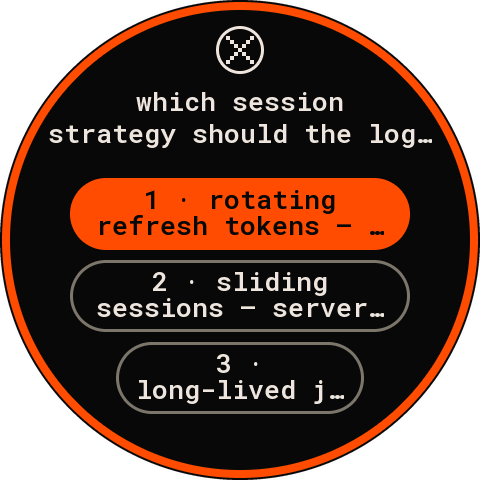 | 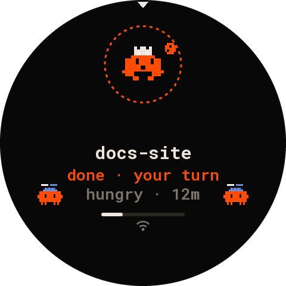 |

- **What's special:** nine agents to a turn; more than nine and the ring keeps going, with dots at
  the bottom showing where you are. A waiting agent has a solid orange ring; a finished one you haven't
  seen, a dashed one. Someone waiting off screen: an orange arc on the rim points to them, and after 10 s
  untouched the ring turns to them by itself (it never answers by itself).
- **Gestures:** drag round the ring to turn it (flick to keep it going); swipe left or right across
  the middle for the next or previous agent; tap an agent to bring it to the top; tap the middle for
  its detail, or its prompt when it waits. On the detail and prompt: swipe down or tap "×" to go back,
  **pinch in with two fingers to go home**; hold the stop button for a second to stop an agent.
- **Build:** `idf5` (`pio run -d firmware/devices/waveshare-touch-lcd-28c/idf5 -e idf5 -t upload`).
  The 2.0.17 build's picture drifts and it has no Wi-Fi.
- **Known issues:** none open. If the picture drifts, the README's self-test (`idf5-selftest`) helps
  find a pixel clock that suits your panel.
- **Get one:** [Waveshare ESP32-S3-Touch-LCD-2.8C](https://www.waveshare.com/esp32-s3-touch-lcd-2.8c.htm)
  (the touch version; about $35–40). Details: [the board's README](../firmware/devices/waveshare-touch-lcd-28c/README.md).

## Waveshare ESP32-S3-Touch-LCD-2.1 (round 2.1″)

The same spring as the 2.8″ on a smaller round screen, with seven agents to a turn and bigger
critters for its size.

| home | done, your turn | detail | prompt | joining Wi-Fi |
|---|---|---|---|---|
|  |  | 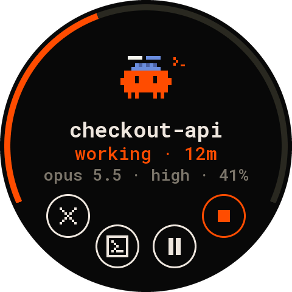 | 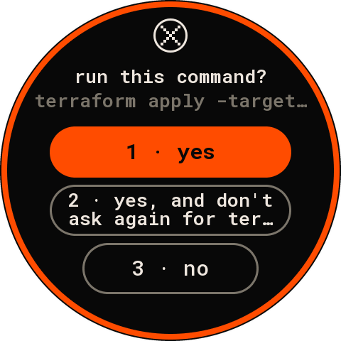 | 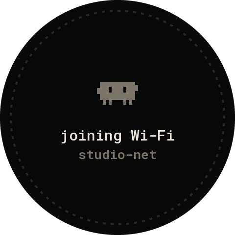 |

- **What's special:** the smallest touch board here, at the size of a watch face. Its touch is
  single-finger, so there's no pinch; tap the big critter on the detail, or press BOOT, to go home.
- **Gestures:** as on the 2.8″ (one agent per 51° of drag), without the pinch.
- **Build:** `idf5` (`pio run -d firmware/devices/waveshare-touch-lcd-21/idf5 -e idf5 -t upload`). The
  2.0.17 build flickers and has no Wi-Fi.
- **Known issues:** none open.
- **Get one:** [Waveshare ESP32-S3-Touch-LCD-2.1](https://www.waveshare.com/esp32-s3-touch-lcd-2.1.htm)
  (about $35). Details: [the board's README](../firmware/devices/waveshare-touch-lcd-21/README.md).

## Waveshare ESP32-S3-Touch-LCD-4 (square 4″)

The deck's 4×4 board on a 4″ square: it draws the desk panel's Flutter UI at 2/3 of its size, so it
looks like the desk panel and the web board.

| grid | card | permission | joining Wi-Fi |
|---|---|---|---|
|  | 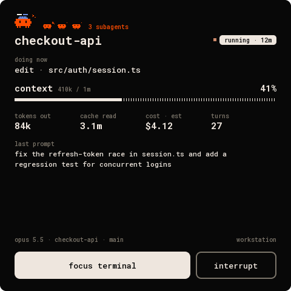 | 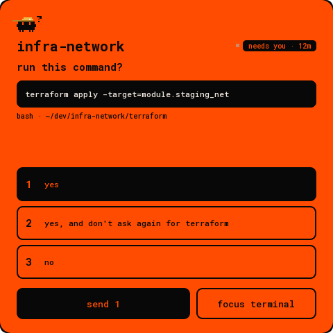 | 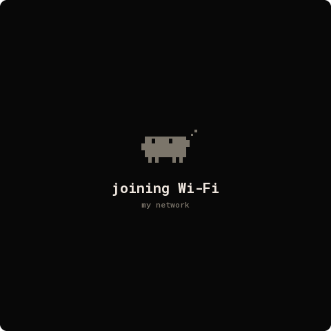 |

- **What's special:** the biggest board, and the closest to the desk panel: tiles by slot, paged;
  the card with tokens, cache, cost and turns; prompts where you pick an answer, then **send**.
- **Gestures:** tap a tile for its card; swipe or tap the page bars to change page; swipe right or
  press BOOT to go back. On the card, stop arms on the first tap ("tap again to stop").
- **Build:** for now flash the **2.0.17 build** (`pio run -d firmware/devices/waveshare-touch-lcd-4 -t
  upload`): USB only, and the steadiest picture. The `idf5` build adds Wi-Fi, but on this board it is
  **experimental**: an early test of it showed horizontal lines across the picture.
- **Known issues:** Wi-Fi (the `idf5` build) isn't settled yet, as above. Older revisions of the board
  (V1–V3) can only switch the backlight on and off, not dim it.
- **Get one:** [Waveshare ESP32-S3-Touch-LCD-4](https://www.waveshare.com/esp32-s3-touch-lcd-4.htm)
  (pick the touch version; about $30). Details: [the board's README](../firmware/devices/waveshare-touch-lcd-4/README.md).

## Waveshare ESP32-S3-Touch-AMOLED-1.8

A small, bright AMOLED: true black, 2×2 tiles in one continuous list you scroll with a finger.

| home | card | permission | joining Wi-Fi |
|---|---|---|---|
|  |  | 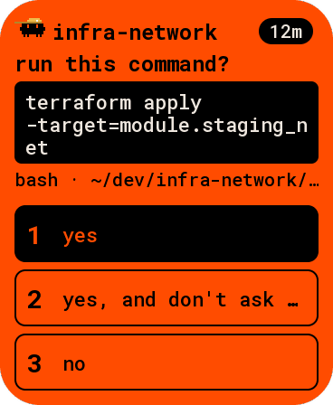 | 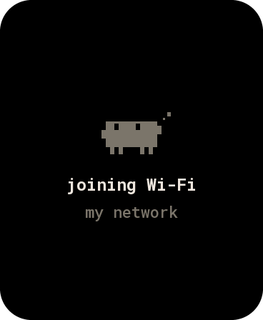 |

- **What's special:** pocket-sized, with a battery option from Waveshare. The header counts who waits
  and who runs; on Wi-Fi it carries a small Wi-Fi mark. Content keeps clear of the glass's rounded
  corners.
- **Gestures:** drag to scroll (it settles on a row; a flick carries further); tap a tile for its card;
  swipe right or press BOOT to go back; hold stop for a second.
- **Build:** `idf5` (`pio run -d firmware/devices/waveshare-touch-amoled-18/idf5 -e idf5 -t upload`).
- **Known issues:** the board's first revision (SH8601 panel, FT3168 touch) is detected but untested.
- **Get one:** [Waveshare ESP32-S3-Touch-AMOLED-1.8](https://www.waveshare.com/esp32-s3-touch-amoled-1.8.htm)
  Details: [the board's README](../firmware/devices/waveshare-touch-amoled-18/README.md).

## LilyGO T4-S3 (2.41″ AMOLED)

The 1.8″'s UI on a bigger, taller AMOLED: three rows of tiles on screen, bigger critters, and the
card's numbers one to a line.

| home | card | question | joining Wi-Fi |
|---|---|---|---|
|  | 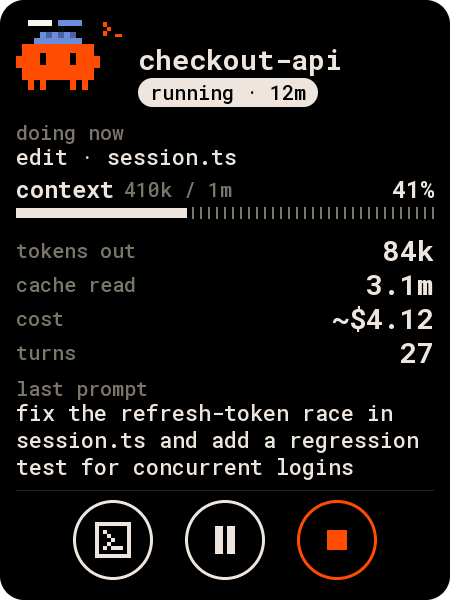 | 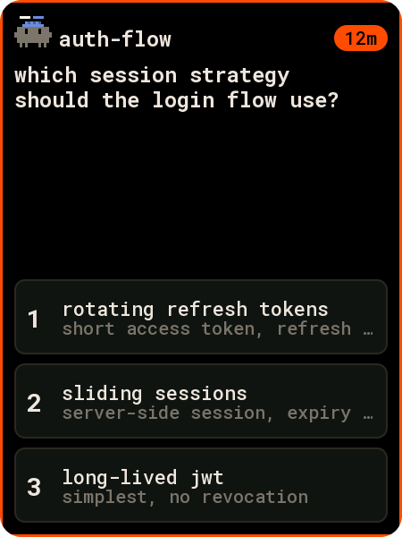 | 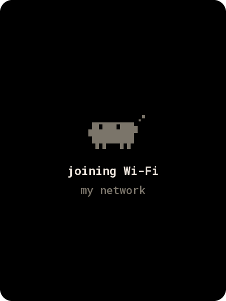 |

- **What's special:** the tallest screen; a good one to hold in your hand or stand on the desk. It
  reports itself as `t4s3-panel`, the same as the earlier firmware, so a board you already approved
  keeps its name and scope.
- **Gestures:** as on the 1.8″.
- **Build:** `idf5` (`pio run -d firmware/devices/lilygo-t4-s3/idf5 -e idf5 -t upload`). The picture
  is turned 180° from LilyGO's orientation; `idf5-upright` builds theirs. A board fresh from LilyGO
  may need the BOOT + RST dance for its first upload (hold BOOT, press RST, let go of BOOT).
- **Known issues:** none open. The earlier LVGL firmware in
  [`t4s3-panel`](../firmware/devices/t4s3-panel) is superseded and kept for reference only.
- **Get one:** [LilyGO T4-S3](https://lilygo.cc/products/t4-s3) (about $60). Details:
  [the board's README](../firmware/devices/lilygo-t4-s3/README.md).

## Waveshare ESP32-S3-LCD-1.47B (strip)

A tiny landscape strip for the corner of your desk: the agent that matters most in detail on the
left, a mini-board of eight on the right, and an RGB LED that flashes orange when someone waits.

| waiting | working | before approval |
|---|---|---|
| 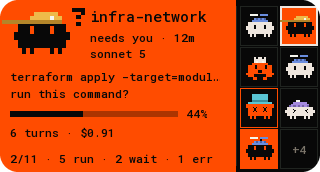 |  | 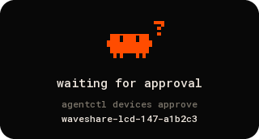 |

- **What's special:** read-only and cheap. It picks the agent to show by itself (waiting, then failed,
  then hungry, then running). Its BOOT button shows the next agent for 30 s.
- **Build:** the default env (`pio run -d firmware/devices/waveshare-lcd-147 -t upload`).
- **Known issues:** no touch and no Wi-Fi: it stays on USB, and it never answers anything.
- **Get one:** [Waveshare ESP32-S3-LCD-1.47B](https://www.waveshare.com/esp32-s3-lcd-1.47b.htm) (the
  "B" version, without touch). Details: [the board's README](../firmware/devices/waveshare-lcd-147/README.md).
  Original drawing, mascots and font by **belidor**.

## Desk panel (4″, 720×720)

Not a microcontroller: a 4″ 720×720 touch panel with a Raspberry Pi CM4 inside
([Wall Panel](https://github.com/dotstartech/wall-panel)), running the deck's Flutter app. It's the full
deck, as in the menu bar.

| board | detail | permission | question |
|---|---|---|---|
|  | 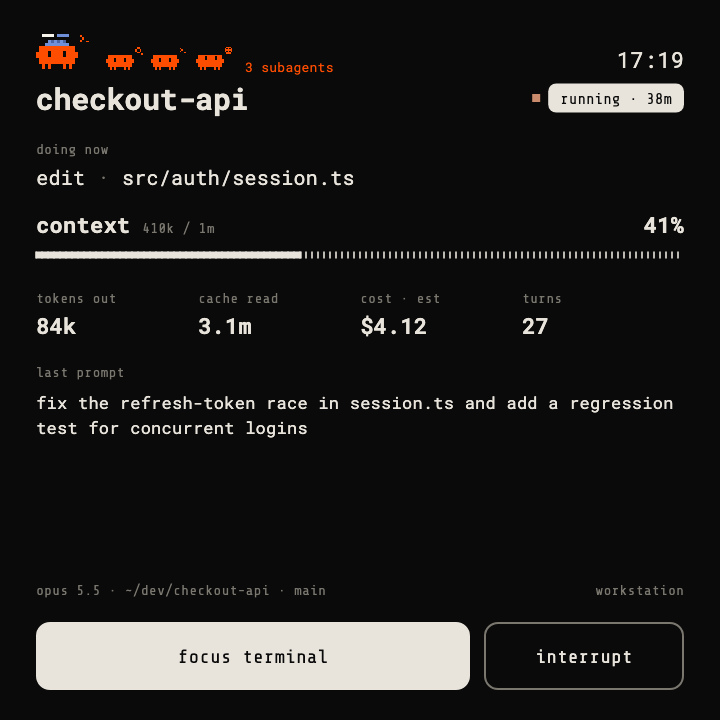 | 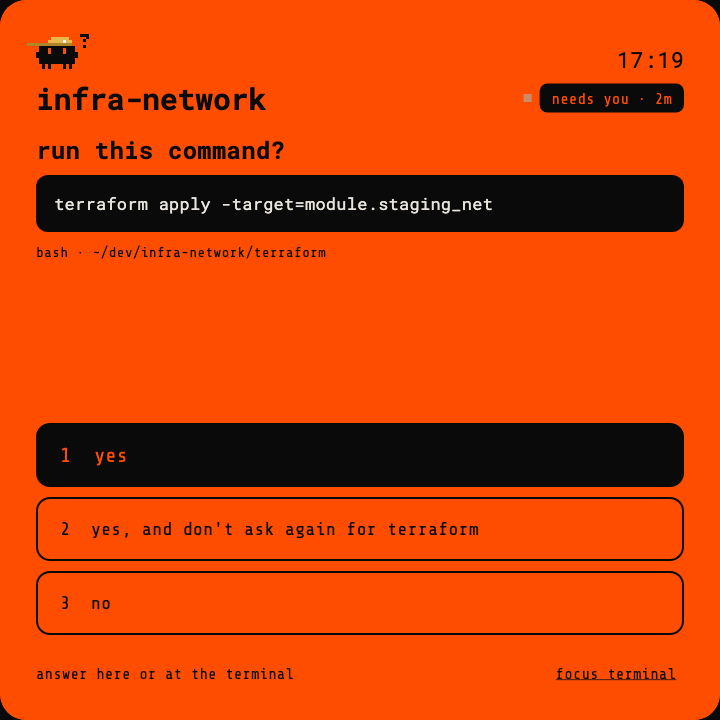 |  |

- **Connect:** over Wi-Fi only, with its own certificate: `agentctl pair desk-panel --bundle -` makes
  a key and certificate to copy to it. See [features](features.md) and [protocol](protocol.md).

## Build your own

Any board with a USB serial port can join: [Deck Link](link/protocol.md) is the protocol, the
[firmware kit](../firmware/deck-link) does it in C (with a status LED, an OLED tile and a knob as
examples), and [new-device.md](link/new-device.md) walks through adding a device. A new touch screen
usually needs only its drivers and a layout spec in [`firmware/panel-core`](../firmware/panel-core).
