# Devices

The deck runs on your computer (the menu bar or tray, and the browser) and, if you like, on a screen
on your desk.
This page is the tour of every screen it supports: what each one looks like, what's special about it,
how you use it, which build to flash, and what isn't finished yet.

New to microcontrollers? Plug the board in and open Settings, Boards in the app: it finds the board,
asks which one it is (with the pictures on this page) and installs the firmware.
[flashing.md](flashing.md) has that and the other ways (the web flasher, the terminal, building it
yourself). Each board's own README (linked below) has the full detail: every screen, every build
option, pins, tests.

The screenshots come from the host renderer (`firmware/panel-core/tools/render_overview.py`), which
draws the same pixels as the boards, from the made-up fleet in
[`docs/fixtures/state.json`](fixtures/state.json). [Pictures](#pictures) at the end says how to make
them again.

| | board | screen | home | touch | Wi-Fi | Bluetooth | Needs you | folder |
|---|---|---|---|---|---|---|---|---|
| 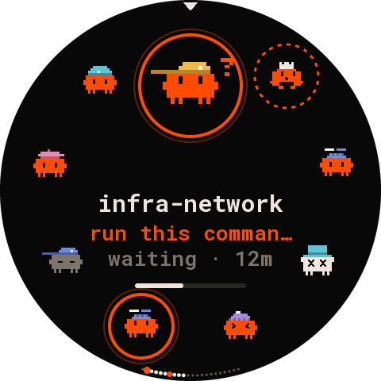 | [Waveshare ESP32-S3-Touch-LCD-2.8C](#waveshare-esp32-s3-touch-lcd-28c-round-28) | 2.8″ round, 480×480 | the spring: 9 agents round the ring | yes, multi-touch | yes | yes | not yet | [`waveshare-touch-lcd-28c`](../firmware/devices/waveshare-touch-lcd-28c) |
| 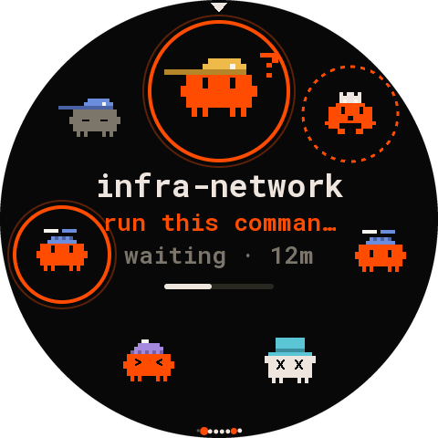 | [Waveshare ESP32-S3-Touch-LCD-2.1](#waveshare-esp32-s3-touch-lcd-21-round-21) | 2.1″ round, 480×480 | the spring: 7 agents round the ring | yes | yes | yes | not yet | [`waveshare-touch-lcd-21`](../firmware/devices/waveshare-touch-lcd-21) |
| 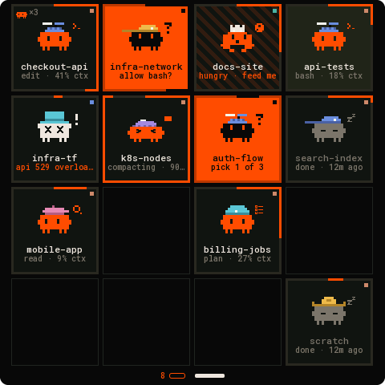 | [Waveshare ESP32-S3-Touch-LCD-4](#waveshare-esp32-s3-touch-lcd-4-square-4) | 4″ square, 480×480 | the deck's 4×4 grid, like the desk panel | yes | yes | yes | yes | [`waveshare-touch-lcd-4`](../firmware/devices/waveshare-touch-lcd-4) |
| 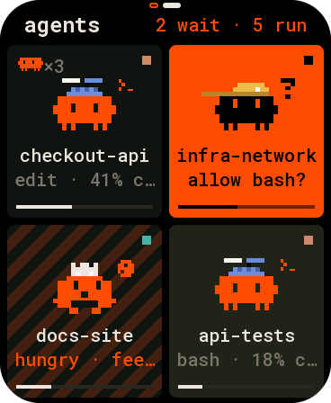 | [Waveshare ESP32-S3-Touch-AMOLED-1.8](#waveshare-esp32-s3-touch-amoled-18) | 1.8″ AMOLED, 368×448 | 2×2 tiles in a scrolling list | yes | yes | yes | yes | [`waveshare-touch-amoled-18`](../firmware/devices/waveshare-touch-amoled-18) |
| 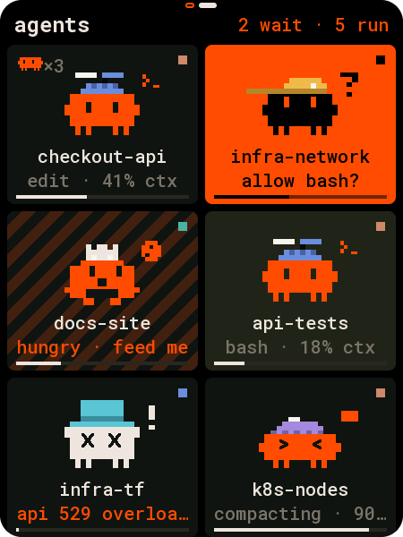 | [LilyGO T4-S3](#lilygo-t4-s3-241-amoled) | 2.41″ AMOLED, 450×600 | 2×3 tiles in a scrolling list | yes | yes | yes | yes | [`lilygo-t4-s3`](../firmware/devices/lilygo-t4-s3) |
| 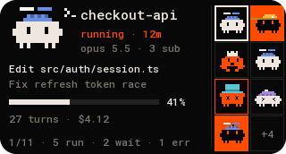 | [Waveshare ESP32-S3-LCD-1.47B](#waveshare-esp32-s3-lcd-147b-strip) | 1.47″ strip, 320×172 | one agent in detail and a mini-board | no (one button) | no, USB only | no | yes, while you hold BOOT | [`waveshare-lcd-147`](../firmware/devices/waveshare-lcd-147) |
| 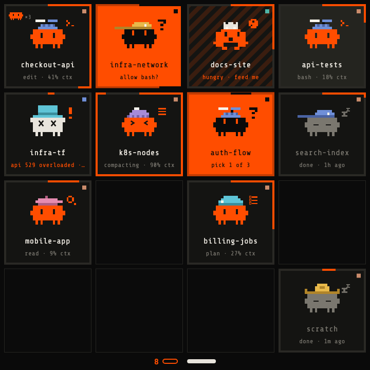 | [Desk panel](#desk-panel-4-720720) | 4″ square, 720×720 | the full deck (Flutter app) | yes | yes (that's how it connects) | no | yes | [`clients/flutter`](../clients/flutter/agents_ui) |

## What every board has in common

- **One deck.** Every board shows the same agents as the web dashboard and the menu bar: who's
  working, who needs you, who's done, with the same critters, hats and colours. Orange means an
  agent needs you; a finished agent you haven't looked at yet is "hungry".
- **Plugged in, it just works.** Confirm the USB port once (Settings, Boards, or `agentctl link add`)
  and any board you plug into it is approved at once and can answer prompts, focus an agent's
  terminal and interrupt it (scope `act`). Stopping an agent takes scope `admin`, which you give by
  hand (Settings, Boards, or `agentctl devices scope <board> admin`).
- **Wi-Fi when you unplug it** (every touch board except where noted). Set your network once
  (Settings, Network, or `agentctl link wifi --default --ssid "my network"`); every board you plug in
  gets it. Unplug it, power it from any USB charger, and it reaches the deck over Wi-Fi: TLS 1.3 with
  a certificate of its own, made over the USB cable when you first plugged it in. Plug it back into
  your computer and it's on USB again at once.
- **Needs you** (every board but the round ones). One screen with only the agents at work, asking
  you something, or finished and not looked at yet. The service decides who is in which spot, so the
  board shows them in the same places as the browser, the menu bar and the desk panel. Each board
  below says how to get to it; [features.md](features.md#the-board) has the details.
- **Bluetooth, if you like** (the touch boards on their `idf5` firmware, with the macOS app). In
  Settings, Boards, Add a board, turn on **Look for Bluetooth boards**, click **Add** next to the board's name and type the
  6-digit code the board shows into the window macOS opens. The board then shows your agents with no
  cable and no Wi-Fi, and can get your Wi-Fi network over Bluetooth. Firmware updates still need
  Wi-Fi or the cable. Linux and Windows don't have Bluetooth yet.
- **Updatable.** Settings, Boards and Settings, Updates say when a release has newer firmware for a
  board, with an **Update** button; nothing updates by itself. On USB it's flashed again; a board on
  Wi-Fi updates over the air and goes back to its old firmware if the new one can't reach the deck.
  Its name, certificate and Wi-Fi stay. Firmware you built yourself installs the same way
  ([flashing.md](flashing.md#firmware-built-on-this-computer)).
- **Revocable.** Settings, Boards (or `agentctl devices`) lists every board; removing one there (or
  `agentctl devices revoke <board>`) cuts it off, on USB and Wi-Fi.
- **AMOLED and LCD care.** The screens dim when every agent is idle and nobody touched them for a
  while.

Builds (only if you [build the firmware yourself](flashing.md#build-from-source); the app and the
web flasher pick the right one for you): every touch board has two PlatformIO projects. The one in
the board's folder is arduino-esp32 2.0.17 and talks over USB only. The one in its `idf5/` folder is
arduino-esp32 3.x (ESP-IDF 5), which has the TLS 1.3 the Wi-Fi link needs; it's the one released, and
the one to flash, on every board (the 1.47″ has one too, though its firmware stays on USB). The first `idf5` build downloads about
1 GB and takes about five minutes.

---

## Waveshare ESP32-S3-Touch-LCD-2.8C (round 2.8″)

A round 2.8″ touch screen: your agents sit on a spring round the edge, the selected one large at the
top, and its name, what it's doing and its context in the middle. Turn the ring with a finger like a
dial.

| home | detail | question | on Wi-Fi | Bluetooth code |
|---|---|---|---|---|
|  | 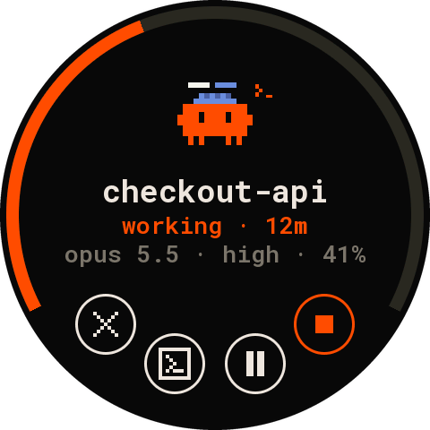 | 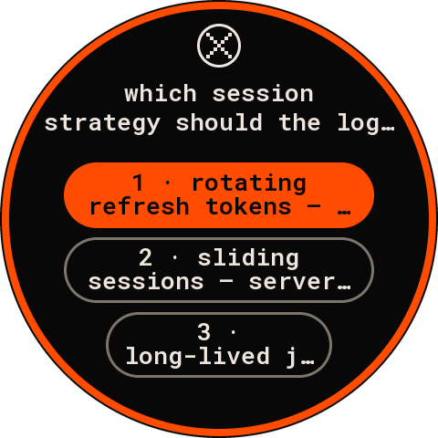 | 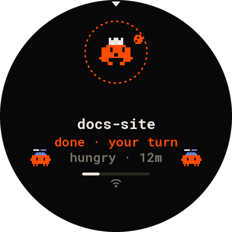 | 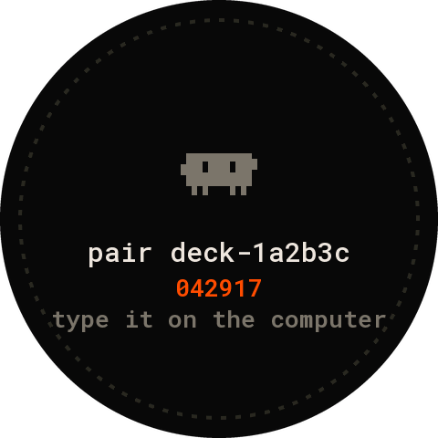 |

- **What's special:** nine agents to a turn; more than nine and the ring keeps going, with dots at
  the bottom showing where you are. A waiting agent has a solid orange ring; a finished one you haven't
  seen, a dashed one. Someone waiting off screen: an orange arc on the rim points to them, and after 10 s
  untouched the ring turns to them by itself (it never answers by itself). The detail shows the
  agent's working subagents as small critters beside it.
- **Gestures:** drag round the ring to turn it (flick to keep it going); swipe left or right across
  the middle for the next or previous agent; tap an agent to bring it to the top; tap the middle for
  its detail, or its prompt when it waits. On the detail and prompt: swipe down or tap "×" to go back,
  **pinch in with two fingers to go home**; hold the stop button for a second to stop an agent.
- **Build:** `idf5` (`pio run -d firmware/devices/waveshare-touch-lcd-28c/idf5 -e idf5 -t upload`).
  The 2.0.17 build's picture drifts and it has no Wi-Fi.
- **Known issues:** none open. If the picture drifts, the README's self-test (`idf5-selftest`) helps
  find a pixel clock that suits your panel.
- **Get one:** [Waveshare ESP32-S3-Touch-LCD-2.8C](https://www.waveshare.com/esp32-s3-touch-lcd-2.8c.htm)
  (the touch version; about $40 in Waveshare's shop, October 2026). Details: [the board's README](../firmware/devices/waveshare-touch-lcd-28c/README.md).

## Waveshare ESP32-S3-Touch-LCD-2.1 (round 2.1″)

The same spring as the 2.8″ on a smaller round screen, with seven agents to a turn and bigger
critters for its size.

| home | done, your turn | detail | prompt | joining Wi-Fi |
|---|---|---|---|---|
|  | 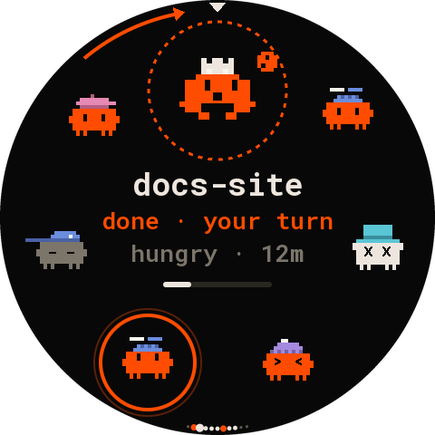 | 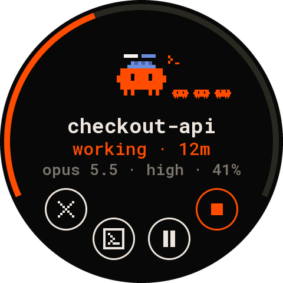 | 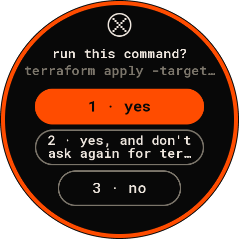 | 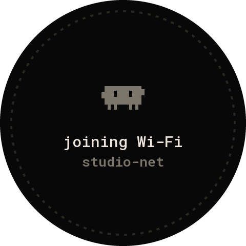 |

- **What's special:** the smallest touch board here, at the size of a watch face. Its touch is
  single-finger, so there's no pinch; tap the big critter on the detail, or press BOOT, to go home.
- **Gestures:** as on the 2.8″ (one agent per 51° of drag), without the pinch.
- **Build:** `idf5` (`pio run -d firmware/devices/waveshare-touch-lcd-21/idf5 -e idf5 -t upload`). The
  2.0.17 build flickers and has no Wi-Fi.
- **Known issues:** none open.
- **Get one:** [Waveshare ESP32-S3-Touch-LCD-2.1](https://www.waveshare.com/esp32-s3-touch-lcd-2.1.htm)
  (about $33 in Waveshare's shop, October 2026). Details: [the board's README](../firmware/devices/waveshare-touch-lcd-21/README.md).

## Waveshare ESP32-S3-Touch-LCD-4 (square 4″)

The deck's 4×4 board on a 4″ square: it draws the desk panel's Flutter UI at 2/3 of its size, so it
looks like the desk panel and the web board.

| grid | Needs you | card | permission | joining Wi-Fi |
|---|---|---|---|---|
|  | 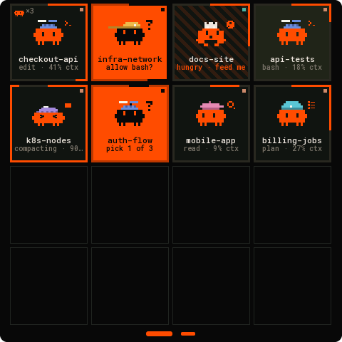 | 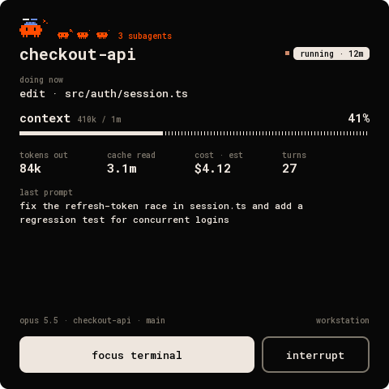 | 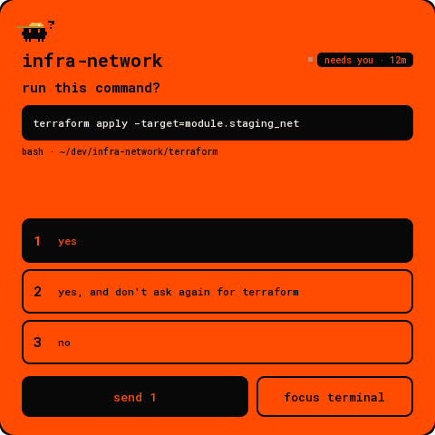 | 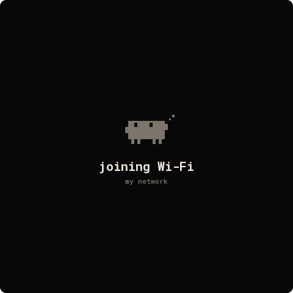 |

- **What's special:** the biggest board, and the closest to the desk panel: tiles by slot, paged;
  the card with its subagent crew, tokens, cache, cost and turns; prompts where you pick an answer, then **send**.
- **Gestures:** tap a tile for its card; swipe or tap the page bars to change page; swipe right or
  press BOOT to go back. On the card, stop arms on the first tap ("tap again to stop"). Swipe right
  on the first page (or tap the mark at the left of the page bars) for **Needs you**: the agents at
  work, asking or not checked yet, in the same grid.
- **Build:** `idf5` (`pio run -d firmware/devices/waveshare-touch-lcd-4/idf5 -e idf5 -t upload`), which
  is what the releases install: USB, Wi-Fi and Bluetooth.
- **Known issues:** on `idf5` the picture at times jumped sideways while the board connected to the
  deck. It now uses the round boards' bounce buffer and display settings, which should stop that. Once,
  on a build from before 20 November 2026, a board's screen went black while the firmware kept
  running, until it was restarted; it has not happened on the released code (power cycles, a
  restart and joining Wi-Fi on a real board). If yours does either, the 2.0.17 build (`pio run -d firmware/devices/waveshare-touch-lcd-4 -t upload`)
  has the steadiest picture, on USB only; please tell us in an issue. Older revisions of the board
  (V1–V3) can only switch the backlight on and off, not dim it.
- **Get one:** [Waveshare ESP32-S3-Touch-LCD-4](https://www.waveshare.com/esp32-s3-touch-lcd-4.htm)
  (pick the touch version; about $33 in Waveshare's shop, October 2026). Details: [the board's README](../firmware/devices/waveshare-touch-lcd-4/README.md).

## Waveshare ESP32-S3-Touch-AMOLED-1.8

A small, bright AMOLED: true black, 2×2 tiles in one continuous list you scroll with a finger.

| home | Needs you | card | permission | joining Wi-Fi | Bluetooth code |
|---|---|---|---|---|---|
|  |  | 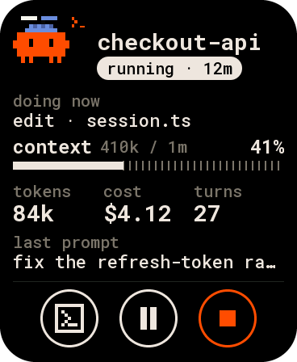 | 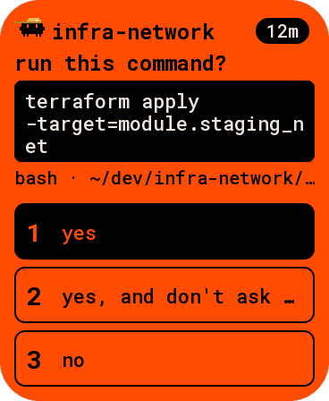 | 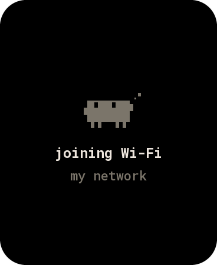 | 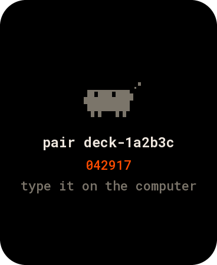 |

- **What's special:** pocket-sized, with a battery option from Waveshare. The card lists up to three
  working subagents, each a small critter with its task. The header counts who waits
  and who runs; on Wi-Fi it carries a small Wi-Fi mark. Content keeps clear of the glass's rounded
  corners.
- **Gestures:** drag to scroll (it settles on a row; a flick carries further); tap a tile for its card;
  swipe right or press BOOT to go back; hold stop for a second. Swipe right on the list (or press
  BOOT) for **Needs you**: one screen of the agents at work, asking or not checked yet.
- **Build:** `idf5` (`pio run -d firmware/devices/waveshare-touch-amoled-18/idf5 -e idf5 -t upload`).
- **Known issues:** the board's first revision (SH8601 panel, FT3168 touch) is detected but untested.
- **Get one:** [Waveshare ESP32-S3-Touch-AMOLED-1.8](https://www.waveshare.com/esp32-s3-touch-amoled-1.8.htm)
  (about $28 without the battery in Waveshare's shop, October 2026). Details: [the board's README](../firmware/devices/waveshare-touch-amoled-18/README.md).

## LilyGO T4-S3 (2.41″ AMOLED)

The 1.8″'s UI on a bigger, taller AMOLED: three rows of tiles on screen, bigger critters, and the
card's numbers one to a line.

| home | Needs you | card | question | joining Wi-Fi |
|---|---|---|---|---|
|  | 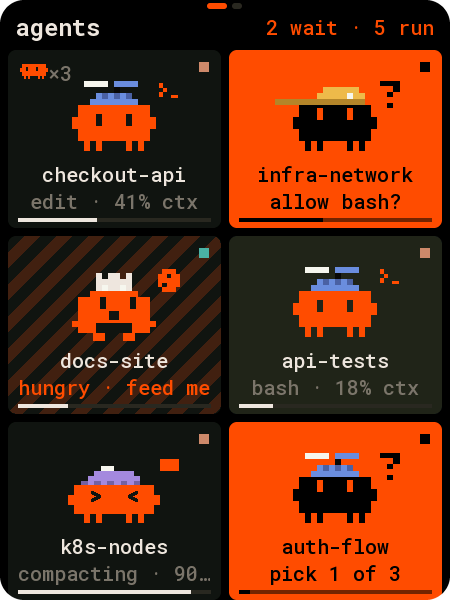 | 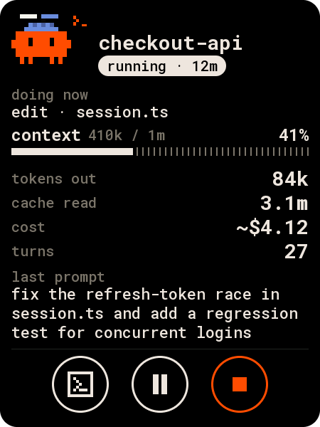 | 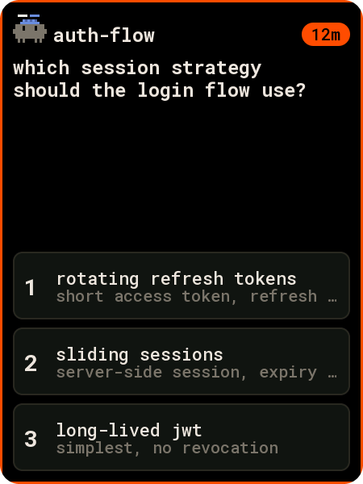 | 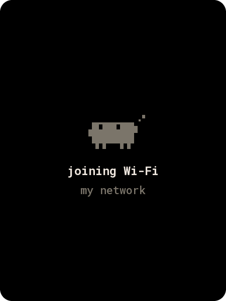 |

- **What's special:** the tallest screen; a good one to hold in your hand or stand on the desk. It
  reports itself as `t4s3-panel`, the same as the earlier firmware, so a board you already approved
  keeps its name and scope.
- **Gestures:** as on the 1.8″.
- **Build:** `idf5` (`pio run -d firmware/devices/lilygo-t4-s3/idf5 -e idf5 -t upload`). The picture
  is turned 180° from LilyGO's orientation; `idf5-upright` builds theirs. A board fresh from LilyGO
  may need the BOOT + RST dance for its first upload (hold BOOT, press RST, let go of BOOT).
- **Known issues:** none open. The earlier LVGL firmware in
  [`t4s3-panel`](../firmware/devices/t4s3-panel) is superseded and kept for reference only.
- **Get one:** [LilyGO T4-S3](https://lilygo.cc/products/t4-s3) (about $59 in LilyGO's shop, October 2026). Details:
  [the board's README](../firmware/devices/lilygo-t4-s3/README.md).

## Waveshare ESP32-S3-LCD-1.47B (strip)

A tiny landscape strip for the corner of your desk: the agent that matters most in detail on the
left, a mini-board of eight on the right, and an RGB LED that flashes orange when someone waits.

| waiting | working | Needs you (hold BOOT) | before approval |
|---|---|---|---|
| 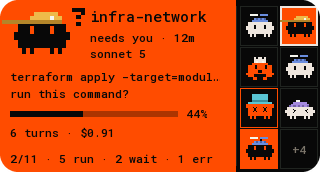 |  | 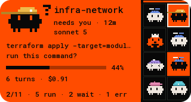 | 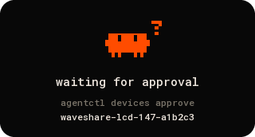 |

- **What's special:** read-only and cheap. It picks the agent to show by itself (waiting, then failed,
  then hungry, then running). Its BOOT button shows the next agent for 30 s; held, it shows **Needs you** on the mini-board.
- **Build:** `idf5` (`pio run -d firmware/devices/waveshare-lcd-147/idf5 -e idf5 -t upload`).
- **Known issues:** no touch and no Wi-Fi: it stays on USB, and it never answers anything.
- **Get one:** [Waveshare ESP32-S3-LCD-1.47B](https://www.waveshare.com/esp32-s3-lcd-1.47b.htm) (the
  "B" version, without touch; about $13 in Waveshare's shop, October 2026). Details: [the board's README](../firmware/devices/waveshare-lcd-147/README.md).
  Original drawing, mascots and font by **belidor**.

## Desk panel (4″, 720×720)

Not a microcontroller: a 4″ 720×720 touch panel with a Raspberry Pi CM4 inside
([Wall Panel](https://github.com/dotstartech/wall-panel)), running the deck's Flutter app. It's the full
deck, as in the menu bar.

| board | Needs you | detail | permission | question |
|---|---|---|---|---|
|  | 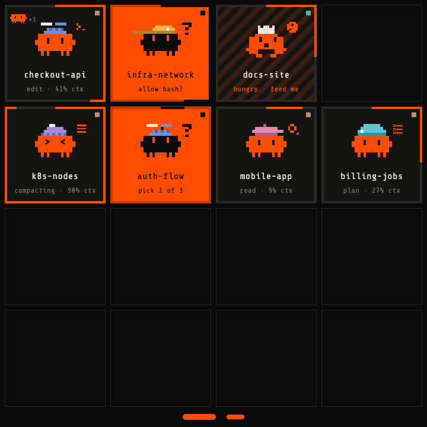 | 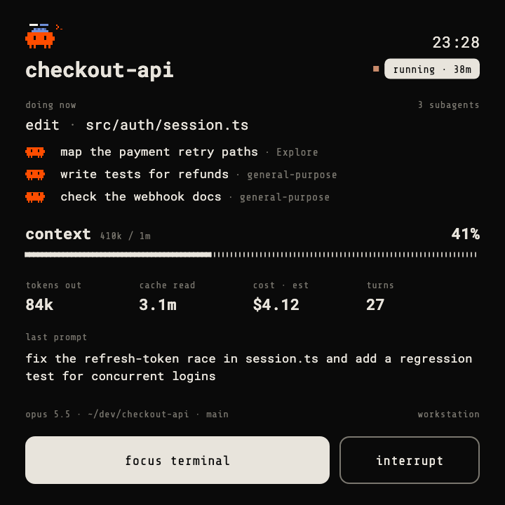 | 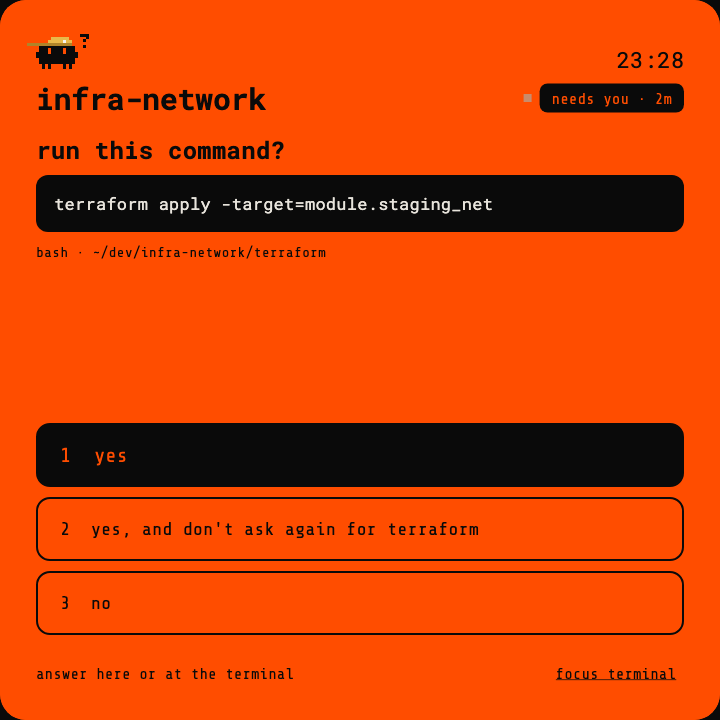 | 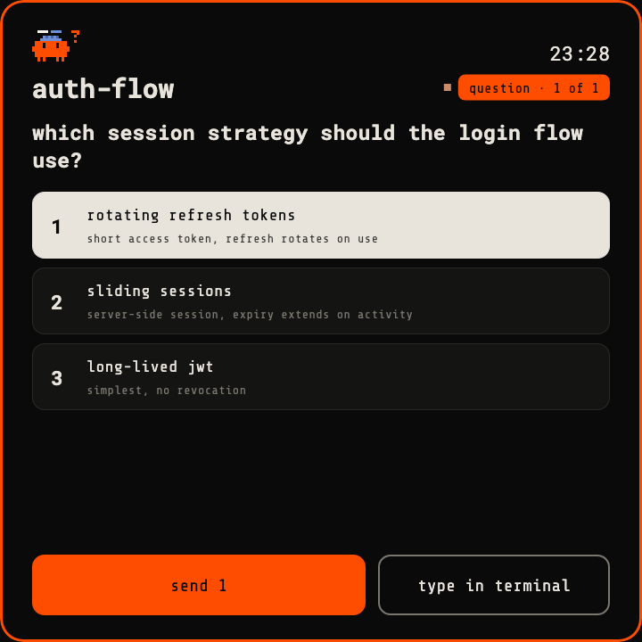 |

- **Connect:** over Wi-Fi only, with its own certificate: `agentctl pair desk-panel --bundle -` makes
  a key and certificate to copy to it. See [features](features.md) and [protocol](protocol.md).

## Build your own

Any board with a USB serial port can join: [Deck Link](link/protocol.md) is the protocol, the
[firmware kit](../firmware/deck-link) does it in C (with a status LED, an OLED tile and a knob as
examples), and [new-device.md](link/new-device.md) walks through adding a device. A new touch screen
usually needs only its drivers and a layout spec in [`firmware/panel-core`](../firmware/panel-core).

## Pictures

Every picture on this page, in the README and in [features.md](features.md) is made from the
made-up fleet in [`docs/fixtures/state.json`](fixtures/state.json), never from a real deck. To make
them again after a change:

```bash
# boards: docs/images/devices/*.png (Python with pillow)
python3 firmware/panel-core/tools/render_overview.py
# every screen of each board, into its own docs/ folder
firmware/panel-core/tools/render_docs.sh

# desk panel and menu bar: the Flutter golden tests, then copy them over
(cd clients/flutter/agents_ui && flutter test --update-goldens test/agents_golden_test.dart)
(cd clients/macos && flutter test --update-goldens test/menubar_golden_test.dart)

# browser and Settings: agentctl serve --demo in a folder of its own, headless Chrome
node docs/tools/web-shots.mjs
```

The goldens map to `docs/images` as `agents-grid.png` to `panel-board-v3.png`,
`agents-attention.png` to `panel-needs-you-v3.png`, `agents-detail-running.png` to
`panel-detail-v3.png`, `agents-permission.png` to `panel-permission-v3.png`, `agents-question.png` to
`panel-question-v3.png`, and `menubar.png` to `menubar-deck-v3.png`. `menubar-needs-you-v3.png` is
the same deck with the Needs you mark tapped (`agents-page-attention`). When a picture changes, give
it the next `-vN` name so GitHub's image cache shows the new one. `web-shots.mjs` runs the demo on
`127.0.0.1:17340` with its own data folder and the network listener off, so it never meets the
service you run.
