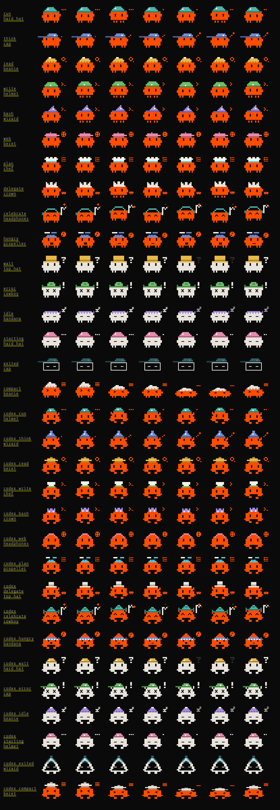
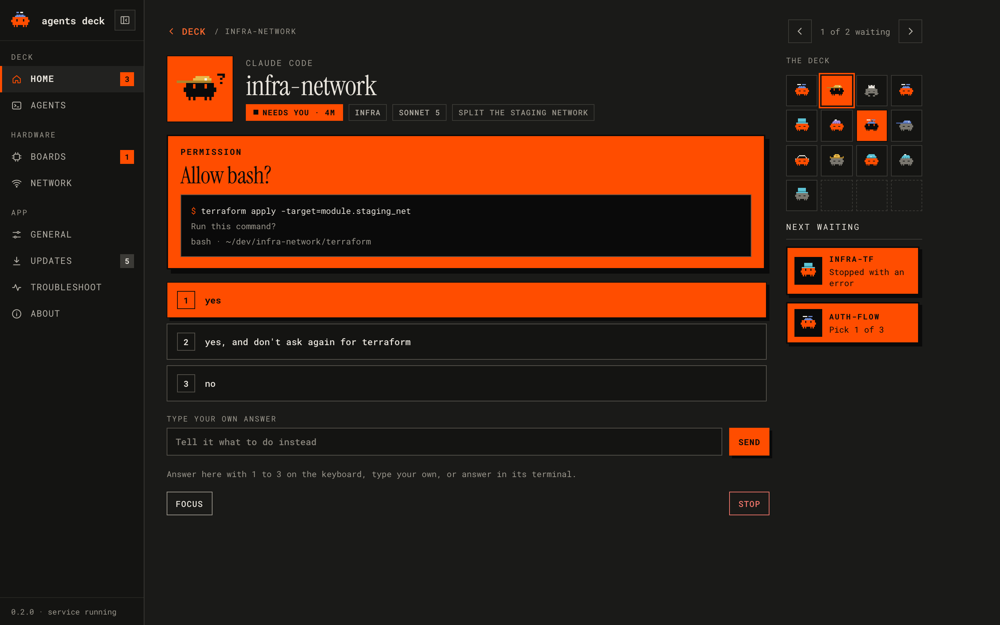

# Features

Everything the deck shows and does, in one place. The [README](../README.md) is the short version.

## The board

One tile per agent, on a 4×4 deck: the same board in the menu bar, on the desk panel and in the browser's panel view.

- **The critter** is Claude's pixel mascot (Codex threads get an onigiri) and shows what the agent is doing: thinking, reading, editing, running a command, searching the web, planning, delegating to subagents. A finished turn waves a checkered flag; an error throws both arms up; while Claude compacts the conversation it gets squeezed flat and springs back.
- **Hats.** Every agent wears a pixel hat picked by its working folder, so agents of one project look alike at a glance: 13 shapes (hard hat, cap, beanie, helmet, wizard, beret, chef, crown, headphones, propeller, top hat, cowboy, bandana) in 8 colours, chosen by a stable hash of the folder. Tap the critter on an agent's card (or click it on the agent's page in the browser) to pick another shape or colour for that folder, or go back to automatic. While an agent works its hat animates too, a pixel at a time (the propeller spins, the bandana's tails flutter on the left, the wizard's tip sways…); otherwise it stays still. From the terminal: `agentctl hats`, `agentctl set hat <agent|folder> <shape> [colour]`, `agentctl set hat <agent|folder> auto`. The hats were inspired by the hatted pixel Claudes in [“9 NEW Claude Mods that can truly change how you work”](https://www.youtube.com/watch?v=lDrAZ1wAyVs) by Jay E (RoboNuggets).
- **Claude accounts.** If you use more than one Claude account (say personal and work, each its own Claude config folder), name them once: `agentctl account add personal ~/.claude sky`, `agentctl account add work ~/.claude-work yellow`. Each agent then shows a small square in its account's colour: on its tile, next to its name on the card, and in its terminal's header. Sessions you started by hand are found in every account. `agentctl new -a work` starts an agent in a given account (`agentctl account default work` changes the default). When one account runs out of usage, **continue on…** on the agent's card (or `agentctl handoff <agent> <account>`) copies the conversation into the other account and resumes it there: an agent the deck started comes back in the same tile, and a session you started by hand keeps its own terminal while the copy starts as a new agent. The original conversation stays in the first account.
- **Colour.** Orange means working; a solid orange tile means the agent needs you (a permission prompt or a question).
- **The border** fills clockwise with the agent's context window.
- **Hungry.** An agent that finished but whose result you haven't reviewed gets sliding orange stripes and a critter chomping at a cookie, until you focus its terminal or give it a new task.
- **Subagents.** A small critter in the tile's top-left corner means subagents are at work too, with a count when there are several. The agent's card lists them under "doing now", one to a row: a small critter posed by what it's doing, then its task and its type.
- **Background subagents keep the agent working.** When Claude finishes its turn but subagents it started in the background (or a workflow run) are still at work, the agent stays working: the tile reads "N subagents working" and the agent stays on the Needs you screen and the boards. A question or permission prompt from a subagent still shows as "needs you", and an error still shows. When the last one is done and Claude starts no turn of its own, the agent is done and hungry ("feed me") until you look at it. A subagent counts as working from its launch until Claude Code reports it finished, failed, killed or stopped, however quiet it is meanwhile. Subagents end with the Claude Code session: once its terminal closes, or a session is restarted or resumed, none of the earlier ones count. As a last resort, one with no sign of life for 6 hours is over. Background shell commands are not subagents and don't keep the agent working.
- **Pages.** The deck holds 16 agents per page (page = slot ÷ 16). With more, the tiles get a little shorter (they keep their width) and a row of bars appears under the grid, in the same square: the current page bright, another page orange when an agent there needs you. Swipe left and right (touch or trackpad), use ← / →, or tap a bar.
- **Needs you.** One extra screen to the left of the first page holds only the agents at work or asking you something, and the ones that finished and you haven't checked yet (hungry): those stay until you check them. An agent leaves 5 seconds after it stops needing you. The service keeps this screen as one grid of 16 spots (4×4) and tells every screen who is in which spot, so the panel, the menu bar app, the browser and the boards show the same agents in the same spots. An agent keeps its spot: nobody moves up when another leaves, a newcomer takes the lowest free spot, and an agent that comes back gets its old spot if it is free (else a random free one). The old spots are kept when the service restarts. With more than 16, the rest wait for a spot, the one waiting longest first (the count on the mark includes them). It looks like any page of the deck; the mark at the left of the page bars turns solid orange while you are on it. The deck always opens on the normal view; scroll or swipe left, press ←, or tap the mark (it shows how many agents are there) to go to it, and swipe back, press → or tap a page bar to return. The agents stay on the deck too. Screens with fewer than 16 cells (a phone, the smaller boards) show the agents in order of their spot, lowest first, as many as fit; the first spots fill first, so this rarely leaves anyone out. The square boards have it too: on the 4″ it is the page left of the first, with the same 16 spots (swipe right on the first page, tap the mark at the left of the page bars, or press BOOT after the last page), on the 1.8″ AMOLED and the T4-S3 a screen of 2×2 or 2×3 left of the list (swipe right, or press BOOT; two small marks at the top say where you are), and on the 1.47″ the mini-board while you hold BOOT. A board always starts on the normal view. Boards need the new firmware for the shared spots; older firmware keeps placing the agents by itself. The round boards don't have it yet.
- **Arranging.** Drag a tile onto any free spot to move it there, or onto another tile to swap them (long-press on touch screens). The layout is shared by every view. `agentctl move <agent> <n>` does the same from the terminal.

<p align="center"><br><sub>Every pose, for the Claude critter and the Codex onigiri.</sub></p>

## Agent cards

Tap a tile for its card (in the browser, the agent's own page, with a box to send it a prompt):

- **Overview.** What it's doing now, context used, tokens, estimated cost, turns and the last prompt, with **focus terminal**, **interrupt** and **stop** (or **resume** / **remove** once it has exited).
- **Permission prompts** show the exact command with Claude's own options; **questions** show their choices; a question with several parts goes one question at a time (pick-any ones tick, then **next**), then **submit answers**. Your answer is typed into the agent's terminal, and a prompt that has already changed is refused.
- **Your own answer.** In the browser, an agent's page also has **Type your own answer** under the choices: the deck presses Esc on the question and types your text in as the next prompt, so it reaches the agent as your reply. Agents in another app's terminal (a session started by hand) don't get it. On the other screens, free-text input sends you to the terminal.
- **Queue the next task.** While an agent works, the prompt box on its page says **Queue**: the deck keeps your prompt and types it in the moment the turn ends (**Stop and send** stops the turn first instead). Queued prompts go in one per turn, in order; the tile shows how many wait (`+2` in its corner), and the agent's page lists them, each with **Cancel**. An agent waiting on a question keeps its queue until you answer and that turn ends: nothing is answered for you. The queue survives a restart of the service. Agents whose status the deck can't see (Codex or a shell started here) get the prompt at once.
- **Last active** says when the agent last sent or got a message ("last active 3h ago"), also after a
  crash or a restart. `agentctl ls` shows it as ACTIVE, and `agentctl ls --sort active` puts the most
  recently active first.

<p align="center"></p>

## Where it shows up

| | |
|---|---|
| **Menu bar** | A critter icon that turns orange when an agent needs you; the deck drops down in the top-right corner. Esc, the ‹ button or a click elsewhere hides it; right-click opens the web dashboard. **Pin** under the deck keeps it open above other windows, where you drag it. |
| **System tray (Linux)** | The same app and critter icon in the system tray. A click opens the deck next to the icon; Esc or a click elsewhere hides it; the icon's menu has the deck, the web dashboard and Quit. Details in [clients/macos/README.md](../clients/macos/README.md#linux). |
| **Browser** | `agentctl web` opens the app with a one-time login link. Home is the deck: the agents as tiles in pages of 16, what needs you and what is ready for you, and **Panel view**, the page as the 720×720 desk panel draws it. The rest of the sidebar is its settings ([The app in the browser](#the-app-in-the-browser)). |
| **Wall panel** | A 4″ 720×720 touch panel ([Wall Panel](https://github.com/dotstartech/wall-panel): Raspberry Pi CM4, Flutter) talking to the daemon over Wi-Fi: TLS 1.3 with its own client certificate (`agentctl pair desk-panel --bundle -`). Cards close with an edge swipe. |
| **Serial boards** | ESP32 boards on USB with Deck Link: see below. |
| **Terminal** | `agentctl ls`, `sessions`, `resume`… Agent terminals are tmux sessions you attach to with `agentctl attach`, or jump to with **focus terminal**. |

## Codex sessions

Threads from the Codex app (and Codex CLI) active in the last 6 hours appear on the board automatically, drawn as an onigiri, with no wrapper and no login. agents deck reads Codex's local files read-only: names, folder, branch and model from `~/.codex/state_*.sqlite` (opened with `sqlite3 -readonly`), live status from the end of each thread's `rollout-*.jsonl`.

| | Claude Code agents | Codex threads |
|---|---|---|
| started by | `agentctl new` / `resume` | the Codex app, as usual |
| status, activity, context, tokens | yes | yes |
| cost estimate | yes | — (Codex reports no prices) |
| answer prompts from the deck | yes | no, answer in the Codex app |
| focus | the agent's iTerm tab | opens the thread in the Codex app |
| interrupt / stop | yes | no |
| remove from the board | **stop** | **hide**, until the thread is active again |

`config.json`: `"codex": false` turns it off; `"codexWindowHours": 12` widens the window.

## Agents in other harnesses

The deck doesn't need to start your agents. If you run them in a harness, it reads that harness and
shows its agents alongside agentctl's own. Each one is found by itself while the harness runs; only cmux
needs a setting changed before you can answer from the deck. To add another harness, see
[harnesses.md](harnesses.md).

### Orca

Agents you run in [Orca](https://github.com/stablyai/orca) (Claude Code, Codex and others, each in its
own worktree) show up on the deck by themselves while Orca is open. Their status comes from Orca, which
reads the agents' own hooks: working, waiting for you, done. Tokens, context and cost come from the
agent's transcript when it's a Claude session.

From the deck, **open in orca** switches Orca to the agent's terminal and brings Orca forward; answers
and **interrupt** are typed into that terminal; **hide** takes the agent off the deck until it's active
again. The daemon talks to Orca through its `orca` CLI only (`worktree ps`, `terminal list`, `read`,
`send`, `switch`). `config.json`: `"orca": false` turns it off.

### herdr

Agents you run in [herdr](https://herdr.dev) (Claude Code, Codex and the other agents it knows) show up
on the deck while herdr runs, from every herdr session: the default one and named ones
(`herdr --session work`). Their status is herdr's own: working, blocked (waiting for you) and done
(hungry until you look at it, in herdr or from the deck). A Claude agent's tokens, context, cost and
account come from its transcript, matched through the agent's process, so herdr's Claude integration is
optional.

When an agent is blocked, the deck reads the dialog off its screen: the question and its options, which
you answer from the deck. **open in herdr** switches herdr to the agent's pane and brings up the
terminal tab herdr is open in; **interrupt** presses Esc in the pane; **hide** takes the agent off the
deck until its state changes. The daemon talks to herdr through its socket API only
(`session.snapshot`, `pane.read`, `pane.send_text`, `pane.send_keys`, `pane.process_info`,
`agent.focus`). `config.json`: `"herdr": false` turns it off.

### cmux

Claude Code sessions you run in [cmux](https://cmux.com)'s terminals show up on the deck by themselves
while cmux is open. Their status comes from cmux's Claude hooks, which it installs in every Claude it
starts: working, waiting for you, and hungry when a turn finishes. The deck reads them from the file
cmux keeps (`~/.cmuxterm/claude-hook-sessions.json`), so showing them needs no setup. Tokens, context,
cost and account come from the session's transcript.

Answering, **interrupt** and **open in cmux** go through cmux's control socket, which by default only
takes programs started inside cmux. To use them from the deck, in cmux set **Settings › Automation ›
Socket Control Mode** to **Automation mode** (or `"automation": { "socketControlMode": "automation" }` in
`~/.config/cmux/cmux.json`). That lets other apps you run on this Mac control cmux too. Without it, the
deck shows what the agent asks (from the hooks' note) and you answer it in cmux; **open in cmux** brings
cmux forward without picking the tab.

With access, the deck reads the dialog off the agent's screen (the question and its options) and types
your answer into the terminal; **interrupt** presses Esc; **open in cmux** switches to the agent's
terminal and brings cmux forward. **hide** takes the agent off the deck until its state changes. The
daemon uses the socket methods `surface.read_text`, `surface.send_text`, `surface.send_key`,
`surface.focus` and `system.identify`. Codex sessions in cmux aren't mirrored yet. `config.json`:
`"cmux": false` turns it off.

## Claude sessions started elsewhere

Claude Code sessions you start by hand in any terminal (plain `claude`) can join the deck too. Tap a free cell (in the browser, a free spot's **Or add a Claude session**, or `agentctl live` / `agentctl add <session>`) to see them and add one; it lands in that cell.

The list comes from Claude Code itself (`claude agents --json`), so it covers every active session on the Mac: ones in your terminals and **background** sessions (`claude --bg`, and the ones the Claude desktop app runs). Older Claude Code versions fall back to scanning for `claude` processes in terminals.

Added sessions are **watched**: status (working, idle, hungry when a turn finishes while watched), activity, context, cost and subagents come from the session's transcript, and **focus** jumps to its terminal tab. Claude Code reports when one is blocked on you, so the tile turns "needs you"; answer it in that session (the deck can't type into it). Focus on a background session opens it in a new iTerm tab with `claude attach`. **remove from deck** takes the session off the deck; the session itself keeps running. Added sessions come back whenever they run again.

To have every one join by itself, set **Put them on the deck** to **automatically** in Settings, Agents (`agentctl set sessions auto`): each Claude session the list shows joins the deck within a few seconds, including the ones the Claude desktop app starts from another session. A session you take off the deck stays off, also after a restart of the service, until you add it again. `pick` (the default) waits for you to add them.

## MCP: one agent runs the others

The deck is an MCP server, so one agent (Claude Code, for example) can orchestrate the others: list
them and what they ask, send an idle agent a task (`send_prompt`), queue one for a busy agent to get
when its turn ends (`send_prompt` with `mode: queue`; `list_queue`, `cancel_queued`), answer a
question, interrupt a turn, and start a new agent in a folder with a first prompt (`start_agent`). Make a token in Settings,
Agents, MCP (or `agentctl mcp token create <name>`), then add it over HTTP (`POST /mcp` on
`127.0.0.1`) or stdio (`agentctl mcp`). Prompts reach agents the deck started and agents in herdr,
cmux and Orca; sessions started by hand in another terminal stay read-only. Every call is checked
against the token's scope and audited under its name. [mcp.md](mcp.md) has the tools and the
security model.

## Agent terminals

- **Focus.** iTerm's local API selects the agent's tab and pane, then iTerm's `StealFocus` escape brings the window forward, including a hidden hotkey window. `agentctl set term tmux` switches your last-used tab to the agent instead; `window` only raises its window.
- **Mouse.** tmux mouse mode is on, so the wheel scrolls the agent's history. A drag selection stays highlighted and goes to the clipboard; double-click selects a word, path or URL, triple-click a line; typing afterwards goes to the agent. A click on a link opens it (http, https and file links only). `agentctl set mouse native` hands the mouse to iTerm instead.
- **Tab names** follow the name Claude Code gives the session.
- **Header.** Each agent terminal has a band at the top: the agent's critter (Claude Code's logo, in quarter blocks) in its hat, its name, status and how long it has been in it, folder, branch, model and effort, the context bar, tokens, cost and turns, what it is doing or asking, and its subagents. `agentctl set header off` removes it.
- **After an iTerm crash** the agents keep running in tmux; `agentctl reopen` opens a tab for each one again.

## Restore after a tmux crash or reboot

If the tmux server dies under live agents (a crash, a reboot), they are marked **lost with tmux** and stay on the board. `agentctl restore` (or **Restore all** on Home in the browser) brings them back: Claude agents resume their own conversation, other tools start fresh in their folder, each in its old spot. `agentctl set restore auto` does it as soon as the loss is noticed. `agentctl restore <name>` brings back just that one (any part of its name works), and asks before
restoring more than 5 at once. `resume` and `restore` are the same command: name an agent or a Claude
session and it comes back (restored, resumed or started) and opens; one still running just opens.

## Simulated agents

`agentctl sim start --root ~/dev --slots 12` fills the board with simulated agents that "work" on the real projects under `~/dev`: they read, edit, run commands, ask questions, hit errors and sometimes compact. They're read-only (they list file names and never open, change or run anything). `agentctl sim stop` removes them.

## Serial boards (Deck Link)

Small boards (ESP32 and the like) connect over USB serial with Deck Link, a protobuf protocol with the
same agents, statuses, prompts and actions as the web API ([protocol](link/protocol.md)). The same
frames also travel over Wi-Fi (TLS 1.3) and Bluetooth LE: three transports, one device, scope and
audit log. The
[firmware kit](../firmware/deck-link) does the protocol; its examples are a status LED, an OLED tile
with a button, and a rotary-encoder knob. Ready-made devices are in
[firmware/devices](../firmware/devices), and [devices.md](devices.md) tours them with screenshots: two
round Waveshare screens (2.8″ and 2.1″) with the spring carousel, the Waveshare 4″ square with the desk
panel's 4×4 grid, the Waveshare 1.8″ AMOLED and the LilyGO T4-S3 with scrolling tiles, and the
read-only Waveshare 1.47″ strip. The touch boards answer prompts with scope `act`, and their `idf5`
builds also work over Wi-Fi. They share [firmware/panel-core](../firmware/panel-core).

```sh
agentctl link ports                      # USB serial ports that look like boards
agentctl link add /dev/cu.usbmodem1101   # the daemon only ever opens registered ports
agentctl link                            # what's connected
```

A new board plugged into a registered port is approved at once with scope `act` (it can answer
prompts): the USB cable on your Mac counts as your consent, and the audit log says so. `admin` is given
by hand (`agentctl devices scope <name> admin`); `agentctl devices auto-approve usb off` makes new
boards wait for `agentctl devices approve <name>` instead. A revoked board stays revoked until you
approve it again, and nothing is ever approved over Wi-Fi.

**Wi-Fi.** The touch boards on their `idf5` firmware (the round ones, the 4″, the 1.8″ AMOLED
and the T4-S3) also work without the Mac's cable. Plugged in
and approved, a board pairs by itself: it gets its own certificate from the deck. Tell the deck your
network once, and every board plugged in after that gets it by itself:

```sh
agentctl link wifi --default --ssid "my network"     # asks for the password; kept in the Keychain
```

Or give one board a network of its own (the default then leaves it alone; `--use-default` undoes it):

```sh
agentctl link wifi waveshare-touch-lcd-21-3fa9c1 --ssid "my network"   # asks for the password
```

The password goes over the USB cable to the board; the Mac keeps only the default's, in the Keychain,
and never logs it. The board tries the network at once; `agentctl link wifi` (or, for the default,
`agentctl link`) tells you whether it worked. From then on, powered
anywhere without the Mac on its USB port, the board joins the network and connects to the deck over
TLS, as the same device: same name, scope and audit log. Plugged into the Mac again, it switches back
to USB. `agentctl link` shows how each board is connected; `agentctl link wifi <board> --forget` drops
the network, `agentctl devices revoke` cuts a board off on both. See
[link/protocol.md](link/protocol.md#pairing-and-wi-fi).

**Bluetooth.** The touch boards' `idf5` firmware also speaks Deck Link over Bluetooth LE, through a
small helper in the macOS app (`deck-ble`): for a board next to a laptop with no Wi-Fi and no cable,
or to set up a board without plugging it in. Only the macOS app has the helper so far; Linux and
Windows say Bluetooth isn't available. Firmware updates never go over Bluetooth: they need Wi-Fi or
the cable. Nothing is approved on sight: you add a board yourself,
and the computer pairs with it while you type the 6-digit code the board shows. Over that link it
pairs for Wi-Fi and takes the default network, as on USB. Each board has an uplink preference (`auto`:
USB, else Wi-Fi, else Bluetooth; `wifi`; `ble`), which the deck also sends to the board:

```sh
agentctl bluetooth scan                  # boards nearby, in setup or not
agentctl bluetooth add deck-1a2b3c       # type the code on the board into the window macOS opens
agentctl devices uplink <name> ble       # Bluetooth only; Wi-Fi stays off
```

See [protocol.md](protocol.md#devices-and-security) for the security rule and its known limits.

With auto-approval off, a new board waits for approval and starts with view-only access. The daemon lets go of a port while
another program has it open: at once for `agentctl flash` and the deck's own installs, which borrow
it; for other programs (a flasher, a serial monitor) when the board goes quiet, and at least every ten
minutes. `agentctl link sim` is a board without
hardware; `agentctl link check <port>` tests a board's firmware against a demo deck. To build a new
device, see [link/new-device.md](link/new-device.md).

## Magic trick

A party trick for two screens: knock on a small board and the agents on another screen fly onto it; knock
again and they fly back. It is off until you switch it on.

- **Set it up** in Settings, Boards, Magic trick: pick the **giver** (any screen: the wall panel, a board)
  and the **receiver** (a board with a motion sensor, like the 1.8 inch AMOLED), and the corners the tiles
  fly to and from on each. Then switch it on.
- **Do it:** on the receiver, pull the menu down from the top edge and switch **Magic trick** on. Its grid
  goes empty. Knock once on the board (on a table, or with a knuckle): the agents the giver shows fly off the
  giver to its corner and onto the receiver from its corner; their places on the giver stay empty. Use them
  on the receiver as usual: open them, scroll, shake one. Back on the receiver's grid, knock again: they fly
  back. The receiver then shows its empty grid, and knocks do nothing, until you switch Magic trick off in
  its menu.
- **What is taken:** the agents on the giver's screen when you knock: the open page on the wall panel, the
  tiles on screen on a board. At most 16.
- **Other screens** (the menu bar, the browser, other boards) are not part of it and show every agent all
  along.
- If the receiver goes quiet mid-trick (unplugged, restarted), the giver gets its agents back after 30 s.
  Switching the trick off in Settings gives them back at once.

## The app in the browser

`http://127.0.0.1:7340/` on this computer (`agentctl web` opens it with a one-time login link), and the
tray app's Settings window, which shows the same app. It never listens on the network. A sidebar on the
left lists the pages in three groups, with counts for what waits for you; the button at its top folds it
to icons (the browser remembers which). Everything on it is also a command.

| page | what you can do | in a terminal |
|---|---|---|
| Home | the deck: a strip with how many agents need you, updates ready and boards waiting; the agents as tiles in pages of 16 (drag one onto another spot to move it); **Needs you** and **Ready for you** beside them. A tile opens the agent's page: its question with the answers (keys 1 to 9 answer it), or what it is doing, its context, tokens, cost and turns, a box to send it a prompt (or queue one while it works, listed with **Cancel**), **Interrupt**, **Focus**, **Continue on** another account, **Stop**; a click on the critter picks the folder's hat. A free spot starts an agent in one of your projects, with a first prompt if you like. **Panel** shows the page as the wall panel draws it (Esc leaves) | `agentctl ls`, `agentctl new`, `agentctl move` |
| Agents | which tools were found and how many agents each has; your projects; whether Claude sessions started elsewhere join the deck by themselves, and the ones running outside the deck (Add to deck); accounts, their colours and the one new agents start in; MCP tokens | `agentctl live`, `agentctl set sessions`, `agentctl accounts`, `agentctl mcp token` |
| Boards | tabs: **Your boards** (what waits for your approval, then each board with its screen and how it is connected), **Add a board** (over USB, or Look for Bluetooth boards nearby and add one with the code on its screen), **Magic trick**, **USB ports** (forget a port, or say a port is a board). A board's own page: rename, how it is connected and its uplink, its Wi-Fi, Bluetooth, what it may do, its part in the magic trick, update its firmware or install a firmware file of your own, cut off, remove. A new ESP32 on USB appears under Waiting for you; Set it up asks whether it's yours, looks at it, lets you pick the board and installs the firmware with a progress bar | `agentctl devices`, `agentctl ports`, `agentctl flash --board`, `agentctl firmware add`, `agentctl bluetooth` |
| Network | whether paired devices may connect over the network, the Wi-Fi network boards get on USB or Bluetooth, each board's network, whether Bluetooth is on and allowed, pairing a phone or desk panel and the ones paired | `agentctl settings network`, `agentctl link wifi`, `agentctl pair` |
| General | start when you log in (the service; on Linux the tray app too, when it's installed; on macOS add the app in System Settings > Login Items), bring agents back after a restart, notifications and their sound, install the `agentctl` command | `agentctl settings`, `agentctl install` |
| Updates | the version you have, what's new, Install and restart; tell me, automatic or never check, Check now; boards with newer firmware | `agentctl update`, `agentctl devices update` |
| Troubleshoot | is the service running and for how long, restart it, a report to copy (versions, platform, board models; no names, folders or prompts), the last lines of the log, where its files are | `agentctl status`, `agentctl diagnostics` |
| About | version, how it was installed, links | `agentctl version` |

**Projects** are what you start agents in: a name and one or more folders (an app, its website and its
server can be one project; new agents start in the first folder, or pick another when you start one;
an agent working in a project folder, or a folder inside one such as a worktree, counts as the
project's), each with, if you like, the tool it runs
(Claude Code, Codex or a shell), the Claude account and a hat. Add, change and remove them in Agents,
Projects; folders your agents already work in are offered there too (**Keep it** as a project of their own, or **Add to…** an existing one). Agents in a project
wear its hat, since a hat belongs to the folder. Home starts an agent in a project from a free spot:
pick the project, the tool and account (the project's by default) and a first prompt. They are kept in
`projects.json` in the data folder.

**New boards.** A port is listed from its USB id alone and never opened until you say it's yours.
Then the service asks the board: a board running agents deck says what it is; anything else is asked
through the ESP32's bootloader, and you pick from the boards that fit its chip and flash. If it
doesn't answer: hold BOOT, press RST, let go of BOOT, and try again. Picking the wrong board does no
harm: install again with the right one. Firmware built on this computer (`agentctl firmware add`)
is offered there too, also in a copy built from source, which won't install firmware downloaded from
a release. Without one, **Install a firmware file...** sets the board up from a full image on this
computer instead ([flashing.md](flashing.md#from-the-app-settings-boards)).

**Board updates** are never automatic. A board on USB is written by the flasher (it keeps its name,
pairing and Wi-Fi); a board on Wi-Fi downloads the update from the service over its encrypted link
and goes back to its old firmware if the new one doesn't reach the deck. Each board says which
firmware it runs and whether it is up to date, has an update, or runs something newer than the latest
release. **Install a firmware file...** installs a build of your own from this computer, over Wi-Fi
or USB ([flashing.md](flashing.md#from-the-app-settings-boards)).

**Firmware built on this computer.** `agentctl firmware add <folder>` keeps the release script's
files for a board (`agents-deck-<board>-<version>.bin`, `.app.bin`, `.manifest.json`) in the
service's `firmware-builds` folder, after the same checks as a picked file. A board that runs an
older version then says **0.2.0-dev.7 built on this computer** with an **Install** button: one click,
over its USB cable when it's plugged in (the full image), else over Wi-Fi (the app image). When a
release is newer still, and this copy can install releases, the line offers the release instead.
It works with or without a release key, every install checks the files again, and nothing of it
comes from the network ([flashing.md](flashing.md#firmware-built-on-this-computer)). `agentctl
firmware ls` lists the builds, `agentctl firmware rm` removes them.

**App updates.** The service looks for a new release two minutes after it starts and then daily.
"Tell me" downloads and checks it and waits for you; "automatic" also installs it; "never check"
doesn't look. A build without a release key lists versions but never installs anything from the
network.

The calls behind the page are the management API, `/admin/v1` ([protocol.md](protocol.md#management-api-adminv1)):
on this computer only, never on the network.

## Settings

`agentctl get` lists them; `agentctl set <key> <value>` changes them.

| key | values |
|---|---|
| `term` | `iterm` (default), `tmux`, `window`: how focus shows an agent |
| `mouse` | `tmux` (default), `native`: who owns the mouse in agent terminals |
| `restore` | `ask` (default), `auto`: what happens to agents lost with tmux |
| `header` | `on` (default), `off`: the band at the top of agent terminals |
| `sessions` | `pick` (default), `auto`: Claude sessions started elsewhere join the deck when you add them, or by themselves |
| `web` | `local` (default), `lan`: also serve the dashboard on your local network |
| `hat` | `agentctl set hat <agent|folder> <shape> [colour]`, `none` or `auto`: the hat of a working folder (stored in `config.json` `"hats"`) |
