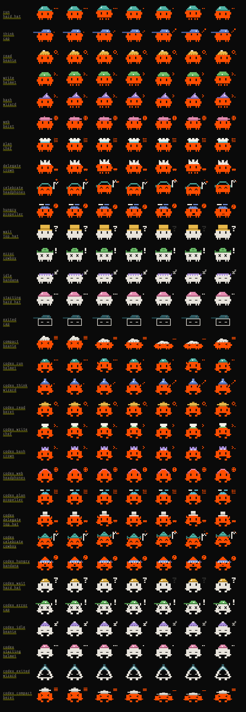
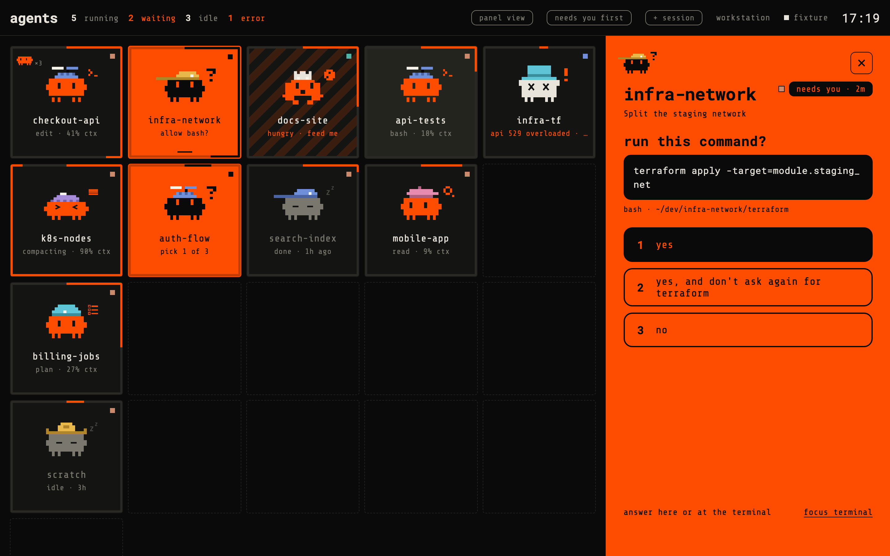

# Features

Everything the deck shows and does, in one place. The [README](../README.md) is the short version.

## The board

One tile per agent, on a 4×4 deck: the same board in the menu bar, on the desk panel and in the browser's panel view.

- **The critter** is Claude's pixel mascot (Codex threads get an onigiri) and shows what the agent is doing: thinking, reading, editing, running a command, searching the web, planning, delegating to subagents. A finished turn waves a checkered flag; an error throws both arms up; while Claude compacts the conversation it gets squeezed flat and springs back.
- **Hats.** Every agent wears a pixel hat picked by its working folder, so agents of one project look alike at a glance: 13 shapes (hard hat, cap, beanie, helmet, wizard, beret, chef, crown, headphones, propeller, top hat, cowboy, bandana) in 8 colours, chosen by a stable hash of the folder. Tap the critter on an agent's card (or click it in the web dashboard) to pick another shape or colour for that folder, or go back to automatic. While an agent works its hat animates too, a pixel at a time (the propeller spins, the bandana's tails flutter on the left, the wizard's tip sways…); otherwise it stays still. From the terminal: `agentctl hats`, `agentctl set hat <agent|folder> <shape> [colour]`, `agentctl set hat <agent|folder> auto`. The hats were inspired by the hatted pixel Claudes in [“9 NEW Claude Mods that can truly change how you work”](https://www.youtube.com/watch?v=lDrAZ1wAyVs) by Jay E (RoboNuggets).
- **Claude accounts.** If you use more than one Claude account (say personal and work, each its own Claude config folder), name them once: `agentctl account add personal ~/.claude sky`, `agentctl account add work ~/.claude-work yellow`. Each agent then shows a small square in its account's colour: on its tile, next to its name on the card, and in its terminal's header. Sessions you started by hand are found in every account. `agentctl new -a work` starts an agent in a given account (`agentctl account default work` changes the default). When one account runs out of usage, **continue on…** on the agent's card (or `agentctl handoff <agent> <account>`) copies the conversation into the other account and resumes it there: an agent the deck started comes back in the same tile, and a session you started by hand keeps its own terminal while the copy starts as a new agent. The original conversation stays in the first account.
- **Colour.** Orange means working; a solid orange tile means the agent needs you (a permission prompt or a question).
- **The border** fills clockwise with the agent's context window.
- **Hungry.** An agent that finished but whose result you haven't reviewed gets sliding orange stripes and a critter chomping at a cookie, until you focus its terminal or give it a new task.
- **Subagents.** A small critter in the tile's top-left corner means subagents are at work too, with a count when there are several. The agent's card shows each one, posed by what it's doing.
- **Pages.** The deck holds 16 agents per page (page = slot ÷ 16). With more, the tiles get a little shorter (they keep their width) and a row of bars appears under the grid, in the same square: the current page bright, another page orange when an agent there needs you. Swipe left and right (touch or trackpad), use ← / →, or tap a bar.
- **Arranging.** Drag a tile onto any free spot to move it there, or onto another tile to swap them (long-press on touch screens). The layout is shared by every view. `agentctl move <agent> <n>` does the same from the terminal.

<p align="center"><br><sub>Every pose, for the Claude critter and the Codex onigiri.</sub></p>

## Agent cards

Tap a tile for its card:

- **Overview.** What it's doing now, context used, tokens, estimated cost, turns and the last prompt, with **focus terminal**, **interrupt** and **stop** (or **resume** / **remove** once it has exited).
- **Permission prompts** show the exact command with Claude's own options; **questions** show their choices. Your answer is typed into the agent's terminal, and a prompt that has already changed is refused.
- **Free-text input** can't be typed on the deck: the card sends you to the terminal.

<p align="center"></p>

## Where it shows up

| | |
|---|---|
| **Menu bar** | A critter icon that turns orange when an agent needs you; the deck drops down in the top-right corner. Esc, the ‹ button or a click elsewhere hides it; right-click opens the web dashboard. |
| **Browser** | `agentctl web` opens the dashboard with a one-time login link. It has a grid view and a panel view that mirrors the 720×720 desk panel. |
| **Wall panel** | A 4″ 720×720 touch panel ([Wall Panel](https://github.com/dotstartech/wall-panel): Raspberry Pi CM4, Flutter) talking to the daemon over Wi-Fi: TLS 1.3 with its own client certificate (`agentctl pair desk-panel --bundle -`). Cards close with an edge swipe. |
| **Serial boards** | ESP32 boards on USB with Deck Link: see below. |
| **Terminal** | `agentctl ls`, `sessions`, `resume`… Agent terminals are tmux sessions you attach to with `agentctl attach`, or jump to with **focus terminal**. |

## Codex sessions

Threads from the Codex app (and Codex CLI) active in the last 6 hours appear on the board automatically, drawn as an onigiri, with no wrapper and no login. agents deck reads Codex's local files read-only: names, folder, branch and model from `~/.codex/state_*.sqlite` (opened with `sqlite3 -readonly`), live status from the end of each thread's `rollout-*.jsonl`.

| | Claude Code agents | Codex threads |
|---|---|---|
| started by | `agentctl new` / `resume` | the Codex app, as usual |
| status, activity, context, tokens | yes | yes |
| cost estimate | yes | — (Codex reports no prices) |
| answer prompts from the deck | yes | no, answer in the Codex app |
| focus | the agent's iTerm tab | opens the thread in the Codex app |
| interrupt / stop | yes | no |
| remove from the board | **stop** | **hide**, until the thread is active again |

`config.json`: `"codex": false` turns it off; `"codexWindowHours": 12` widens the window.

## Agents in other harnesses

The deck doesn't need to start your agents. If you run them in a harness, it reads that harness and
shows its agents alongside agentctl's own. Each one is found by itself while the harness runs; only cmux
needs a setting changed before you can answer from the deck. To add another harness, see
[harnesses.md](harnesses.md).

### Orca

Agents you run in [Orca](https://github.com/stablyai/orca) (Claude Code, Codex and others, each in its
own worktree) show up on the deck by themselves while Orca is open. Their status comes from Orca, which
reads the agents' own hooks: working, waiting for you, done. Tokens, context and cost come from the
agent's transcript when it's a Claude session.

From the deck, **open in orca** switches Orca to the agent's terminal and brings Orca forward; answers
and **interrupt** are typed into that terminal; **hide** takes the agent off the deck until it's active
again. The daemon talks to Orca through its `orca` CLI only (`worktree ps`, `terminal list`, `read`,
`send`, `switch`). `config.json`: `"orca": false` turns it off.

### herdr

Agents you run in [herdr](https://herdr.dev) (Claude Code, Codex and the other agents it knows) show up
on the deck while herdr runs, from every herdr session: the default one and named ones
(`herdr --session work`). Their status is herdr's own: working, blocked (waiting for you) and done
(hungry until you look at it, in herdr or from the deck). A Claude agent's tokens, context, cost and
account come from its transcript, matched through the agent's process, so herdr's Claude integration is
optional.

When an agent is blocked, the deck reads the dialog off its screen: the question and its options, which
you answer from the deck. **open in herdr** switches herdr to the agent's pane and brings up the
terminal tab herdr is open in; **interrupt** presses Esc in the pane; **hide** takes the agent off the
deck until its state changes. The daemon talks to herdr through its socket API only
(`session.snapshot`, `pane.read`, `pane.send_text`, `pane.send_keys`, `pane.process_info`,
`agent.focus`). `config.json`: `"herdr": false` turns it off.

### cmux

Claude Code sessions you run in [cmux](https://cmux.com)'s terminals show up on the deck by themselves
while cmux is open. Their status comes from cmux's Claude hooks, which it installs in every Claude it
starts: working, waiting for you, and hungry when a turn finishes. The deck reads them from the file
cmux keeps (`~/.cmuxterm/claude-hook-sessions.json`), so showing them needs no setup. Tokens, context,
cost and account come from the session's transcript.

Answering, **interrupt** and **open in cmux** go through cmux's control socket, which by default only
takes programs started inside cmux. To use them from the deck, in cmux set **Settings › Automation ›
Socket Control Mode** to **Automation mode** (or `"automation": { "socketControlMode": "automation" }` in
`~/.config/cmux/cmux.json`). That lets other apps you run on this Mac control cmux too. Without it, the
deck shows what the agent asks (from the hooks' note) and you answer it in cmux; **open in cmux** brings
cmux forward without picking the tab.

With access, the deck reads the dialog off the agent's screen (the question and its options) and types
your answer into the terminal; **interrupt** presses Esc; **open in cmux** switches to the agent's
terminal and brings cmux forward. **hide** takes the agent off the deck until its state changes. The
daemon uses the socket methods `surface.read_text`, `surface.send_text`, `surface.send_key`,
`surface.focus` and `system.identify`. Codex sessions in cmux aren't mirrored yet. `config.json`:
`"cmux": false` turns it off.

## Claude sessions started elsewhere

Claude Code sessions you start by hand in any terminal (plain `claude`) can join the deck too. Tap a free cell (or **+ session** on the web dashboard, or `agentctl live` / `agentctl add <session>`) to see them and add one; it lands in that cell.

The list comes from Claude Code itself (`claude agents --json`), so it covers every active session on the Mac: ones in your terminals and **background** sessions (`claude --bg`, and the ones the Claude desktop app runs). Older Claude Code versions fall back to scanning for `claude` processes in terminals.

Added sessions are **watched**: status (working, idle, hungry when a turn finishes while watched), activity, context, cost and subagents come from the session's transcript, and **focus** jumps to its terminal tab. Claude Code reports when one is blocked on you, so the tile turns "needs you"; answer it in that session (the deck can't type into it). Focus on a background session opens it in a new iTerm tab with `claude attach`. **remove from deck** takes the session off the deck; the session itself keeps running. Added sessions come back whenever they run again.

## Agent terminals

- **Focus.** iTerm's local API selects the agent's tab and pane, then iTerm's `StealFocus` escape brings the window forward, including a hidden hotkey window. `agentctl set term tmux` switches your last-used tab to the agent instead; `window` only raises its window.
- **Mouse.** tmux mouse mode is on, so the wheel scrolls the agent's history. A drag selection stays highlighted and goes to the clipboard; double-click selects a word, path or URL, triple-click a line; typing afterwards goes to the agent. A click on a link opens it (http, https and file links only). `agentctl set mouse native` hands the mouse to iTerm instead.
- **Tab names** follow the name Claude Code gives the session.
- **Header.** Each agent terminal has a band at the top: the agent's critter (Claude Code's logo, in quarter blocks) in its hat, its name, status and how long it has been in it, folder, branch, model and effort, the context bar, tokens, cost and turns, what it is doing or asking, and its subagents. `agentctl set header off` removes it.
- **After an iTerm crash** the agents keep running in tmux; `agentctl reopen` opens a tab for each one again.

## Restore after a tmux crash or reboot

If the tmux server dies under live agents (a crash, a reboot), they are marked **lost with tmux** and stay on the board. `agentctl restore` (or **restore all** on the web dashboard) brings them back: Claude agents resume their own conversation, other tools start fresh in their folder, each in its old spot. `agentctl set restore auto` does it as soon as the loss is noticed.

## Simulated agents

`agentctl sim start --root ~/dev --slots 12` fills the board with simulated agents that "work" on the real projects under `~/dev`: they read, edit, run commands, ask questions, hit errors and sometimes compact. They're read-only (they list file names and never open, change or run anything). `agentctl sim stop` removes them.

## Serial boards (Deck Link)

Small boards (ESP32 and the like) connect over USB serial with Deck Link, a protobuf protocol with the
same agents, statuses, prompts and actions as the web API ([protocol](link/protocol.md)). The
[firmware kit](../firmware/deck-link) does the protocol; its examples are a status LED, an OLED tile
with a button, and a rotary-encoder knob. Ready-made devices are in
[firmware/devices](../firmware/devices): [t4s3-panel](../firmware/devices/t4s3-panel) is the deck on a
2.41″ AMOLED touch panel, critters and all, and
[`waveshare-lcd-147`](../firmware/devices/waveshare-lcd-147) is a read-only colour panel for the Waveshare ESP32-S3-LCD-1.47B: one agent in detail next to a mini-board of the fleet.
[`waveshare-touch-lcd-4`](../firmware/devices/waveshare-touch-lcd-4) (4″, 480×480) and
[`waveshare-touch-amoled-18`](../firmware/devices/waveshare-touch-amoled-18) (1.8″ AMOLED) show the deck's
tiles with touch (a paged 4×4 grid on the 4″, a scrolling list on the AMOLED): tap one for its card,
answer prompts with scope `act`. All three share
[firmware/panel-core](../firmware/panel-core).

```sh
agentctl link ports                      # USB serial ports that look like boards
agentctl link add /dev/cu.usbmodem1101   # the daemon only ever opens registered ports
agentctl devices approve oled-tile-3fa9c1
agentctl devices scope oled-tile-3fa9c1 act   # to let it answer prompts
agentctl link                            # what's connected
```

A new board waits for approval and starts with view-only access. The daemon lets go of a port while
another program (a flasher, a serial monitor) has it open. `agentctl link sim` is a board without
hardware; `agentctl link check <port>` tests a board's firmware against a demo deck. To build a new
device, see [link/new-device.md](link/new-device.md).

## Settings

`agentctl get` lists them; `agentctl set <key> <value>` changes them.

| key | values |
|---|---|
| `term` | `iterm` (default), `tmux`, `window`: how focus shows an agent |
| `mouse` | `tmux` (default), `native`: who owns the mouse in agent terminals |
| `restore` | `ask` (default), `auto`: what happens to agents lost with tmux |
| `header` | `on` (default), `off`: the band at the top of agent terminals |
| `web` | `local` (default), `lan`: also serve the dashboard on your local network |
| `hat` | `agentctl set hat <agent|folder> <shape> [colour]`, `none` or `auto`: the hat of a working folder (stored in `config.json` `"hats"`) |
