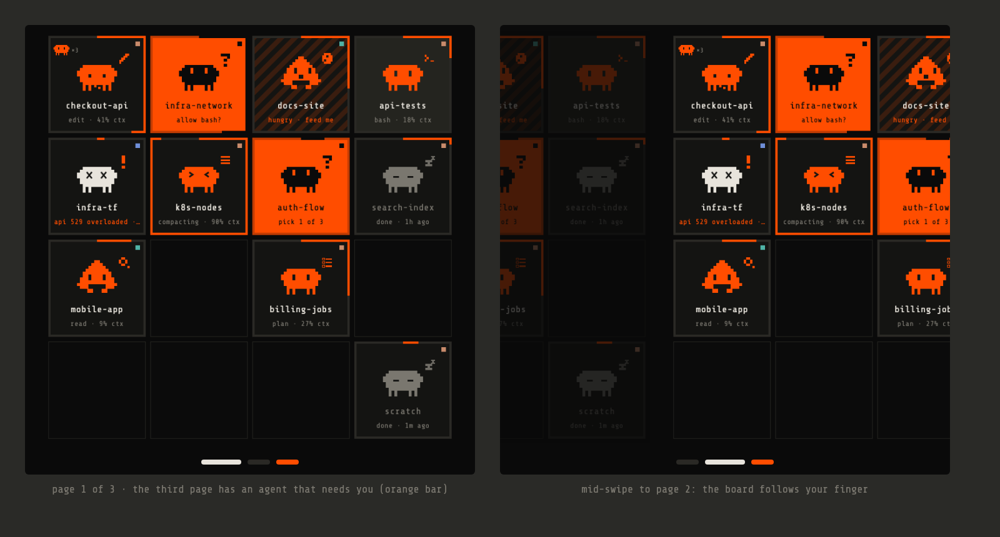

# Roadmap

Short and ordered. Each step should be usable on its own before the next starts.

## 1. Restore after a tmux crash or reboot (done)

`agentctl restore`, `agentctl set restore ask|auto`, `POST /v1/restore`, and a "restore all" bar on the web dashboard. Shells and other tools are relaunched fresh in their folders; simulated agents are dropped.

Before this, a dead tmux server (crash, reboot, `tmux kill-server`) left every agent `exited`; each one offered **resume**, then moved to the history after 10 minutes.

- `agentctl restore` brings the whole board back in one go. Every Claude agent that has a session id is resumed with `claude --resume <id>` in its own folder, keeping its title (if you set one with `-t`) and its board position.
- On daemon start, agents that were alive before the tmux server died are listed for restore instead of expiring. Restoring automatically is a setting (`agentctl set restore auto|ask`), default `ask`.
- Shells and non-Claude agents come back as fresh sessions in their folders.
- Out of scope: running processes themselves never survive; only the conversations do.

## 2. Menu bar app: the deck as an overlay (in progress)

Working: the deck UI moved into a shared Flutter package (`clients/flutter/agents_ui`, used by the desk panel too); `clients/macos` is the menu bar app (no Dock icon, a critter icon that turns orange when an agent needs you, the deck dropping down under it, Esc or a click elsewhere hides it, local pairing). Since then: release builds in CI as one universal arm64 + Intel app, the Linux tray app, a status line under the deck and a Settings window (step 5). Left: a global shortcut.

A macOS menu bar icon. Clicking it opens a small overlay in the top-right corner with the same 4×4 deck as the desk panel. Click an agent for its card: answer, focus terminal, interrupt.

- Reuse the panel UI as-is: the agents app from the Flutter panel, built for macOS desktop. That gives the same tiles, critters, cards and drag-to-arrange, with no second UI to maintain.
- It talks to the daemon over its unix socket: no pairing, nothing on the network.
- The icon shows state at a glance: plain when idle, an accent dot when an agent needs you.
- It hides when it loses focus (like other menu bar popovers), and has a global shortcut to open it.

Decided: Flutter desktop, reusing the panel UI through the shared package.

## 3. Notifications (opt-in)

Off by default. `agentctl set notify off|needs-you|all`:

- `needs-you`: a permission prompt or a question is waiting.
- `all`: also when an agent finishes a turn (turns hungry).

Delivered by the menu bar app as native notifications. Clicking one opens that agent's card. No sound unless asked for.

## 4. Easy install: build and release pipeline (done)

`ci` (tests on every push and pull request) and `release` (on a tag: builds for every platform,
optional signing and notarization, the GitHub release with `SHA256SUMS` and our signature on it), and
`install.sh` for macOS and Linux. [releasing.md](releasing.md) has the files, the jobs and the
signing secrets.

## 5. Agents Deck Desktop (v0.2): an app anyone can install (done; Windows in preview)

One download per platform, for people who have never opened a terminal
([install.md](install.md)):

- **Installers**: a `.dmg` for macOS (Apple Silicon and Intel in one app), a `.deb` and a `.tar.gz`
  for Linux (x64 and arm64), and a per-user `setup.exe` for Windows. The app always carries the
  service (`agentctl`) inside it, at the same version, and registers it to start at login
  (`agentctl install`, `uninstall` and `status` on all three).
- **The app**: the deck in the menu bar or tray with a status line under it (running, boards, what
  wants attention), and a Settings window: the service's own Settings page, the same in the browser.
- **Boards from Settings**: a new ESP32 on USB is listed from its USB id without opening the port;
  after you confirm it, the service flashes the board's image from the latest release with its own
  ESP32-S3 flasher written in Go (`agentctl flash` from a terminal). No PlatformIO, no esptool.
- **Updates**: the service checks GitHub releases, verifies our Ed25519 signature on `SHA256SUMS`,
  and updates itself and the app (`agentctl update`); boards on USB are flashed again, boards on
  Wi-Fi update over the air and fall back to their old firmware if the new one can't connect.
- **Windows (preview)**: the service, boards, flashing, updates and Settings in the browser. Not yet:
  a tray icon, starting agents (`agentctl new` needs tmux), jumping to a terminal.

## Next (after the first release)

### Every Claude Code session on this machine (done)

`agentctl live` / `agentctl add`, `GET /v1/live` + `POST /v1/live/{session}/add`, a free cell (or **+ session** on the web) opens "add a session". Watched sessions show status, activity, context, cost and subagents; "needs you" isn't visible without hooks.

See the Claude sessions that agentctl didn't start (plain `claude` in any terminal) and add the ones you want to the deck.

- Discovery: running `claude` processes, matched to their session transcript by folder and recency. No second process on the session, so nothing gets forked.
- Watch-only tiles until adopted: status, activity, context, cost and subagents from the transcript; the "needs you" state from what the transcript and terminal title show (no hooks there).
- Focus: find the session's terminal by its TTY (the iTerm API already maps TTYs to tabs).
- Adding to the deck is a choice per session (a picker on the web dashboard and in the menu bar app); the rest stay listed but off the board.

### Claude desktop app sessions (local ones done)

Local sessions (including the desktop app's background sessions) come from `claude agents --json` and join the same picker; a blocked one shows "needs you". Cloud sessions (running on Anthropic's servers) aren't on this Mac: reaching them needs claude.ai with your login, so they wait for a decision on network access.

The Claude desktop app's sessions, some of them important. Pick which ones show on the deck, read-only like Codex threads: status and activity, focus opens them in the app. First step: find out what the app keeps locally and whether it can be read without touching it.

### More than 16 agents: a paged deck (done)

Pages of 16 with a bar row under the grid, on the panel, in the menu bar app and in the web panel view.

With every slot taken, the deck pages left and right instead of the pager tile:

- Tiles a little smaller so a row of page bars fits under the 4×4 grid: one rounded bar per page, the current one wider and bright, an orange bar where an agent on that page needs you.
- Swipe left and right on the panel (the board follows your finger), trackpad swipes, arrow keys and clicks on the bars in the menu bar app and the browser.
- Slots keep their meaning: page = slot / 16, so an arranged board stays arranged.

## Later

- **Windows app shell:** the deck next to a notification-area icon, with a native Settings window
  (WebView2), on the same method channel as the macOS and Linux shells
  ([clients/macos/README.md](../clients/macos/README.md#windows)). It also needs a local transport
  Dart can use on Windows (a named pipe, or a loopback port with a token).
- **Signing on Windows:** an open-source licence for the project, then SignPath Foundation (or
  another certificate), so the installer opens without the SmartScreen warning. The release workflow
  already signs when the secrets exist.
- **Notarized macOS releases:** the Developer ID certificate and Apple secrets in the repository, so
  every release opens without a warning and keeps its permissions across updates.
- **Starting agents on Windows:** `agentctl new` and restore run agents in tmux, which Windows lacks;
  it needs another way to host a terminal, and jumping to it (Windows Terminal).
- **Linux:** jumping to an agent's terminal without iTerm, and a signed apt repository.
- **The web flasher on the website**, linked from the README and Settings, About, once it's online.
- **Homebrew:** a tap with a formula for `agentctl` and a cask for the app, once the installers have been used for a while.

## Parked ideas

From reviewing other tools (e.g. herdr). Not planned, but kept in mind:

- Screen-reading status for agents without hooks (Codex CLI, Gemini…), and as a safety net for Claude states hooks miss.
- Agent automation: `agentctl prompt --wait`, `agentctl wait --until blocked`, `agentctl read`, plus a skill file.
- `agentctl explain <agent>`: why the deck shows an agent's current state.
- Grouping agents by project on the board.
