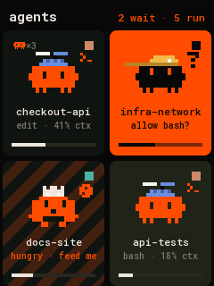
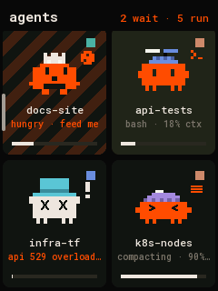
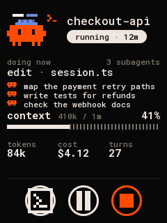
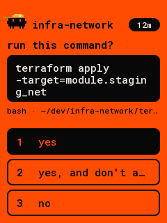
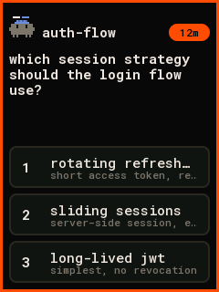
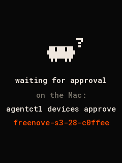

# freenove-s3-28: the deck on the Freenove ESP32-S3 Display 2.8″

The deck on a [Freenove ESP32-S3 Display 2.8″](https://github.com/Freenove/Freenove_ESP32_S3_Display)
(FNK0104B: 240×320 LCD, capacitive touch), over USB or Wi-Fi with
[Deck Link](../../../docs/link/protocol.md). It's the ESP32-S3 cousin of the "Cheap Yellow Display".

It has the same UI as the [1.8″ AMOLED](../waveshare-touch-amoled-18): the same tiles, card, prompts,
icon buttons and gestures, from the same code (`layout_square.h` in
[`panel-core`](../../panel-core), `specFreenove28()`), at about half the size:

- two rows of tiles on screen, two across, with critters at ×4;
- smaller type: names and the status line at 17 px, the card's name at 23 px;
- the card's critter at ×4, the prompt's header at ×2, the notices at ×4.

| home | scrolling | card | permission | question | approval |
|---|---|---|---|---|---|
|  |  |  |  |  |  |

(Rendered on the host from `docs/fixtures/state.json` by `firmware/panel-core/tools/render_docs.sh`.
Every screen is in `docs/`.)

- **Home.** Tiles two across in one vertical list. Drag to scroll; let go and it settles on a row, a
  flick carries further. A thin bar on the left shows where you are while it moves. The header says how
  many agents wait and run, and on Wi-Fi has a small Wi-Fi mark after "agents".
- **Card.** Tap a tile: the critter, the name and the status pill; what it's doing now; context with
  the dotted bar; tokens, cost and turns; the last prompt. Round icon buttons at the bottom:
  **focus** (the terminal), **interrupt** (while running), and **stop**, held for 1 s. Focus and
  interrupt need scope `act`; stop needs `admin`.
- **Prompts.** A waiting agent opens its prompt: the question, the command (for permissions), the
  answers. Answering needs scope `act`.
- **Back.** Swipe right, or press BOOT. There's no back button.
- **Backlight.** It dims when every agent is idle and nobody touched it for a while.

Portrait, with the USB-C at the bottom. The `idf5-turned` env turns picture and touch 180° for the
board standing the other way up.

## Parts

- Freenove ESP32-S3 Display 2.8″, the touch version (FNK0104B). The FNK0104A has no touch: it shows
  the deck, but you can't open a card or answer.
- A USB-C data cable to the Mac. Nothing to wire: the board's own USB is the link.

## Connect it

```sh
pio run -d firmware/devices/freenove-s3-28/idf5 -e idf5 -t upload --upload-port /dev/cu.usbmodem<…>
agentctl link add /dev/cu.usbmodem<…>
agentctl devices approve freenove-s3-28-<id>      # only with `agentctl devices auto-approve usb off`
agentctl devices scope freenove-s3-28-<id> admin  # to stop agents; a registered port gives act
```

The board says Hello as type `freenove-s3-28`, display 240×320 colour, input TOUCH. If the upload
can't connect, hold **BOOT**, press **RST**, let go of BOOT, and upload again.

## Build and flash

| env | what |
|---|---|
| `idf5` (`idf5/platformio.ini`) | arduino-esp32 3.x: USB and Wi-Fi (TLS 1.3). The one to flash. |
| `idf5-debug` | `idf5` with one-line notes on the USB port (link, Wi-Fi phase, touch, memory) |
| `idf5-turned` | `idf5` with picture and touch turned 180° (USB-C at the top) |
| `freenove-s3-28` (`platformio.ini`) | arduino-esp32 2.0.17: USB only (no TLS 1.3, so no Wi-Fi) |
| `debug` | the same with notes on the USB port |

The `idf5` project keeps its platform in `~/.platformio-pioarduino` and rebuilds arduino-esp32's
libraries with TLS 1.3, as the [1.8″ board's](../waveshare-touch-amoled-18/README.md#build-and-flash)
does: about five minutes the first time. If that build stops with
`No module named 'SCons.Tool.FortranCommon'`, see the
[2.8″ round board's README](../waveshare-touch-lcd-28c/README.md#wi-fi).

## First power-on

Flash `debug` (or `idf5-debug`) and open `pio device monitor`. The first line says what the board found:
`freenove28: ft6336 vendor 11 …` and `touch ok, display ok`.

| question | if it's wrong |
|---|---|
| is the picture there, and black is black? | colours inverted (white background): add `-DFREENOVE28_NOT_INVERTED` to `build_flags` |
| are orange things orange, not blue? | red and blue swapped: the panel's colour order; report it |
| does a tap land where the finger is? | upside down: `idf5-turned`; mirrored: report it |
| `touch NONE`? | an FNK0104A (no touch), or the touch didn't answer on I²C |

## Wi-Fi

As on the 1.8″ and the round boards ([the 2.1″ board's README](../waveshare-touch-lcd-21/README.md#wi-fi)
has the whole story): plugged into the Mac and approved, it pairs by itself and gets the deck's default
network; unplugged, it joins that network and reaches the deck over TLS 1.3 with its own certificate.
USB wins whenever it's plugged in. Revoke a board you lose (`agentctl devices revoke freenove-s3-28-<id>`).

## Hardware

From Freenove's [ESP32-S3 Display](https://github.com/Freenove/Freenove_ESP32_S3_Display) repository
(the FNK0104AB TFT_eSPI setup and the touch sketches):

| part | pins |
|---|---|
| ESP32-S3R8 | 8 MB octal PSRAM, 16 MB flash |
| ILI9341 LCD (SPI, FSPI) | CS 10, MOSI 11, SCK 12, MISO 13, DC 46, no reset line; 40 MHz; BGR, inverted |
| backlight | GPIO 45 (through a BSS138, high is on; PWM) |
| FT6336U touch (I²C 0x38) | SDA 16, SCL 15, reset 18, INT 17 (not used: it's polled) |
| BOOT | GPIO 0 |

Left alone: the ES8311 codec (on the same I²C bus, 0x18) and its amplifier, the WS2812 on GPIO 42,
the SD slot (SDMMC) and the battery input.

## Code

`src/main.cpp` is only the board. The layout, the touch UI, Deck Link and Wi-Fi are shared with the
other panels in [`firmware/panel-core`](../../panel-core) (`grid_app.h`, `layout_square.h`).
