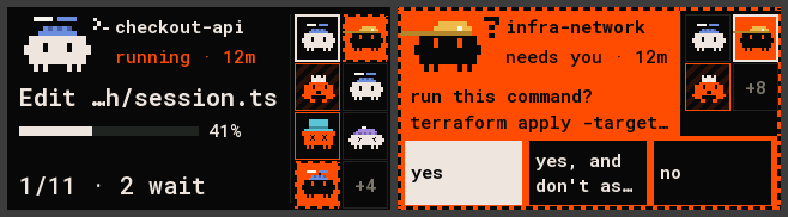

# lilygo-t-display-s3: an agents deck panel on the LilyGO T-Display-S3

A small desk panel for agents deck: firmware for the
[LilyGO T-Display-S3](https://github.com/Xinyuan-LilyGO/T-Display-S3) and the T-Display-S3 Touch
(ST7789, 320×170 on an 8-bit parallel bus, CST816 touch on the Touch version, two buttons). It plugs
into the computer over USB and shows the fleet through [Deck Link](../../../docs/link/protocol.md),
and it answers: a waiting agent's options become buttons you tap.

The layout is the [Waveshare 1.47"](../waveshare-lcd-147)'s in bigger text, for the bigger glass
(`panel-core/src/layout_tds3.h`).



## What the screen shows

- **Left, the hero**: one agent with its sprite and pose, its name and what it is doing in bold,
  status and age, and the context bar. The big footer shows its position and how many agents wait,
  failed or run (as many as fit).
- **Right, the mini-board**: up to 8 agents in slot order. A solid orange cell is an agent that waits
  for you. The white frame marks the hero.
- The board picks the hero itself: waiting → error → finished but not reviewed ("hungry") → running →
  the rest. Equal rank: the most recent change wins.
- **A waiting hero, with scope `act`**: the screen turns into its prompt. The question and what it is
  about (a command, a file) across the hero, the mini-board's top half, and the options as big
  buttons along the bottom, the primary one in white. More than three options: the last button,
  `+N more`, shows the next ones.
- **Motion**: whoever waits gets a frame of marching dashes, round its mini-board cell and round the
  hero or the prompt, so a waiting agent catches the eye even when it isn't the one shown. A finished
  agent you haven't looked at yet ("hungry") gets the web's sliding orange stripes. A new hero slides
  in from the side it came from (a swipe, a button, a tapped cell) and its context bar grows to its
  value; toasts slide up from the bottom. The screen is drawn about
  every 40 ms; a frame takes 20-40 ms. The `fps` env (`pio run -d … -e fps -t upload`) shows how long
  in a corner.
- **Backlight**: always up: on USB the board has power, and the empty screen is worth seeing. The
  board has no LED.
- **No agents**: the time in big digits, and Claude's critter and the Codex onigiri walking along the
  bottom, stopping to think or celebrate; after three quiet minutes they fall asleep. Below, the
  computer's name and `agentctl new`. The deck sends the time in UTC: build with a time zone (see
  [Build, flash, connect](#build-flash-connect)) for local time, or the clock says `UTC`.
- Full-screen messages, each with its critter moving:
  - `connecting`: no answer from the deck yet (the critter runs to and fro).
  - `waiting for approval`: shows the board's name and the command to approve it (it looks around).
  - `deck offline`: the deck has been silent for 15 s and the board has no fleet to show yet (it
    nods off).

  Once the board has a fleet, a silent deck keeps the last fleet on screen with `deck offline` in the
  footer.

## Touch and buttons

| | what it does |
|---|---|
| tap a mini-board cell | shows that agent, held for 30 s (a small square in the footer marks the hold) |
| swipe left / right | the next / the previous agent |
| tap an option | answers the prompt with it |
| tap the agent anywhere else | with a prompt on screen: hides it, to look at other agents · otherwise: focuses its terminal (never answers) |
| hold the agent (0.6 s) | shows its hidden prompt again (a new prompt shows by itself) |
| lower button (GPIO 14) | press: the next agent · hold 1 s: answer the primary option of the prompt on screen, or focus |
| BOOT (GPIO 0) | press: the previous agent · hold 1 s: interrupt the agent |

A new waiting agent ends a hold, so a prompt is never hidden. A short toast confirms what was sent
(`sent`, `focus`, `interrupted`) or says why it wasn't (`the prompt changed`, `not allowed: scope`).

Answering, focusing and interrupting need scope `act`. A board on a registered USB port gets it when
it's approved; with `view` the board only looks and says `view only: needs scope act`. Without the
touch screen (the plain T-Display-S3) the buttons do it all.

## What it asks the deck for

- **Hello**: type `lilygo-t-display-s3`, display 320×170 colour, inputs TOUCH (when the CST816
  answers at boot) and two BUTTONs, board id = the chip's MAC.
- **Subscribe**: every agent (`slot_count` 0), fields `TILE | CARD | PROMPT | NUMBERS`. The board
  keeps the 16 lowest slots.
- **Commands**: Answer (with the prompt's own id), Focus, Interrupt.
- **Clock**: the board has none. It takes the deck's time from `SnapshotBegin.server.time_ms` and from
  every `Ping` (every 5 s), then adds `millis()` since.

## Build, flash, connect

You need [PlatformIO](https://platformio.org/) and the daemon (`agentctl install`). There are two
builds:

- **`idf5`** (arduino-esp32 3.x, the one to flash): USB and Wi-Fi, the frame sent by DMA.
- **the board's folder** (arduino-esp32 2.0.17): USB only; what CI builds on every push.

```bash
pio run -d firmware/devices/lilygo-t-display-s3/idf5 -e idf5 -t upload
agentctl link add /dev/ttyACM0                    # the board's port: agentctl link ports
agentctl devices approve lilygo-t-display-s3-<id> # only with `agentctl devices auto-approve usb off`
```

The first `idf5` build rebuilds the Arduino libraries with TLS 1.3 (several minutes); see
[docs/flashing.md](../../../docs/flashing.md) for it and for the SCons fix it may need once.

On macOS the port is `/dev/cu.usbmodem…`. On Linux your user needs access to the port (the
`dialout` group on Debian and Ubuntu, `uucp` on Arch).

When the port is registered, the daemon reads it; if an upload fails with "serial data stream
stopped", `agentctl link rm <port>` first and `agentctl link add <port>` after.

A board fresh from LilyGO (or with other firmware on it) may not start the upload by itself: hold
BOOT, press RST, let go of BOOT, and upload again. It then stays in the bootloader after the upload:
press RST to start the firmware.

On a registered port a new board is approved at once. With auto-approval off, the screen shows the
exact `approve` command until you run it. Approved on USB, the board also pairs for Wi-Fi by itself
(a key on the chip, a certificate from the deck).

### Wi-Fi

```bash
agentctl link wifi --default --ssid "my network"   # asks for the password
```

Every approved board plugged in over USB gets the network and tries it ("trying Wi-Fi…"). Then it
picks its link by itself, like the other Wi-Fi boards: USB while a deck answers there, Wi-Fi when the
deck is quiet on USB (on a charger, or after `agentctl link rm <port>`), and USB again as soon as the
deck shows up on it. The footer (and the empty screen's corner) shows the Wi-Fi mark while it's on
Wi-Fi. 2.4 GHz networks only; a phone's hotspot may need its 2.4 GHz option.

The board is always powered, so this build keeps the Wi-Fi radio awake (`-DNET_WIFI_SLEEP=0` in
`idf5/platformio.ini`): a tap reaches the deck in tens of ms instead of the hundreds modem sleep
adds. The `idf5-debug` env prints the Wi-Fi and TLS steps, and a line every 2 s about the loop, on
the USB port.

For the clock in local time, give the build a POSIX time zone, e.g. Central Europe:

```bash
PLATFORMIO_BUILD_FLAGS='-DTDS3_TZ=\"CET-1CEST,M3.5.0,M10.5.0/3\"' pio run -d firmware/devices/lilygo-t-display-s3/idf5 -e idf5 -t upload
```

The screen is landscape with the USB port on the right. Build with `-DTDS3_ROTATION=3` (in
`build_flags`) to turn it the other way; touch follows.

No wiring is needed: the display, touch and buttons are on the board. Pins, from LilyGO's
`pin_config.h`:

| part | GPIO |
|---|---|
| LCD data | D0–D7: 39, 40, 41, 42, 45, 46, 47, 48 |
| LCD control | WR 8, RD 9, DC 7, CS 6, RST 5, backlight 38 |
| power on (LCD on battery) | 15 |
| touch (CST816, I2C 0x15) | SDA 18, SCL 17, INT 16, RST 21 |
| buttons | BOOT 0, the other 14 |

The link is the chip's own USB (CDC). Opening the port with DTR low and RTS high resets the chip into
the bootloader, so the PlatformIO monitor is set to leave both alone.

## Sessions started outside agentctl

The board shows what the deck has, nothing else. A Claude session started by hand reaches the deck
through the daemon: `agentctl live` lists them and `agentctl add <session>` puts one on the deck.

## Tests and the host renderer

The drawing, the touch and buttons, the Deck Link adapter, the tests and the host renderer are shared
with the other panels in [`firmware/panel-core`](../../panel-core); this folder holds only the board's
`main.cpp` (the display, the CST816 driver, the buttons). `panel-core/tests/test_tds3.cpp` draws every
screen inside the frame and checks taps, swipes, buttons and results.

```bash
firmware/panel-core/tests/run.sh
cd firmware/panel-core
c++ -std=c++17 -Isrc -I../deck-link/src -I../deck-link/src/proto sim/render.cpp -o out/render
mkdir -p out/frames && out/render ../../docs/fixtures/state.json out/frames 300 tds3
python3 tools/ppm2png.py out/sheet.png out/frames/hero-*.ppm out/frames/prompt-*.ppm --cols 3    # needs pillow
```

`docs/screen.png` is `hero-00` and `prompt-permission`; `firmware/panel-core/tools/render_docs.sh` writes it.

## Limits

- Landscape only. At most 16 agents in memory and 8 on the mini-board.
- A pick-any question is answered one option at a time.
- Wi-Fi in the `idf5` build only, 2.4 GHz only.
- Roboto Mono has no arrows or CJK. A missing glyph is drawn as `?`.
- The serial port carries Deck Link only, so there's no debug console over USB.

## Licences

The bitmap font in `panel-core/src/font_data.h` is rendered from Roboto Mono (SIL Open Font License
1.1, `panel-core/OFL-robotomono.txt`).
