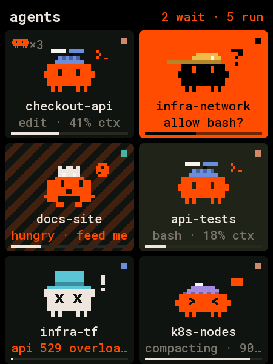
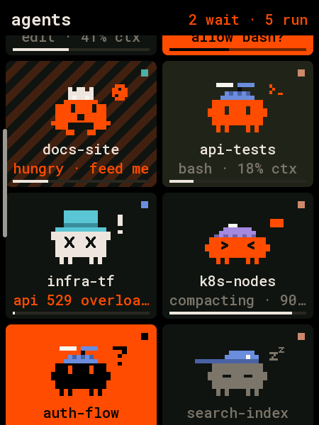
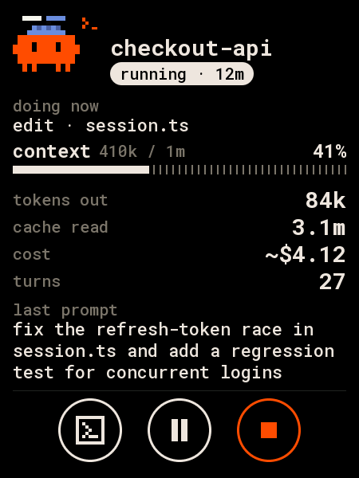
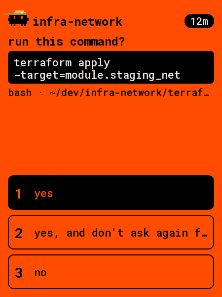
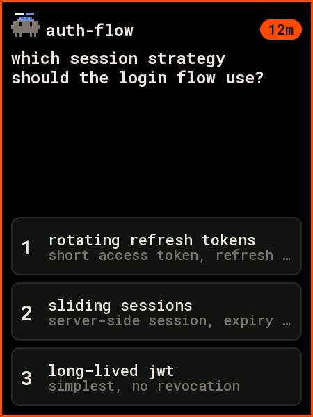
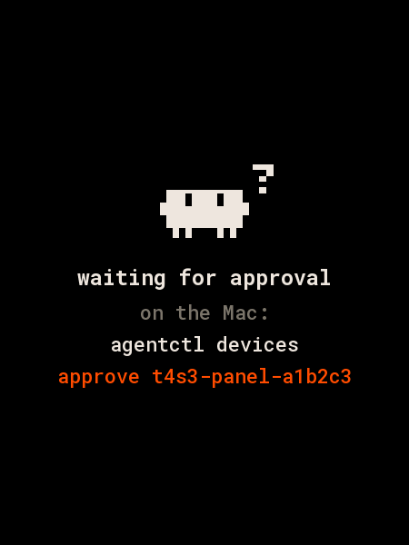

# lilygo-t4-s3: the deck on the LilyGO T4-S3 (current firmware)

The deck on a [LilyGO T4-S3](https://www.lilygo.cc/products/t4-s3) (2.41″ AMOLED, 450×600, touch),
over USB or Wi-Fi with [Deck Link](../../../docs/link/protocol.md). This is the firmware to flash; the
earlier LVGL firmware in [`../t4s3-panel`](../t4s3-panel) is kept for reference.

It has the same UI as the [1.8″ AMOLED](../waveshare-touch-amoled-18): the same tiles, card, prompts,
icon buttons and gestures, from the same code (`layout_square.h` in
[`panel-core`](../../panel-core), `specT4S3()`). What differs is only what the bigger screen has room for:

- three rows of tiles on screen instead of two, with bigger critters (×6 against the 1.8″'s ×5);
- on the card, the numbers one to a line: tokens out, cache read, cost (approximate, `~$4.12`), turns;
- a bigger critter on the card (×6), the prompt's header (×3) and the notices (×7).

| home | scrolling | card | permission | question | approval |
|---|---|---|---|---|---|
|  |  |  |  |  |  |

(Rendered on the host from `docs/fixtures/state.json` by `firmware/panel-core/tools/render_docs.sh`.
Every screen is in `docs/`.)

- **Home.** Tiles two across in one vertical list. Drag to scroll; let go and it settles on a row, a
  flick carries further. A thin bar on the left shows where you are while it moves. The header says how
  many agents wait and run, and on Wi-Fi has a small Wi-Fi mark after "agents".
- **Card.** Tap a tile: the critter, the name and the status pill; what it's doing now; context with
  the dotted bar; tokens out, cache read, cost and turns; the last prompt. Round icon buttons at the
  bottom: **focus** (the terminal), **interrupt** (while running), and **stop**, held for 1 s. Focus
  and interrupt need scope `act`; stop needs `admin`.
- **Prompts.** A waiting agent opens its prompt: the question, the command (for permissions), the
  answers. Answering needs scope `act`.
- **Back.** Swipe right, or press BOOT. There's no back button.
- **AMOLED.** True black; it dims when every agent is idle and nobody touched it for 30 s.

The panel is turned 180° (as the earlier `t4s3-flip` build): picture and touch both. The `idf5-upright`
env builds LilyGO's own orientation.

## Connect it

It reports the same type (`t4s3-panel`) and board id as the earlier firmware, so the deck sees the
same device: its name, approval and scope carry over.

```sh
pio run -d firmware/devices/lilygo-t4-s3/idf5 -e idf5 -t upload --upload-port /dev/cu.usbmodem<…>
agentctl link add /dev/cu.usbmodem<…>
agentctl devices approve t4s3-panel-<id>      # only with `agentctl devices auto-approve usb off`
agentctl devices scope t4s3-panel-<id> act    # answer, focus, interrupt; admin to stop
```

If the upload can't connect (a board that's crashing, or one fresh from LilyGO), hold **BOOT**, press
**RST**, let go of BOOT, and upload again.

## Build and flash

| env | what |
|---|---|
| `idf5` (`idf5/platformio.ini`) | arduino-esp32 3.x: USB and Wi-Fi (TLS 1.3). The one to flash. |
| `idf5-debug` | `idf5` with one-line notes on the USB port (link, Wi-Fi phase, frame time, memory) |
| `idf5-upright` | `idf5` in LilyGO's orientation (not turned) |
| `lilygo-t4-s3` (`platformio.ini`) | arduino-esp32 2.0.17: USB only (no TLS 1.3, so no Wi-Fi) |
| `debug` | the same with notes on the USB port |

The `idf5` project keeps its platform in `~/.platformio-pioarduino` and rebuilds arduino-esp32's
libraries with TLS 1.3, as the [1.8″ board's](../waveshare-touch-amoled-18/README.md#build-and-flash)
does: about five minutes the first time.

## Wi-Fi

As on the 1.8″ and the round boards ([the 2.1″ board's README](../waveshare-touch-lcd-21/README.md#wi-fi)
has the whole story): plugged into the Mac and approved, it pairs by itself and gets the deck's default
network; unplugged, it joins that network and reaches the deck over TLS 1.3 with its own certificate.
USB wins whenever it's plugged in. Revoke a board you lose (`agentctl devices revoke t4s3-panel-<id>`).

## Hardware

From LilyGO's [LilyGo-AMOLED-Series](https://github.com/Xinyuan-LilyGO/LilyGo-AMOLED-Series)
(`BOARD_AMOLED_241`), as in the earlier firmware:

| part | pins |
|---|---|
| RM690B0 AMOLED (QSPI) | CS 11, SCK 15, D0–D3 14 10 16 12, reset 13; 40 MHz; 16-column offset (the RAM is 482 wide) |
| panel power | GPIO 9, high |
| CST226SE touch (I²C 0x5A) | SDA 6, SCL 7, reset 17 |
| BOOT | GPIO 0 |

The SY6970 charger stays at its power-on defaults. Brightness is the panel's own (0x51).

## Code

`src/main.cpp` is only the board. The layout, the touch UI, Deck Link and Wi-Fi are shared with the
other panels in [`firmware/panel-core`](../../panel-core) (`grid_app.h`, `layout_square.h`).
