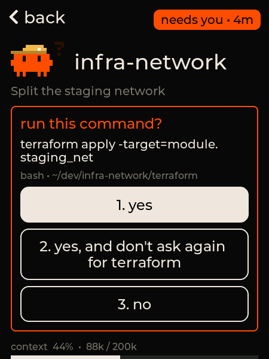
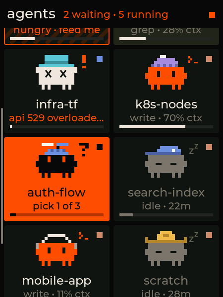
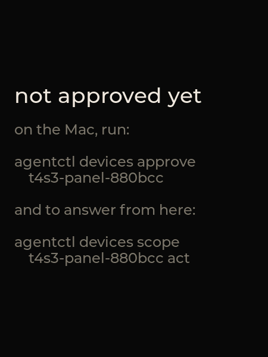

# t4s3-panel (earlier firmware)

> **Superseded by [`../lilygo-t4-s3`](../lilygo-t4-s3)**, the current firmware for this board: the
> same UI as the 1.8″ AMOLED from the shared `panel-core`, and Wi-Fi. It reports the same type and
> board id, so the deck keeps the device. This LVGL firmware stays here for reference.

The deck on a [LilyGo T4-S3](https://www.lilygo.cc/products/t4-s3): a 2.41″ AMOLED touch panel
(450×600) on USB. Your agents in a 2×3 grid, each with its critter, hat and status line, as on the
deck. Scroll up and down for more; let go and it settles on a row. Tap one for its card.

| grid | card with a prompt | scrolling | before approval |
|---|---|---|---|
|  |  |  |  |

(Screenshots from the panel itself, with the demo deck.)

- **Grid.** Orange tiles need you; an orange-striped tile finished a turn you haven't looked at; a dim
  critter is idle. The square in the corner is the agent's account colour (or its tool's), the bar at
  the bottom its context, `+2` its working subagents. The header counts who's waiting and running.
- **Scrolling.** Up and down only (the panel is portrait). While it moves, a bar on the left shows
  where you are in the list; it fades once the list settles on a row.
- **Card.** What the agent asks, with a button per answer; what it's doing; context, tokens, cost and
  turns; its last prompt; model, folder, branch and account; **focus terminal** and **interrupt**.
  Swipe right or tap **back** to return.
- Without a deck it says what to do: run `agentctl link add`, approve it, or wait for the deck to come
  back.

It subscribes to every agent with all fields (`TILE | CARD | PROMPT | NUMBERS`). Answering, focusing
and interrupting need scope **act**:

```sh
agentctl devices approve t4s3-panel-<id>
agentctl devices scope t4s3-panel-<id> act
```

## Parts

Just the board: LilyGo T4-S3 (ESP32-S3R8, 16 MB flash, 8 MB PSRAM, RM690B0 AMOLED, CST226SE touch). No
wiring; it talks to the Mac over its USB-C port (the ESP32-S3's own USB serial). The board has no
motion sensor, so the panel stays in portrait.

## How it's built

ESP-IDF 5.3 on FreeRTOS, through PlatformIO, with [LVGL 9](https://lvgl.io) from the ESP-IDF component
registry. Two tasks share one state:

| file | what |
|---|---|
| `src/link.c` | the Deck Link task: USB serial, the [kit](../../deck-link)'s C core, actions from the UI |
| `src/agents.c` | the shared state: the agents (full records, in PSRAM, sorted by slot) and the link's state, behind a mutex |
| `src/ui.c` | the UI task's screens: grid, card, notes |
| `src/critter.c` | the critter, a port of `spriteSVG()` in the web dashboard, poses and animations included |
| `src/hats.c` | the hats, generated from the web dashboard by `node tools/gen_hats.mjs` |
| `src/display.c`, `src/touch.c` | the RM690B0 (QSPI) and CST226SE (I²C) drivers |

Logs go to UART0 (GPIO43/44), never to USB, which is Deck Link's.

## Build and flash

Install [PlatformIO](https://platformio.org) (the first build downloads ESP-IDF, about 1 GB):

```sh
pio run -d firmware/devices/t4s3-panel
pio run -d firmware/devices/t4s3-panel -t upload --upload-port /dev/cu.usbmodem<…>
```

If the upload can't connect (a board that's crashing, or one fresh from LilyGo), hold **BOOT**, press
**RST**, let go of BOOT, and upload again. The project pins esptool 4.8: the older one PlatformIO
brings loses the board halfway through an upload over the S3's own USB.

Then hand the port to the deck:

```sh
agentctl link ports
agentctl link add /dev/cu.usbmodem<…>
agentctl devices approve t4s3-panel-<id>     # the panel shows its name
agentctl devices scope t4s3-panel-<id> act   # to answer from the panel
```

The daemon lets go of the port while a flasher has it open, so you can reflash without `link rm`.

## Development

`pio run -e t4s3-debug` builds a version whose USB port also takes `!snap` (dump the screen),
`!tap x y`, `!drag x1 y1 x2 y2`, `!perf` (frames per second, drawing vs sending) and `!log` (touch and
scroll events), see `src/debug.h`: for screenshots, and for testing screens and touch without touching
the panel. Don't leave it on a panel in daily use.

When the deck's hats change, run `node tools/gen_hats.mjs` and commit `src/hats.c`.

`agentctl link check /dev/cu.usbmodem<…>` (with the port not registered) checks the firmware against
a demo deck.
