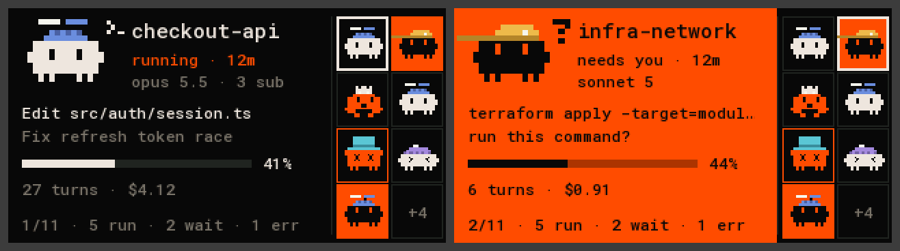

# waveshare-lcd-147: an agents deck panel on an ESP32-S3

A small desk panel for agents deck: firmware for the
[Waveshare ESP32-S3-LCD-1.47B](https://www.waveshare.com/wiki/ESP32-S3-LCD-1.47B)
(ST7789, 320×172, no touch, one BOOT button, one RGB LED). It plugs into the Mac over USB and shows
the fleet through [Deck Link](../../../docs/link/protocol.md).

Written by **belidor**, who made the original Wi-Fi panel with its drawing, mascots, hats and font.
It was adapted to Deck Link for this repository.



The board is **read-only**. It sends Hello, Subscribe and Pong (the [kit](../../deck-link) does all
three) and never a command, so it can't answer a prompt, focus a terminal or stop an agent. The
default `view` scope is all it needs.

## What the screen shows

- **Left, the hero**: one agent with its sprite and pose, name, status and age, model, what it is
  doing, context bar, turns and cost. The footer shows its position and how many agents run, wait or
  failed.
- **Right, the mini-board**: up to 8 agents in slot order. A solid orange cell is an agent that waits
  for you. The white frame marks the hero.
- The board picks the hero itself: waiting → error → finished but not reviewed ("hungry") → running →
  the rest. Equal rank: the most recent change wins.
- **BOOT button**: a short press shows the next agent and holds it for 30 s. A small square in the
  footer marks the hold. A new waiting agent ends it. The button changes only what the board shows.
- **LED**: orange flashes when an agent waits or failed, a slow blue breath while agents run, off
  otherwise.
- **Backlight**: dim when every agent is idle.
- Full-screen messages:
  - `connecting`: no answer from the deck yet.
  - `waiting for approval`: shows the board's name and the command to approve it.
  - `no agents`.
  - `deck offline`: the deck has been silent for 15 s and the board has no fleet to show yet.

  Once the board has a fleet, a silent deck keeps the last fleet on screen with `deck offline` in the
  footer.

The mascots are ported from the web UI: Claude's block with arms, the Codex onigiri, every pose, and
the pixel hat of each working folder (13 shapes, 8 colours, sent by the deck). Text is Roboto Mono
with Latin and Cyrillic.

## What it asks the deck for

- **Hello**: type `waveshare-lcd-147`, display 320×172 colour, input BUTTON, board id = the chip's
  MAC.
- **Subscribe**: every agent (`slot_count` 0), fields `TILE | CARD | PROMPT | NUMBERS`. The board
  keeps the 16 lowest slots.
  - TILE: status, age, context, hat, sub-agent count.
  - CARD: the session title, model, what the tool works on, the error message.
  - PROMPT: the waiting prompt's title and detail.
  - NUMBERS: turns and cost.
- **Clock**: the board has none. It takes the deck's time from `SnapshotBegin.server.time_ms` and from
  every `Ping` (every 5 s), then adds `millis()` since. Ages drift by at most one ping interval.

## Build, flash, connect

You need [PlatformIO](https://platformio.org/) and the daemon on the Mac (`agentctl install`).

```bash
pio run -d firmware/devices/waveshare-lcd-147 -t upload
agentctl link add /dev/cu.usbmodem1101        # the board's port: agentctl link ports
agentctl devices approve waveshare-lcd-147-<id>
```

The screen shows the exact `approve` command until you run it. There's no Wi-Fi, no pairing and no
token: the USB cable is the connection, and the deck decides what the board may see.

No wiring is needed: the display, button and LED are on the board. Pins:

| part | GPIO |
|---|---|
| LCD | DC 41, CS 42, SCK 40, MOSI 45, RST 39, backlight 46 |
| RGB LED | 38 |
| BOOT button | 0 |

The link is the chip's own USB (CDC). Opening the port with DTR low and RTS high resets the chip into
the bootloader, so the PlatformIO monitor is set to leave both alone. The daemon lets go of the port
while the flasher has it open.

## Sessions started outside agentctl

The board shows what the deck has, nothing else. A Claude session started by hand, in the background
or in the desktop app reaches the deck through the daemon:

- `agentctl live` lists them.
- `agentctl add <session>` puts one on the deck.

The board then draws it like any other agent.

## Tests and the host renderer

The drawing, the view logic, the Deck Link adapter, the tests and the host renderer are shared with
the other panels in [`firmware/panel-core`](../../panel-core); this folder holds only the board's
`main.cpp`. The 1.47" layout is `panel-core/src/layout_147.h`.

```bash
firmware/panel-core/tests/run.sh
cd firmware/panel-core
c++ -std=c++17 -Isrc -I../deck-link/src -I../deck-link/src/proto sim/render.cpp -o out/render
mkdir -p out/frames && out/render ../../docs/fixtures/state.json out/frames 300
python3 tools/ppm2png.py out/sheet.png out/frames/hero-*.ppm --cols 3    # needs pillow
```

`docs/screen.png` is `hero-00` and `hero-01` (`--cols 2 --scale 2`).

## Limits

- Landscape only. At most 16 agents in memory and 8 on the mini-board. With more than 16 agents, if
  one of the kept agents leaves, the next one appears only at the next snapshot.
- Roboto Mono has no arrows or CJK. A missing glyph is drawn as `?`.
- The serial port carries Deck Link only, so there's no debug console and no framebuffer capture over
  USB. The host renderer draws the same pixels.

## Licences

The bitmap font in `panel-core/src/font_data.h` is rendered from Roboto Mono (SIL Open Font License
1.1, `panel-core/OFL-robotomono.txt`).
