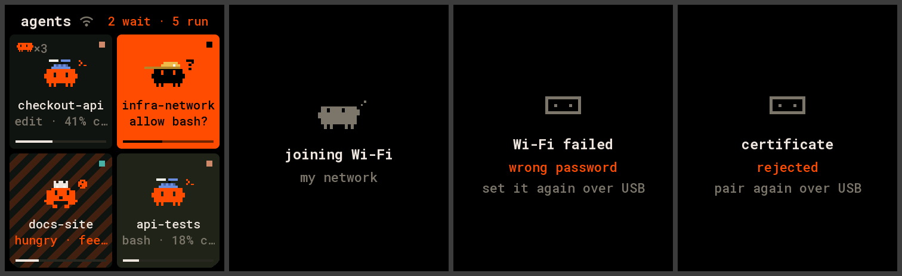

# waveshare-touch-amoled-18: the deck on a 1.8″ AMOLED

The deck on a [Waveshare ESP32-S3-Touch-AMOLED-1.8](https://www.waveshare.com/esp32-s3-touch-amoled-1.8.htm)
(368×448 AMOLED, touch), over USB or Wi-Fi with [Deck Link](../../../docs/link/protocol.md).

| home | scrolling | card | permission | question | approval |
|---|---|---|---|---|---|
|  |  |  |  |  |  |

(Rendered on the host from `docs/fixtures/state.json` by `firmware/panel-core/tools/render_docs.sh`,
with the glass's rounded corners masked. Every screen is in `docs/`.)

- **Home.** 2×2 tiles in one continuous vertical list, as on the T4-S3 panel.
  - Each tile shows the critter with its pose and hat, the name, a status line, the context bar, the
    tool chip and the subagent critter.
  - Drag to scroll. Let go and the list settles on a row; a flick carries further.
  - A thin bar on the left shows where you are while the list moves, and fades a second after it
    settles.
  - The header says how many agents wait and run.
- **Card.** Tap a tile. The card shows:
  - the critter, the name and the status pill;
  - what the agent is doing now;
  - context with the dotted bar;
  - tokens, cost and turns;
  - the last prompt.

  Round buttons at the bottom: **focus**, **interrupt** (while running), and **stop**, which you hold
  for 1 s. Focus and interrupt need scope `act`; stop needs `admin`.
- **Prompts.** A waiting agent opens its prompt: a one-line header, the whole question, the command
  (for permissions), and the answers with their hint lines. A permission is the orange card; a
  question is dark with an orange border. Answering needs scope `act`.
- **Back.** Swipe right, or press BOOT.
- **Other screens.** Waiting for approval (with the command and the board's name), connecting, deck
  offline, no agents.
- **AMOLED.** The background is true black, the screen dims when every agent is idle and nobody touched
  it for 30 s, and content stays clear of the glass's rounded corners (radius 44 px).

## Connect it

```sh
pio run -d firmware/devices/waveshare-touch-amoled-18/idf5 -e idf5 -t upload --upload-port /dev/cu.usbmodem<…>   # or the 2.0.17 build, USB only
agentctl link add /dev/cu.usbmodem<…>
agentctl devices approve waveshare-touch-amoled-18-<id>      # only with `agentctl devices auto-approve usb off`
agentctl devices scope waveshare-touch-amoled-18-<id> act    # answer, focus, interrupt; admin to stop
```

It subscribes to every agent with all fields and keeps up to 64 in PSRAM. The Hello says: display
368×448 colour, inputs TOUCH and BUTTON.

## Build and flash

| env | what |
|---|---|
| `waveshare-touch-amoled-18` (`platformio.ini`) | arduino-esp32 2.0.17: USB only (no TLS 1.3, so no Wi-Fi) |
| `debug` | the same with one-line notes on the USB port |
| `idf5` (`idf5/platformio.ini`) | arduino-esp32 3.x: USB and Wi-Fi (TLS 1.3) |
| `idf5-debug` | `idf5` with notes on the USB port (link, Wi-Fi phase, frame time, internal heap and PSRAM) |

```sh
pio run -d firmware/devices/waveshare-touch-amoled-18/idf5 -e idf5 -t upload --upload-port /dev/cu.usbmodem<…>
```

The `idf5` project keeps its platform in `~/.platformio-pioarduino` (pioarduino and PlatformIO's own
ESP32 platform clash in one home) and rebuilds arduino-esp32's libraries with
`CONFIG_MBEDTLS_SSL_PROTO_TLS1_3=y`: about five minutes the first time, and again after another
pioarduino project was built in between. If it fails with `No module named
'SCons.Tool.FortranCommon'`, see the fix in [the 2.1″ board's README](../waveshare-touch-lcd-21/README.md#wi-fi).

## Wi-Fi

On the `idf5` firmware the board also works away from the Mac, as the same device (name, scope,
audit log), over TLS 1.3 with a certificate of its own. It works as on the round boards
([the 2.1″ board's README](../waveshare-touch-lcd-21/README.md#wi-fi) has the whole story):

1. **Pair.** Plugged into the Mac and approved, it pairs by itself (toast "paired for Wi-Fi";
   `agentctl devices` shows "Wi-Fi certificate").
2. **The network.** The deck's default network (`agentctl link wifi --default --ssid "my network"`)
   goes to it by itself over USB (toast "trying Wi-Fi…", then the outcome; `agentctl link` shows
   `default my network: ok`). `agentctl link wifi waveshare-touch-amoled-18-<id> --ssid …` gives it a network of its
   own.
3. **Unplug it** and power it anywhere. At boot it listens on USB for 4 s; with no deck there it joins
   the network and connects to the deck. Plugged into the Mac again, USB wins at once.



Home on Wi-Fi with its mark, joining, a wrong password, a refused certificate. Text keeps clear of the glass's rounded corners; a toast on a notice sits low on the screen.

| screen | meaning |
|---|---|
| joining Wi-Fi · the network's name | joining the network |
| connecting · to the deck · over Wi-Fi | joined; reaching the deck |
| Wi-Fi failed · wrong password | set it again with `agentctl link wifi` (on USB); retried every minute |
| Wi-Fi failed · network not found | out of range or the name is wrong; retried every 15 s |
| deck not reachable · over Wi-Fi | the Mac is asleep, or the daemon isn't running; retried with a growing pause |
| certificate · rejected · pair again over USB | the board was revoked or paired again: plug it into the Mac |

On Wi-Fi a small Wi-Fi mark sits after "agents" in the home header; on USB there is none. The key, the certificate and the
Wi-Fi password are kept in the board's flash (NVS), not encrypted unless you turn on flash encryption:
revoke a board you lose (`agentctl devices revoke waveshare-touch-amoled-18-<id>`).

## Hardware

Pins are from Waveshare's BSP (`esp32_s3_touch_amoled_1_8` 2.0.3) and Arduino demos:

| part | pins |
|---|---|
| CO5300 AMOLED (QSPI) | CS 12, SCK 11, D0–D3 4 5 6 7; 40 MHz; 16-column offset |
| I²C | SDA 15, SCL 14: TCA9554 0x20, touch 0x15 (CST820) or 0x38 (FT3168), AXP2101 0x34 |
| TCA9554 | EXIO0 LCD reset, EXIO1 panel supply, EXIO2 touch reset |
| BOOT | GPIO0 |

The first revision of the board had an SH8601 panel with FT3168 touch. The firmware detects it by the
touch address and drops the column offset, as Waveshare's BSP does. That revision is untested. The
AXP2101 stays at its power-on defaults, as in Waveshare's code. Brightness is the panel's own (0x51).

`pio run -e debug` adds one-line notes on the USB port for bring-up (frame time, Deck Link rx / bad /
overflow counters); the deck ignores them.

## Code

`src/main.cpp` is only the board. The layout, the touch UI and Deck Link are shared with the other
panels in [`firmware/panel-core`](../../panel-core) (`layout_square.h`, `specAmoled18()`).
