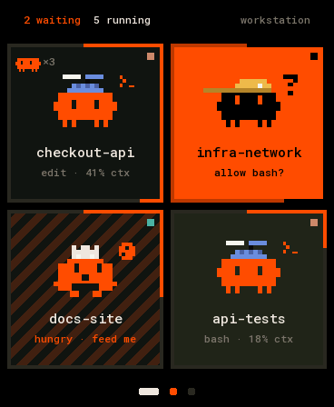
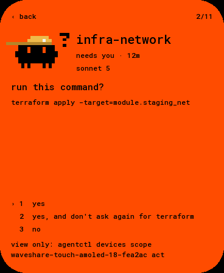
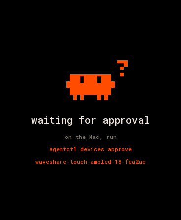

# waveshare-touch-amoled-18: the deck on a 1.8″ AMOLED

The deck on a [Waveshare ESP32-S3-Touch-AMOLED-1.8](https://www.waveshare.com/esp32-s3-touch-amoled-1.8.htm)
(368×448 AMOLED, touch), over USB with [Deck Link](../../../docs/link/protocol.md). It uses the same tile
as the 4″ panel and the desk panel, scaled up, four to a page.

| grid | card | prompt (scope view) | approval |
|---|---|---|---|
|  |  |  |  |

(Rendered on the host from `docs/fixtures/state.json` by `firmware/panel-core/tools/render_docs.sh`,
with the glass's rounded corners masked.)

- **Grid.** Two by two, in slot order.
  - The header counts who's waiting and who's running, and names the deck.
  - The footer has a dot per page (orange when an agent there needs you).
  - The tiles are the deck's: critter, hat, title, status line, context along the border, hungry stripes, the subagent critter, the tool chip.
- **Pages.** Swipe up or left for the next page, down or right for the previous one; BOOT also pages.
- **Card and prompts.** Tap a tile.
  - The card and the prompt answers work as on the 4″ panel.
  - Answer buttons need scope `act`.
  - Tap **‹ back**, swipe right or press BOOT to return.
- **AMOLED.**
  - The background is true black.
  - The screen dims when every agent is idle and nobody touched it for 30 s.
  - Content stays clear of the glass's rounded corners (radius taken as 44 px).

## Connect it

```sh
pio run -d firmware/devices/waveshare-touch-amoled-18 -t upload --upload-port /dev/cu.usbmodem<…>
agentctl link add /dev/cu.usbmodem<…>
agentctl devices approve waveshare-touch-amoled-18-<id>
agentctl devices scope waveshare-touch-amoled-18-<id> act    # to answer prompts from it
```

It subscribes to every agent with all fields and keeps up to 64 in PSRAM. The Hello says: display
368×448 colour, inputs TOUCH and BUTTON.

## Hardware

Pins are from Waveshare's BSP (`esp32_s3_touch_amoled_1_8` 2.0.3) and Arduino demos:

| part | pins |
|---|---|
| CO5300 AMOLED (QSPI) | CS 12, SCK 11, D0–D3 4 5 6 7; 40 MHz; 16-column offset |
| I²C | SDA 15, SCL 14: TCA9554 0x20, touch 0x15 (CST820) or 0x38 (FT3168), AXP2101 0x34 |
| TCA9554 | EXIO0 LCD reset, EXIO1 panel supply, EXIO2 touch reset |
| BOOT | GPIO0 |

The first revision of the board had an SH8601 panel with FT3168 touch. The firmware detects it by the
touch address and drops the column offset, as Waveshare's BSP does. That revision is untested. The
AXP2101 stays at its power-on defaults, as in Waveshare's code. Brightness is the panel's own (0x51).

`pio run -e debug` adds one-line notes on the USB port for bring-up.

## Code

`src/main.cpp` is only the board. The layout, the touch UI and Deck Link are shared with the other
panels in [`firmware/panel-core`](../../panel-core) (`layout_grid.h`, `layoutAmoled18()`).
