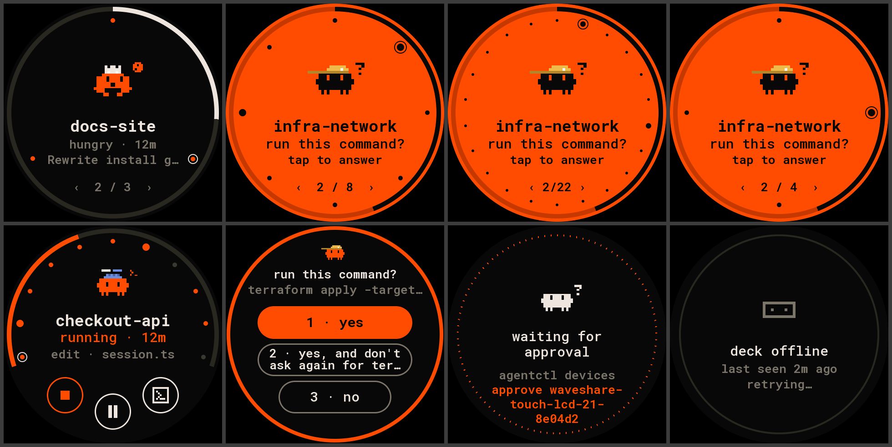

# waveshare-touch-lcd-21: Dial, the deck on a round 2.1″ screen

Firmware for the [Waveshare ESP32-S3-Touch-LCD-2.1](https://www.waveshare.com/wiki/ESP32-S3-Touch-LCD-2.1)
(round 480×480 ST7701 on RGB, CST820 touch, ESP32-S3 with 8 MB PSRAM). It plugs into the Mac over USB
and shows the fleet through [Deck Link](../../../docs/link/protocol.md).



> Not yet run on the board: everything here builds, and the screens above come from the host
> renderer, which draws the same pixels. See [Bring-up](#bring-up).

## What the screen shows

- **Home, the dial**: the orbit, reduced. One agent fills the face, with its critter, name, status
  and age, and what it is doing. Every agent is a dot on an inner ring (orange working, hungry or
  failed; a bigger dot when it waits; grey idle), the shown one circled, and "‹ 2 / 8 ›" under it.
  The outer ring is the shown agent's context use. Swipe left or right to change agent. It starts on
  the agent that matters most: the one waiting longest, then hungry, then failed, then the busiest.
- **Someone waits.** The dial jumps to it and the whole face turns orange, like the deck's needs-you
  tile, with its question and "tap to answer". It never jumps straight into the prompt, so a stray
  touch can't answer.
- **Detail** (tap the middle). The context bar runs over the top (three fifths of the circle, leaving
  room for bigger buttons) with the fleet's dots inside it; then the critter, name, status and age,
  and what it is doing. Round buttons on the bottom arc:
  focus (its terminal comes to the front), interrupt (while it runs) and stop (orange: hold it for a
  second while its ring fills). Swipe left or right for the neighbouring agent, down to go back.
- **Prompt** (tap the middle when it waits, or the detail's middle). The question and its answers as
  pills; the first answer is filled orange. A tap answers (`Answer` with the prompt's id), shows
  "sent" for a second, then goes back. More than three answers scroll with swipes up and down.
- After 30 s untouched it goes back home, to the agent that matters most. The backlight dims after 2 minutes with nothing going on.
- Full-screen states: connecting, waiting for approval (with the exact `agentctl devices approve`
  command), deck offline (with when it was last heard), no agents.

`docs/` has every screen: `home-3`, `home-8`, `home-22` (the dial with 3, 8 and 22 agents), `waiting`, `detail`, `detail-stop-held`,
`prompt`, `prompt-view`, `not-approved`, `offline`, `connecting`.

## Scope

New boards start at `view`: the board shows everything, the prompt reads "answer on the deck" and
the detail has no buttons. Give it `act` to answer prompts, focus and interrupt; `admin` adds stop
(which ends the agent and takes it off the deck):

```bash
agentctl devices scope waveshare-touch-lcd-21-<id> act
```

## What it asks the deck for

- **Hello**: type `waveshare-touch-lcd-21`, display 480×480 colour, input TOUCH, board id = the
  chip's MAC.
- **Subscribe**: every agent, fields `TILE | CARD | PROMPT | NUMBERS` (CARD for the detail's model,
  effort and activity). The board keeps up to 64 agents in PSRAM.
- **Commands**: `Answer`, `Focus`, `Interrupt` (scope act), `Dismiss` for stop (scope admin).

## Build, flash, connect

```bash
pio run -d firmware/devices/waveshare-touch-lcd-21 -t upload
agentctl link add /dev/cu.usbmodem1101        # the board's port: agentctl link ports
agentctl devices approve waveshare-touch-lcd-21-<id>
```

`-e debug` builds the same firmware with one-line notes on the USB port (the deck ignores text).

## Pins

From Waveshare's demo for this board (`ESP32-S3-Touch-LCD-2.1-Demo.zip` on the wiki,
`Arduino/examples/LVGL_Arduino`), checked against its ESP-IDF demo.

| part | GPIO |
|---|---|
| RGB bus | DE 40, VSYNC 39, HSYNC 38, PCLK 41; R 46 3 8 18 17; G 14 13 12 11 10 9; B 5 45 48 47 21 |
| ST7701 init (3-wire SPI, 9 bit) | SCK 2, SDA 1, CS on the expander's EXIO3 |
| I2C (expander, touch) | SDA 15, SCL 7 |
| CST820 touch | address 0x15, INT 16, reset EXIO2; auto sleep off (0xFE = 0xFF) |
| TCA9554 expander (0x20) | EXIO1 LCD reset, EXIO2 touch reset, EXIO3 LCD CS, EXIO4 SD CS, EXIO8 buzzer |
| backlight | 6 (PWM, 20 kHz) |
| BOOT button | 0 (back home) |

RGB timing: hsync 8 / 10 / 50 (pulse, back, front), vsync 3 / 8 / 8, 16-bit RGB565, pixel clock
16 MHz, as in Waveshare's Arduino demo. The panel's init sequence is Waveshare's, byte for byte (`src/main.cpp`).

## Bring-up

What still needs the real board:

- **Pixel clock.** 16 MHz as in Waveshare's Arduino demo, but without its bounce buffer (that needs
  arduino-esp32 3.x; this build is on 2.0.17 with Arduino_GFX 1.5.0). If the picture drifts, lower it.
- **Orientation and colour order** of panel and touch (the demos map touch straight to pixels).
- **The expander's power-up**: the buzzer is on until EXIO8 goes low; the firmware does that first.
- Frame time on the chip (`-e debug` prints it every 5 s), touch feel (tap slop, swipe length, the 1 s hold), and the backlight levels.
- `agentctl link check` against the board.

## Tests and the host renderer

The layout is `panel-core/src/layout_dial.h`; the detail, prompt and notices it shares with the
2.8″ Orbit are in `round_ui.h`, the state machine in `round_view.h`, the circle geometry in
`round_geom.h`.

```bash
firmware/panel-core/tests/run.sh
cd firmware/panel-core
c++ -std=c++17 -DPANEL_MAX_AGENTS=64 -Isrc -I../deck-link/src -I../deck-link/src/proto sim/render.cpp -o out/render
mkdir -p out/dial && out/render ../../docs/fixtures/state.json out/dial 0 dial
python3 tools/ppm2png.py out/dial.png out/dial/home-*.ppm --cols 3    # needs pillow
```
