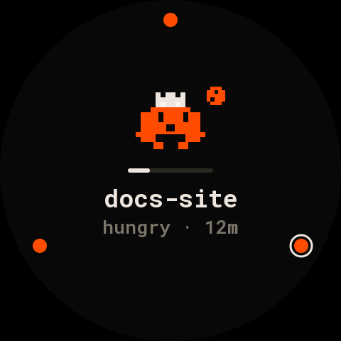
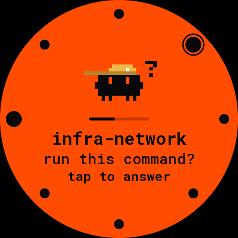
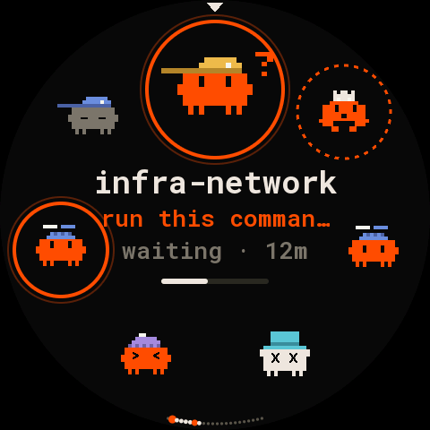
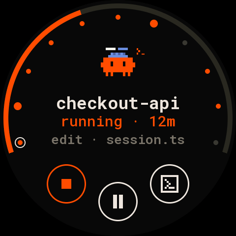
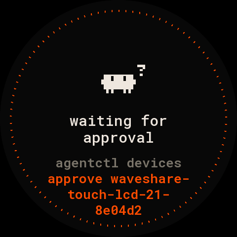
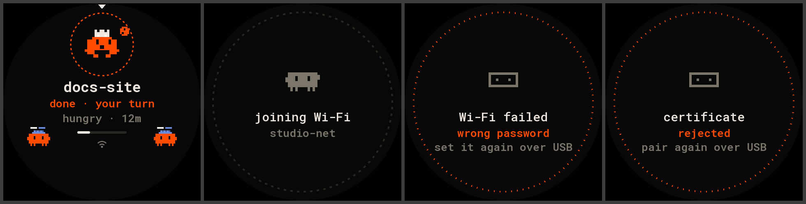
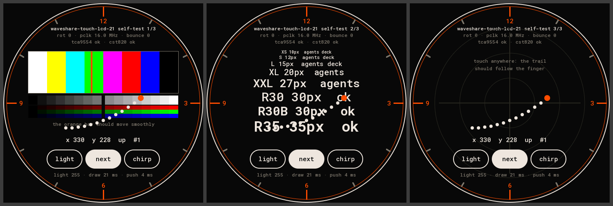

# waveshare-touch-lcd-21: Dial, the deck on a round 2.1″ screen

Firmware for the [Waveshare ESP32-S3-Touch-LCD-2.1](https://www.waveshare.com/wiki/ESP32-S3-Touch-LCD-2.1):
one agent at a time, the whole fleet as dots round it. It plugs into the Mac over USB and
talks to the deck through [Deck Link](../../../docs/link/protocol.md).


> Runs on the board. The self-test showed steady colour bars with the `idf5` build; on the default
> build (arduino-esp32 2.0.17, no RGB bounce buffer) the picture flickers, so flash `idf5` on
> this board. The screens above come from the host renderer, which draws the same pixels.

## Parts

- Waveshare ESP32-S3-Touch-LCD-2.1: a round 480×480 IPS panel (ST7701, RGB), CST820 touch, ESP32-S3
  with 8 MB PSRAM and 16 MB flash, a TCA9554 IO expander, a buzzer.
- A USB-C data cable to the Mac. Nothing to wire: the board's own USB is the link.

## What the screen shows

- **Home, the dial**: the orbit, reduced. One agent fills the face with its critter, name, status
  and age, and what it is doing. Every agent is a dot on an inner ring:
  - orange: working, hungry or failed;
  - a bigger orange dot: waiting;
  - grey: idle.

  The shown agent's dot is circled, with "‹ 2 / 8 ›" under the face. The outer ring is the shown
  agent's context use. The dial starts on the agent that matters most: the one waiting longest, then
  hungry, then failed, then the busiest.
- **Someone waits.** The dial jumps to it and the whole face turns orange, like the deck's
  needs-you tile, with its question and "tap to answer". It never opens the prompt by itself, so a
  stray touch can't answer.
- **Detail.** The context bar runs over the top (three fifths of the circle, leaving room for the
  buttons), with the fleet's dots inside it. Below it: the critter, the name, status and age, and
  what the agent is doing. Round buttons on the bottom
  arc: focus (brings its terminal to the front), interrupt (only while it runs), and stop (orange:
  hold it for a second while its ring fills).
- **Prompt.** The question and its answers as pills; the suggested answer is filled orange. A tap
  answers, shows "sent" for a second, then goes back. With more than three answers, the list
  scrolls.
- **Full-screen states**: connecting; waiting for approval (with the exact command); deck offline
  (with when it was last heard); no agents.
- **Backlight**: dims after 2 minutes with nothing going on.

| home, 3 agents | 8, two waiting | 22 | detail | prompt | waiting for approval |
|---|---|---|---|---|---|
|  |  |  |  |  |  |

## Gestures

| where | gesture | does |
|---|---|---|
| home | slide a finger round the outer ring | the agent under the finger, live; it stays when you let go |
| home | swipe left / right | the next / previous agent |
| home | tap the middle | the shown agent's prompt when it waits, else its detail |
| detail | swipe left / right | the next / previous agent in slot order |
| detail | tap the middle (when it waits) | its prompt |
| detail | tap focus / interrupt; hold stop 1 s | sends Focus / Interrupt / Dismiss |
| prompt | tap a pill | answers; swipe up / down scrolls a long list |
| detail, prompt | swipe down, or tap "×" (the detail's bottom row, the prompt's top) | back |
| detail | tap the big critter | home |
| anywhere | 30 s untouched, or the BOOT button | home, on the agent that matters most |

## Scope

New boards start at `view`: everything shows, but the prompt reads "answer on the deck" and the
detail has no buttons.

- `act` adds answering, focus and interrupt.
- `admin` also adds stop. Stop ends the agent and takes it off the deck. A board with only `act`
  never shows the stop button, so it never shows a button that would fail.

## Build and flash

You need [PlatformIO](https://platformio.org/). From the repository's root:

| env | what | flash |
|---|---|---|
| `selftest` | the hardware self-test, no Deck Link | `pio run -d firmware/devices/waveshare-touch-lcd-21 -e selftest -t upload` |
| `waveshare-touch-lcd-21` | the firmware (default) | `pio run -d firmware/devices/waveshare-touch-lcd-21 -t upload` |
| `debug` | the firmware, plus a line per touch and gesture and a status line every 5 s on the USB port | `pio run -d firmware/devices/waveshare-touch-lcd-21 -e debug -t upload` |
| `idf5` | the firmware on arduino-esp32 3.x with an RGB bounce buffer: the fallback if the picture drifts | `pio run -d firmware/devices/waveshare-touch-lcd-21/idf5 -e idf5 -t upload` |
| `idf5-debug` | `idf5` with the debug lines | `pio run -d firmware/devices/waveshare-touch-lcd-21/idf5 -e idf5-debug -t upload` |
| `idf5-selftest` | the self-test on that platform | `pio run -d firmware/devices/waveshare-touch-lcd-21/idf5 -e idf5-selftest -t upload` |

The `idf5` project keeps its platform in `~/.platformio-pioarduino`. pioarduino and PlatformIO's own
ESP32 platform clash in one PlatformIO home. Its first build downloads about 1 GB.

Settings, in `build_flags` of either `platformio.ini`:

| flag | default | |
|---|---|---|
| `ROUND_ROTATION` | `0` | `0`, `90`, `180` or `270`: turns the image clockwise, and the touch with it |
| `ROUND_PCLK_HZ` | `16000000` | the RGB pixel clock |
| `ROUND_BOUNCE_PX` | `4800` (idf5 only) | the RGB bounce buffer, in pixels |

If the board won't take an upload, hold BOOT while you plug it in.

## Connect it to the deck

```bash
agentctl link ports                                         # find the board's port
agentctl link add /dev/cu.usbmodem1101
agentctl devices approve waveshare-touch-lcd-21-<id>       # the screen shows the exact name
agentctl devices scope waveshare-touch-lcd-21-<id> act     # to answer, focus and interrupt
```

The board says Hello as type `waveshare-touch-lcd-21`, display 480×480 colour, input TOUCH. It
subscribes to every agent with `TILE | CARD | PROMPT | NUMBERS` and keeps up to 64 agents. The
commands it sends:

- `Answer`, `Focus` and `Interrupt` (scope act);
- `Dismiss` for stop (scope admin).

On `idf5` it also pairs for Wi-Fi (`CertRequest`), takes Wi-Fi credentials (`WifiConfig`) and reports
how it is connected (`NetStatus`): see [Wi-Fi](#wi-fi).

## Wi-Fi

On the `idf5` firmware the board also works away from the Mac: on Wi-Fi it reaches the deck over TLS
1.3 with a certificate of its own, as the same device (same name, scope and audit log). The default
build (arduino-esp32 2.0.17) has no TLS 1.3, so it stays on USB.

1. **Pair.** Nothing to do: plugged into the Mac and approved, the board makes a key on the chip and
   gets its certificate from the deck over USB (a toast says "paired for Wi-Fi"). `agentctl devices`
   then shows "Wi-Fi certificate" for it.
2. **Give it your network**, while it is on USB:

   ```bash
   agentctl link wifi waveshare-touch-lcd-21-<id> --ssid "my network"     # asks for the password
   ```

   The password goes over the cable to the board's flash and nowhere else. The board tries the network
   at once (toast: "trying Wi-Fi…", then "Wi-Fi works" or what went wrong) and the command prints the
   outcome. `--forget` drops it again.
3. **Unplug it from the Mac** and power it anywhere (a USB charger). At boot it listens on USB for 4
   seconds; when no deck answers there, it joins the network and connects to the deck.

What the screen shows on the way (home on Wi-Fi with its mark, joining, a wrong password, a refused
certificate):



| screen | meaning |
|---|---|
| joining Wi-Fi · the network's name | joining the network |
| connecting · to the deck · over Wi-Fi | joined; reaching the deck (its `.local` name, then its addresses) |
| Wi-Fi failed · wrong password | set it again with `agentctl link wifi` (on USB); retried every minute |
| Wi-Fi failed · network not found | out of range or the name is wrong; retried every 15 s |
| deck not reachable · over Wi-Fi | the Mac is asleep, or the daemon isn't running; retried with a growing pause |
| certificate rejected · pair again over USB | the board was revoked or paired again: plug it into the Mac |

On Wi-Fi a small Wi-Fi mark sits under the middle of the home screen; on USB there is none. Plugged
into the Mac again, the board switches to USB at once (USB always wins, so pairing and recovery work
over the cable), and a board on USB whose deck goes quiet for 30 s tries Wi-Fi meanwhile.

```bash
agentctl link                       # every board: via usb or wifi, its address and signal
agentctl link pair waveshare-touch-lcd-21-<id>           # a new certificate (it pairs again over USB)
agentctl devices revoke waveshare-touch-lcd-21-<id>      # cut it off on USB and Wi-Fi
```

The key, the certificate and the Wi-Fi password are kept in the board's flash (NVS). It isn't
encrypted unless you turn on flash encryption: revoke a board you lose.

The `idf5` project rebuilds arduino-esp32's libraries with `CONFIG_MBEDTLS_SSL_PROTO_TLS1_3=y`
(pioarduino's `custom_sdkconfig`; about five minutes the first time, and again whenever another
pioarduino project, such as the other round board's, was built in between: they share `~/.platformio-pioarduino`). If that build fails with
`No module named 'SCons.Tool.FortranCommon'`, pioarduino and PlatformIO Core disagree about their
SCons package; once, give the platform PlatformIO's own:

```bash
rm -rf ~/.platformio-pioarduino/packages/tool-scons
cp -R ~/.platformio/packages/tool-scons ~/.platformio-pioarduino/packages/tool-scons
python3 -c "import json,os;p=os.path.expanduser('~/.platformio-pioarduino/packages/tool-scons/package.json');d=json.load(open(p));d['version']='4.40801.0';json.dump(d,open(p,'w'))"
```

## The self-test



The `selftest` env runs without Deck Link. A "next" pill turns its three pages: colour, text, touch.
On every page, the top lines show:

- the build settings (rotation, pixel clock, bounce buffer);
- what the board found (`tca9554 ok · cst820 ok`).

The bottom line shows the draw and push time of each frame. The port prints the same once in a while
(`pio device monitor`). What to look at:

| question | look at | if it's wrong |
|---|---|---|
| does the panel start, are the colours right? | page 1: white, yellow, cyan, green, magenta, red, blue, black from left to right; smooth grey, red, green and blue ramps | colours swapped: the RGB data pin order; no picture: the init or the expander line |
| is the picture still, without drift or tearing? | page 1: the orange bar sweeping across the bars | lower `ROUND_PCLK_HZ` (try 12000000); still bad: flash `idf5-selftest` |
| which way is up? | the 12 mark at the top of the glass | set `ROUND_ROTATION` so 12 is at the top |
| is the whole circle visible and centred? | the white and orange circles at the edge | an offset to report |
| does touch land where the finger is? | page 3: the trail and x / y | off by a turn: `ROUND_ROTATION`; mirrored: report it |
| is the buzzer quiet by default? | silence at boot; "chirp" beeps for 80 ms | a buzzer that sounds at boot: the expander's power-up |
| does the backlight dim? | "light" steps 255, 128, 48, 12 | |
| how fast is a frame? | "draw … ms · push … ms" | |
| is text readable at 26 px and up? | page 2, every size | |

## First power-on

1. **Self-test.** Flash `selftest` and go through the table above. Fix `ROUND_ROTATION` or
   `ROUND_PCLK_HZ` if needed, or move to `idf5-selftest`.
2. **The firmware.** Flash the default env (or `idf5`) with the same settings. The screen shows
   "connecting", then "waiting for approval" once `agentctl link add` has the port.
3. **Approve.** Run `agentctl devices approve` with the name on the screen, then `scope … act`. The
   dial appears. Optionally run `agentctl link check <port>` before `link add`: it plays a demo deck
   and reports on the handshake, pings and recovery.

## Pins

From Waveshare's demo for this board (`ESP32-S3-Touch-LCD-2.1-Demo.zip` on the wiki,
`Arduino/examples/LVGL_Arduino`), checked against its ESP-IDF demo. The 2.8C board has the same
wiring; `panel-core/src/waveshare_round.h` holds it.

| part | GPIO |
|---|---|
| RGB bus | DE 40, VSYNC 39, HSYNC 38, PCLK 41; R 46 3 8 18 17; G 14 13 12 11 10 9; B 5 45 48 47 21 |
| ST7701 init (3-wire SPI, 9 bit) | SCK 2, SDA 1, CS on the expander's EXIO3 |
| I2C (expander, touch) | SDA 15, SCL 7 |
| CST820 touch | address 0x15, INT 16, reset EXIO2; auto sleep off (0xFE = 0xFF) |
| TCA9554 expander (0x20) | EXIO1 LCD reset, EXIO2 touch reset, EXIO3 LCD CS, EXIO4 SD CS, EXIO8 buzzer |
| backlight | 6 (PWM, 20 kHz) |
| BOOT button | 0 |

RGB timing:
- hsync: pulse 8, back porch 10, front porch 50;
- vsync: pulse 3, back porch 8, front porch 8;
- 16-bit RGB565.

The panel's init sequence is Waveshare's, byte for byte (`src/main.cpp`).

## Tests and the host renderer

- The layout is `panel-core/src/layout_dial.h`.
- The detail, prompt and notices it shares with the 2.8″ Orbit are in `round_ui.h`.
- The state machine is in `round_view.h`.
- `sim/round_sim.cpp` runs it all against a deck over stdin and stdout; the Go test
  `backend/internal/link/round_test.go` does that with the real deck code.

```bash
firmware/panel-core/tests/run.sh
cd backend && go test ./internal/link -run TestRoundBoard
firmware/panel-core/tools/render_docs.sh      # docs/, needs pillow
```
