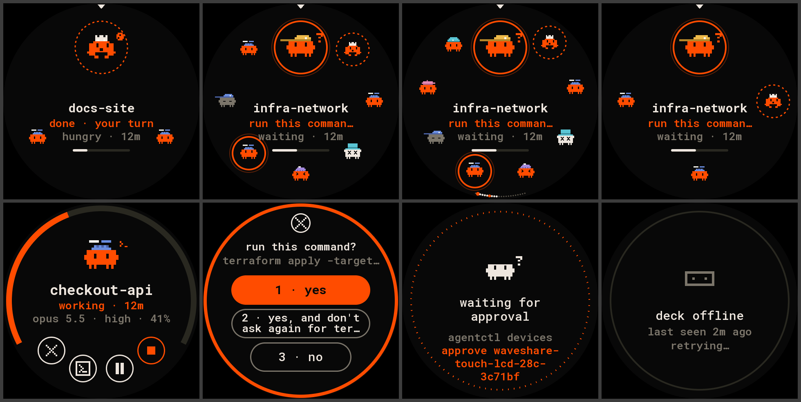
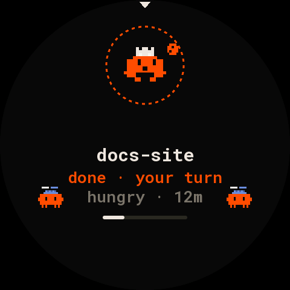
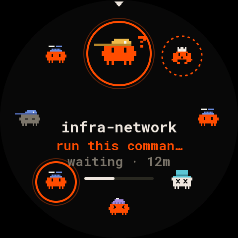
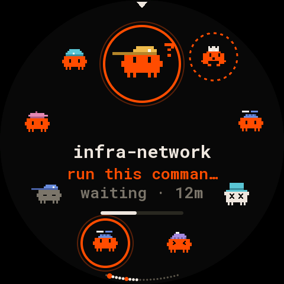
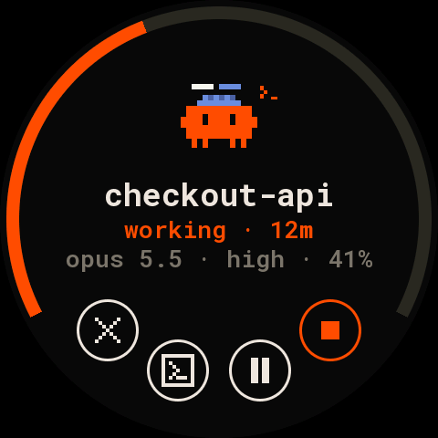
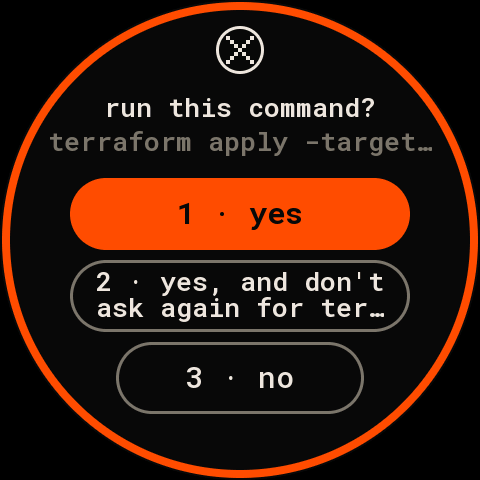
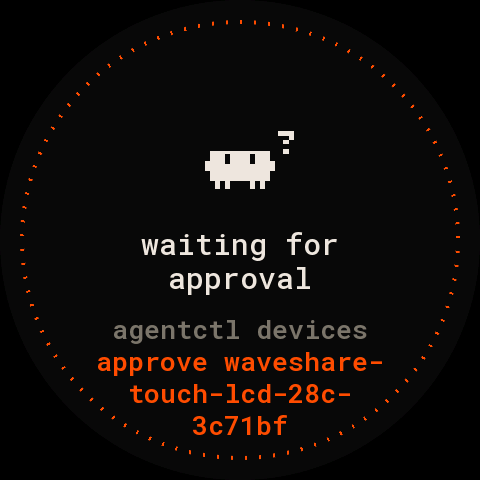
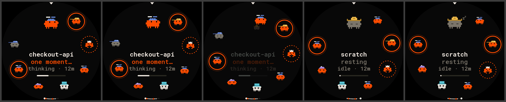
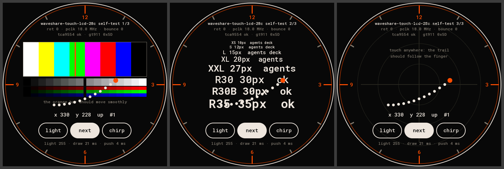

# waveshare-touch-lcd-28c: the deck on a round 2.8″ screen

Firmware for the [Waveshare ESP32-S3-Touch-LCD-2.8C](https://www.waveshare.com/wiki/ESP32-S3-Touch-LCD-2.8C):
the agents on a spring, one turn of nine round the selected one. It plugs into the Mac over USB and
talks to the deck through [Deck Link](../../../docs/link/protocol.md).



> Not yet run on the board. Everything builds, the screens above come from the host renderer (the
> same pixels), and the board's logic has answered a prompt through the real deck in a test. The
> [first power-on](#first-power-on) takes about ten minutes.

## Parts

- Waveshare ESP32-S3-Touch-LCD-2.8C: a round 480×480 IPS panel (ST7701, RGB), GT911 touch, ESP32-S3
  with 8 MB PSRAM and 16 MB flash, a TCA9554 IO expander, a buzzer.
- A USB-C data cable to the Mac. Nothing to wire: the board's own USB is the link.

## What the screen shows

- **Home, the spring.** The agents sit on a spring, in deck slot order, and the screen shows one
  turn of it: the selected agent large at 12 o'clock under a small pointer, the next 8 clockwise
  round the ring (×3; the selected one ×5). The middle is the selected agent: its name, a
  phrase ("one moment…" while it thinks, "on it…" while it works, its question when it waits, "done ·
  your turn" when it finished and you haven't looked, "resting", "hit an error"), its state and age,
  and its context bar. Turning the ring one step brings the next agent up from under the pointer and
  sends the last one on the turn down under it; after the last agent comes the first again.
  - A waiting agent has a solid orange ring round it; a finished one you haven't seen, a dashed one.
    Working critters move; idle ones are grey.
  - Up to 9 agents the ring is a closed loop, spread evenly, and nothing goes under the pointer.
  - More than 9: a short row of dots at 6 o'clock, one per agent. The ones on screen are white,
    the selected one larger, waiting ones orange.
  - Someone waits where you can't see them: an orange arc on the rim points to the side to pull up.
    Leave the board alone for 10 s and the ring turns to them by itself. It never opens the prompt
    by itself, so a stray touch can't answer.

  The screen starts on the agent that matters most: the one waiting longest, then hungry, then
  failed, then the busiest.
- **Detail.** The context bar runs over the top, from 8 to 4 o'clock. Below it: the critter, the
  name, status and age, model and effort, and what the agent is doing. Round buttons on the bottom
  arc: focus (brings its terminal to the front), interrupt (only while it runs), and stop (orange:
  hold it for a second while its ring fills).
- **Prompt.** The question and its answers as pills; the suggested answer is filled orange. A tap
  answers, shows "sent" for a second, then goes back. With more than three answers, the list
  scrolls.
- **Full-screen states**: connecting; waiting for approval (with the exact command); deck offline
  (with when it was last heard); no agents.
- **Backlight**: dims after 2 minutes with nothing going on.

| home, 3 agents | 8, two waiting | 22 | detail | prompt | waiting for approval |
|---|---|---|---|---|---|
|  |  |  |  |  |  |

One step clockwise, 300 ms (frames 0, 2, 4, 7 and 9 of 9):



## Gestures

| where | gesture | does |
|---|---|---|
| home | drag a finger round the ring | the ring follows it, one agent per 40°, and settles on the nearest when you let go; flick it and it keeps turning (at most one turn) |
| home | swipe left / right across the middle | the next / previous agent |
| home | tap an agent on the ring | turns it to the top, the short way |
| home | tap the selected agent or the middle | its prompt when it waits, else its detail |
| detail | swipe left / right | the next / previous agent in slot order |
| detail | tap the middle (when it waits) | its prompt |
| detail | tap focus / interrupt; hold stop 1 s | sends Focus / Interrupt / Dismiss |
| prompt | tap a pill | answers; swipe up / down scrolls a long list |
| detail, prompt | swipe down, or tap "×" (the detail's bottom row, the prompt's top) | back |
| detail, prompt | pinch in with two fingers | home |
| detail | tap the big critter | home |
| anywhere | 30 s untouched, or the BOOT button | home |

## Scope

New boards start at `view`: everything shows, but the prompt reads "answer on the deck" and the
detail has no buttons.

- `act` adds answering, focus and interrupt.
- `admin` also adds stop. Stop ends the agent and takes it off the deck. A board with only `act`
  never shows the stop button, so it never shows a button that would fail.

## Build and flash

You need [PlatformIO](https://platformio.org/). From the repository's root:

| env | what | flash |
|---|---|---|
| `selftest` | the hardware self-test, no Deck Link | `pio run -d firmware/devices/waveshare-touch-lcd-28c -e selftest -t upload` |
| `waveshare-touch-lcd-28c` | the firmware (default) | `pio run -d firmware/devices/waveshare-touch-lcd-28c -t upload` |
| `debug` | the firmware, plus a line per touch and gesture and a status line every 5 s on the USB port | `pio run -d firmware/devices/waveshare-touch-lcd-28c -e debug -t upload` |
| `idf5` | the firmware on arduino-esp32 3.x with an RGB bounce buffer: the fallback if the picture drifts | `pio run -d firmware/devices/waveshare-touch-lcd-28c/idf5 -e idf5 -t upload` |
| `idf5-debug` | `idf5` with the debug lines | `pio run -d firmware/devices/waveshare-touch-lcd-28c/idf5 -e idf5-debug -t upload` |
| `idf5-selftest` | the self-test on that platform | `pio run -d firmware/devices/waveshare-touch-lcd-28c/idf5 -e idf5-selftest -t upload` |

The `idf5` project keeps its platform in `~/.platformio-pioarduino`. pioarduino and PlatformIO's own
ESP32 platform clash in one PlatformIO home. Its first build downloads about 1 GB.

Settings, in `build_flags` of either `platformio.ini`:

| flag | default | |
|---|---|---|
| `ROUND_ROTATION` | `0` | `0`, `90`, `180` or `270`: turns the image clockwise, and the touch with it |
| `ROUND_PCLK_HZ` | `18000000` | the RGB pixel clock |
| `ROUND_BOUNCE_PX` | `4800` (idf5 only) | the RGB bounce buffer, in pixels |

If the board won't take an upload, hold BOOT while you plug it in.

## Connect it to the deck

```bash
agentctl link ports                                         # find the board's port
agentctl link add /dev/cu.usbmodem1101
agentctl devices approve waveshare-touch-lcd-28c-<id>       # the screen shows the exact name
agentctl devices scope waveshare-touch-lcd-28c-<id> act     # to answer, focus and interrupt
```

The board says Hello as type `waveshare-touch-lcd-28c`, display 480×480 colour, input TOUCH. It
subscribes to every agent with `TILE | CARD | PROMPT | NUMBERS` and keeps up to 64 agents. The
commands it sends:

- `Answer`, `Focus` and `Interrupt` (scope act);
- `Dismiss` for stop (scope admin).

## The self-test



The `selftest` env runs without Deck Link. A "next" pill turns its three pages: colour, text, touch.
On every page, the top lines show:

- the build settings (rotation, pixel clock, bounce buffer);
- what the board found (`tca9554 ok · gt911 0x5D`).

The bottom line shows the draw and push time of each frame. The port prints the same once in a while
(`pio device monitor`). What to look at:

| question | look at | if it's wrong |
|---|---|---|
| does the panel start, are the colours right? | page 1: white, yellow, cyan, green, magenta, red, blue, black from left to right; smooth grey, red, green and blue ramps | colours swapped: the RGB data pin order; no picture: the init or the expander line |
| is the picture still, without drift or tearing? | page 1: the orange bar sweeping across the bars | lower `ROUND_PCLK_HZ` (try 14000000); still bad: flash `idf5-selftest` |
| which way is up? | the 12 mark at the top of the glass | set `ROUND_ROTATION` so 12 is at the top |
| is the whole circle visible and centred? | the white and orange circles at the edge | an offset to report |
| does touch land where the finger is? | page 3: the trail and x / y | off by a turn: `ROUND_ROTATION`; mirrored: report it |
| is the buzzer quiet by default? | silence at boot; "chirp" beeps for 80 ms | a buzzer that sounds at boot: the expander's power-up |
| does the backlight dim? | "light" steps 255, 128, 48, 12 | |
| how fast is a frame? | "draw … ms · push … ms" | |
| is text readable at 26 px and up? | page 2, every size | |

## First power-on

1. **Self-test.** Flash `selftest` and go through the table above. Fix `ROUND_ROTATION` or
   `ROUND_PCLK_HZ` if needed, or move to `idf5-selftest`.
2. **The firmware.** Flash the default env (or `idf5`) with the same settings. The screen shows
   "connecting", then "waiting for approval" once `agentctl link add` has the port.
3. **Approve.** Run `agentctl devices approve` with the name on the screen, then `scope … act`. The
   orbit appears. Optionally run `agentctl link check <port>` before `link add`: it plays a demo deck
   and reports on the handshake, pings and recovery.

## Pins

From Waveshare's demo for this board (`ESP32-S3-Touch-LCD-2.8C-Demo.zip` on the wiki,
`Arduino/examples/LVGL_Arduino`), checked against its ESP-IDF demo. The 2.1″ board has the same
wiring; `panel-core/src/waveshare_round.h` holds it.

| part | GPIO |
|---|---|
| RGB bus | DE 40, VSYNC 39, HSYNC 38, PCLK 41; R 46 3 8 18 17; G 14 13 12 11 10 9; B 5 45 48 47 21 |
| ST7701 init (3-wire SPI, 9 bit) | SCK 2, SDA 1, CS on the expander's EXIO3 |
| I2C (expander, touch) | SDA 15, SCL 7 |
| GT911 touch | address 0x5D (INT held low during reset), INT 16, reset EXIO2 |
| TCA9554 expander (0x20) | EXIO1 LCD reset, EXIO2 touch reset, EXIO3 LCD CS, EXIO4 SD CS, EXIO8 buzzer |
| backlight | 6 (PWM, 20 kHz) |
| BOOT button | 0 |

RGB timing:
- hsync: pulse 8, back porch 10, front porch 50;
- vsync: pulse 2, back porch 18, front porch 8;
- 16-bit RGB565.

The panel's init sequence is Waveshare's, byte for byte (`src/main.cpp`).

## Tests and the host renderer

- The home is `panel-core/src/layout_spring.h` (`layoutSpring28()`), its geometry and motion
  `spring.h`. Build with `-DROUND_ORBIT_CLASSIC` for the earlier Orbit home (`layout_orbit.h`).
- The detail, prompt and notices it shares with the 2.1″ Dial are in `round_ui.h`.
- The state machine is in `round_view.h`.
- `sim/round_sim.cpp` runs it all against a deck over stdin and stdout; the Go test
  `backend/internal/link/round_test.go` does that with the real deck code.

```bash
firmware/panel-core/tests/run.sh
cd backend && go test ./internal/link -run TestRoundBoard
firmware/panel-core/tools/render_docs.sh      # docs/, needs pillow
```
