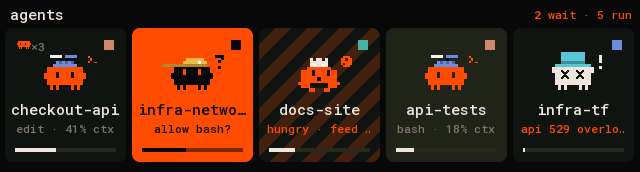
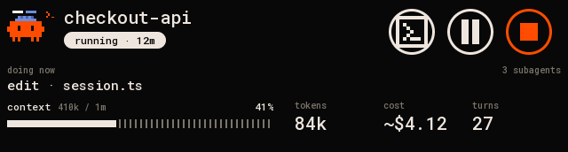
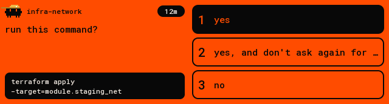
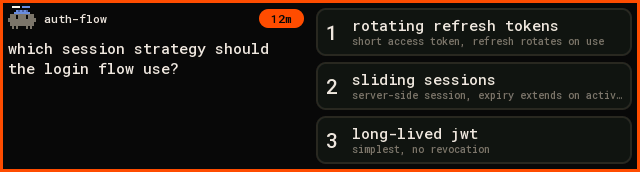
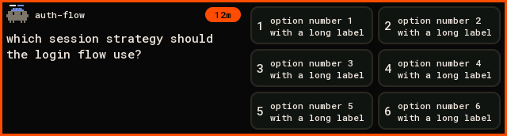
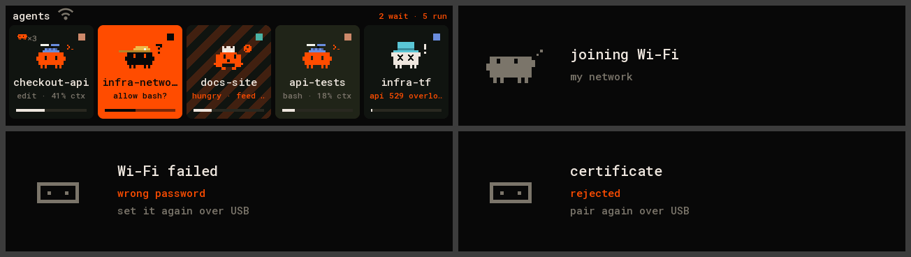

# waveshare-touch-lcd-349: the deck on a 3.49″ strip

The deck on a [Waveshare ESP32-S3-Touch-LCD-3.49](https://www.waveshare.com/wiki/ESP32-S3-Touch-LCD-3.49)
(a 640×172 bar in landscape, touch), over USB or Wi-Fi with [Deck Link](../../../docs/link/protocol.md).
It fits under a monitor or in front of a keyboard.

| home | card |
|---|---|
|  |  |
| **permission** | **question** |
|  |  |
| **six answers** | **waiting for approval** |
|  |  |

(Rendered on the host from `docs/fixtures/state.json` by `firmware/panel-core/tools/render_docs.sh`.
Every screen is in `docs/`.)

- **Home.** A header ("agents", how many wait and run, the Wi-Fi mark on Wi-Fi, the battery on
  battery power), then the agents in one row of tiles, five on screen. Each tile has the critter with
  its pose and hat, the name, a status line and the context bar. Orange means it needs you; stripes
  mean a finished turn you haven't looked at.
  - Drag sideways to scroll. Let go and the row settles on a tile; a flick carries further.
  - A thin bar along the bottom shows where you are while the row moves.
  - BOOT shows the next five agents, then the first five again.
- **Card.** Tap a tile: the critter, the name and the status pill; what it's doing now and how many
  subagents work for it; context with the dotted bar; tokens, cost and turns. On the right, round
  buttons: **focus** its terminal, **interrupt** while it runs, and **stop**, held for a second while
  the ring fills (admin only).
- **Prompt.** Tap an orange tile: the question on the left (for a permission, the command it asks to
  run, two lines of it), the answers on the right. Up to three answers stack in one column with their
  hint lines; four to six go in two columns. Tap one: "sent", and back home.
- **Back.** Swipe right, or press BOOT.
- Without a deck it says what to do: run `agentctl link add`, approve it, or wait for the deck to come
  back.

## Parts

- Waveshare ESP32-S3-Touch-LCD-3.49: a 3.49″ IPS bar (AXS15231B, QSPI, 172×640) with touch in the same
  chip, ESP32-S3 with 8 MB PSRAM and 16 MB flash, a TCA9554 IO expander, a battery connector with
  charging.
- A USB-C data cable to the Mac. Nothing to wire: the board's own USB is the link.
- Optional: a 3.7 V lithium battery on the MX1.25 connector, to run it on Wi-Fi away from the Mac.

## Connect it

```sh
pio run -d firmware/devices/waveshare-touch-lcd-349/idf5 -e idf5 -t upload --upload-port /dev/cu.usbmodem<…>   # or the 2.0.17 build, USB only
agentctl link add /dev/cu.usbmodem<…>
agentctl devices approve waveshare-touch-lcd-349-<id>      # only with `agentctl devices auto-approve usb off`
agentctl devices scope waveshare-touch-lcd-349-<id> act    # answer, focus, interrupt; admin to stop
```

It needs scope `act` to answer prompts, focus terminals and interrupt agents, and `admin` for stop.
A new board on a registered USB port gets `act` at once. It subscribes to every agent with all
fields and keeps up to 64 in PSRAM. The Hello says: display 640×172 colour, inputs TOUCH and BUTTON.

## Build and flash

| env | what |
|---|---|
| `waveshare-touch-lcd-349` (`platformio.ini`) | arduino-esp32 2.0.17: USB only (no TLS 1.3, so no Wi-Fi) |
| `debug` | the same with one-line notes on the USB port |
| `selftest` | the hardware self-test, no Deck Link: corner colours, a dot under the finger, BOOT switching the backlight, frame and touch timings on the USB port |
| `idf5` (`idf5/platformio.ini`) | arduino-esp32 3.x: USB and Wi-Fi (TLS 1.3). The firmware to flash |
| `idf5-debug` | `idf5` with notes on the USB port (link, Wi-Fi phase, frame time, heap and PSRAM) |
| `idf5-selftest` | the self-test on arduino-esp32 3.x |

```sh
pio run -d firmware/devices/waveshare-touch-lcd-349/idf5 -e idf5 -t upload --upload-port /dev/cu.usbmodem<…>
```

The `idf5` project keeps its platform in `~/.platformio-pioarduino` and rebuilds arduino-esp32's
libraries with TLS 1.3 the first time (about ten minutes). pioarduino's platform needs Python 3.10 to
3.14 to run PlatformIO. If the build fails with `No module named 'SCons.Tool.FortranCommon'`, see the
fix in [flashing.md](../../../docs/flashing.md#troubleshooting).

If a flash can't connect: hold BOOT, press and release RESET, let go of BOOT, and flash again.

## Wi-Fi

> Untested on this board so far: USB and `agentctl link check` are tested on both builds; joining a
> network and the link over Wi-Fi are not yet.

On the `idf5` firmware it also works away from the Mac, as the same device, over TLS 1.3 with a
certificate of its own, as on the other touch boards ([the 2.1″ board's README](../waveshare-touch-lcd-21/README.md#wi-fi)
has the whole story): it pairs by itself on USB, takes the deck's default network
(`agentctl link wifi --default --ssid "my network"`), and when no deck answers on USB at boot it joins
the network. Plugged into the Mac again, USB wins at once.



Home on Wi-Fi with its mark, joining, a wrong password, a refused certificate.

## Battery and power

> Untested so far: everything here has run on USB power only. The charge is read from the voltage
> (3.3 V empty, 4.15 V full), not calibrated against a battery.

- On battery power the header shows the charge, in orange at 15 % and below. On a USB host there is
  no battery mark.
- **Hold PWR for 1.5 s** to switch it off on the battery. On USB it stays powered (a toast says so).
  Press PWR to switch it on again.

## Hardware

Pins are from Waveshare's demos ([ESP32-S3-Touch-LCD-3.49](https://github.com/waveshareteam/ESP32-S3-Touch-LCD-3.49),
`Examples/Arduino`) and the board's schematic:

| part | pins |
|---|---|
| AXS15231B LCD (QSPI) | CS 9, SCK 10, D0–D3 11 12 13 14, RST 21; 40 MHz |
| touch (AXS15231B) | I²C SDA 17, SCL 18, address 0x3B |
| I²C | SDA 47, SCL 48: TCA9554 0x20, RTC 0x51, IMU 0x6B |
| TCA9554 | EXIO1 backlight enable (`BL_EN`), EXIO6 battery power hold |
| backlight | `BL_EN` on EXIO1 switches it; GPIO8 (PWM, inverted) only trims it a little |
| buttons | BOOT GPIO0, PWR GPIO16 (both active low) |
| battery | GPIO4, through a 1:3 divider |

What's particular about this board:

- **The panel is portrait in its memory** (172 columns × 640 rows). The firmware draws the landscape
  frame and turns it while sending (`STRIP_ROTATION`, 90 or 270, picks which long edge is the top).
- **A frame always goes out whole.** In QSPI mode the panel ignores the row window: 0x2C starts at
  the first row and the following writes carry on from there. Sending a frame takes about 23 ms on
  2.0.17 and 34 ms on `idf5`; drawing it about 9 ms more.
- **The panel runs on its own settings.** Waveshare sends only sleep-out and display-on, not the
  long init of the 320×480 AXS15231B panels that Arduino_GFX's driver has.
- **Touch never reports a lift.** Between reports the chip returns filler bytes, so the finger counts
  as lifted after three filler reads in a row and 60 ms without a report.
- **The backlight is on or off.** Idle keeps it on.

## Code

`src/board_349.h` is the board's drivers and `src/main.cpp` the board's firmware (battery, PWR) and
the self-test. The layout, the touch UI and Deck Link are shared with the other panels in
[`firmware/panel-core`](../../panel-core) (`layout_strip.h`, `StripPanel`; host tests in
`tests/test_strip.cpp`).
