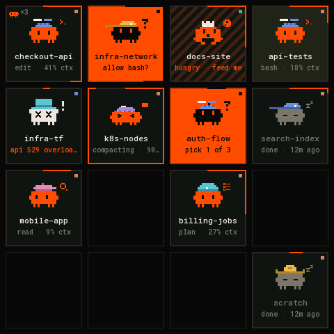
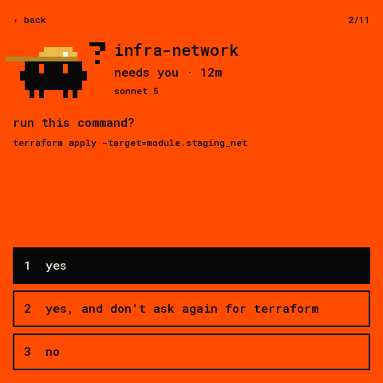
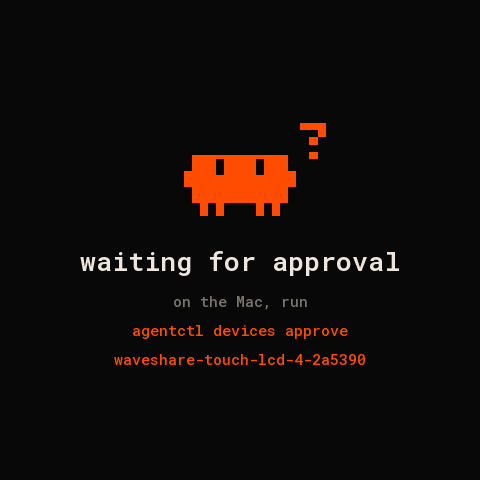

# waveshare-touch-lcd-4: the deck on a 4″ touch panel

The deck's 4×4 board on a [Waveshare ESP32-S3-Touch-LCD-4](https://www.waveshare.com/wiki/ESP32-S3-Touch-LCD-4)
(480×480 ST7701 LCD, GT911 touch), over USB with [Deck Link](../../../docs/link/protocol.md). It looks
like the desk panel and the web board.

| grid | card | prompt | approval |
|---|---|---|---|
|  |  |  |  |

(Rendered on the host from `docs/fixtures/state.json` by `firmware/panel-core/tools/render_docs.sh`.)

- **Grid.** One tile per slot, 16 per page, as on the deck:
  - Each tile has the critter with its pose and hat, the title, and a status line.
  - An orange tile needs you. Orange stripes mean a turn finished that you haven't looked at. A dim tile is idle.
  - The border fills with the agent's context use.
  - The small square in the corner is the tool. A small critter top left means subagents are working.
- **Pages.** Swipe left and right, or tap a page bar. Another page's bar turns orange when an agent
  there needs you. BOOT also goes to the next page.
- **Card.** Tap a tile. The card shows status, model, what the agent is doing, context, turns and
  cost. Tap **‹ back**, swipe right or press BOOT to return.
- **Prompts.** A waiting agent's card shows the question and its answers. With scope `act` they are
  buttons: a tap sends the answer, and the card closes when the deck confirms. With scope `view` the
  answers are listed and the card says how to allow answering.
- **Other screens:**
  - `connecting` until the deck answers;
  - `waiting for approval`, with the command to run and the board's name;
  - `deck offline` after 15 s of silence.
- **Backlight.** Dims when every agent is idle and nobody has touched the screen for 30 s.

## Connect it

```sh
pio run -d firmware/devices/waveshare-touch-lcd-4 -t upload --upload-port /dev/cu.usbmodem<…>
agentctl link add /dev/cu.usbmodem<…>
agentctl devices approve waveshare-touch-lcd-4-<id>      # the screen shows the name
agentctl devices scope waveshare-touch-lcd-4-<id> act    # to answer prompts from the panel
```

It subscribes to every agent with all fields (`TILE | CARD | PROMPT | NUMBERS`) and keeps up to 64 in
PSRAM. The Hello says: display 480×480 colour, inputs TOUCH and BUTTON.

## Hardware

The board has no wiring of its own. Pins below are from Waveshare's BSP
(`esp32_s3_touch_lcd_4` 3.0.0) and their Arduino demos:

| part | pins |
|---|---|
| ST7701 RGB | DE 40, VSYNC 39, HSYNC 38, PCLK 41; R 46 3 8 18 17; G 14 13 12 11 10 9; B 5 45 48 47 21 |
| ST7701 init (3-wire SPI) | CS 42, SCK 2, SDA 1; Arduino_GFX `st7701_type1_init_operations` |
| I²C | SDA 15, SCL 7: GT911 touch 0x5D, IO expander, RTC 0x51 |
| IO expander | V4: CH32V003 at 0x24 (power, LCD and touch reset, backlight PWM); V1–V3: TCA9554 at 0x20 |
| BOOT | GPIO0 |

The panel is mounted upside down relative to its scan order, so the firmware turns the frame and the
touch by 180°. The backlight PWM on the CH32V003 is inverted (0 is brightest), as in Waveshare's BSP.
V1–V3 boards can only switch the backlight on and off.

`pio run -e debug` builds the same firmware with one-line notes on the USB port (which expander and
touch it found, frame time, memory); the deck ignores them.

## Code

`src/main.cpp` is only the board: display, touch, expander, backlight. The layout, the touch UI and
Deck Link are shared with the other panels in [`firmware/panel-core`](../../panel-core)
(`layout_grid.h`, `layoutLcd4()`).
