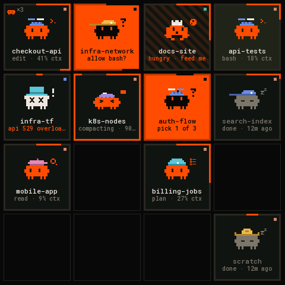
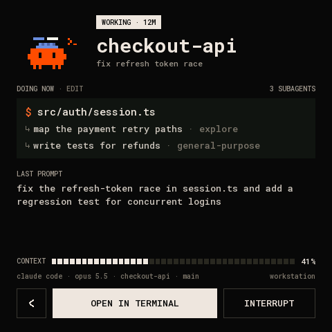
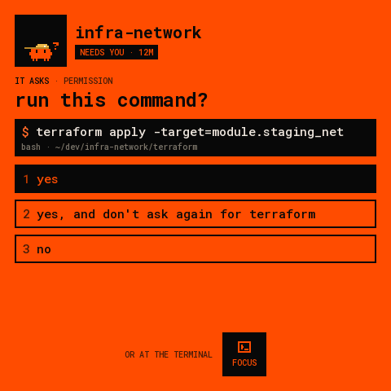
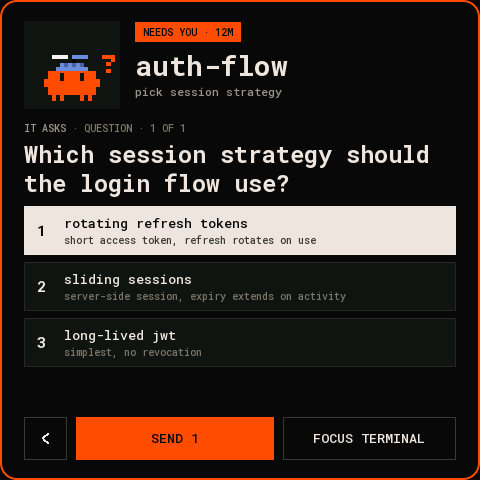
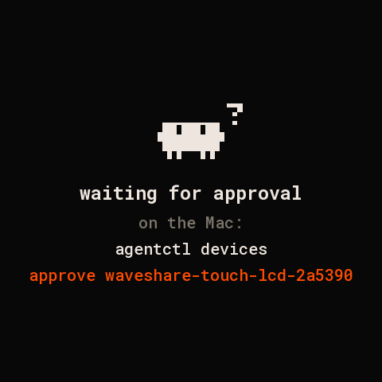
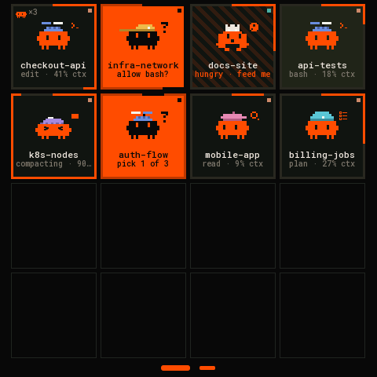
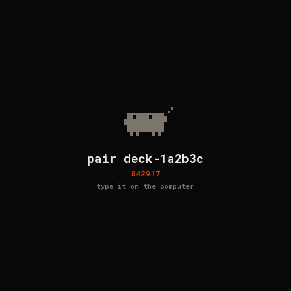
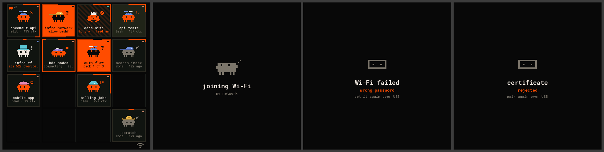

# waveshare-touch-lcd-4: the deck on a 4″ touch panel

The deck's 4×4 board on a [Waveshare ESP32-S3-Touch-LCD-4](https://www.waveshare.com/wiki/ESP32-S3-Touch-LCD-4)
(480×480 ST7701 LCD, GT911 touch), over USB or Wi-Fi with [Deck Link](../../../docs/link/protocol.md). It looks
like the desk panel and the web board.

| grid | card | permission | question | approval | needs you | Bluetooth code |
|---|---|---|---|---|---|---|
|  |  |  |  |  |  |  |

(Rendered on the host from `docs/fixtures/state.json` by `firmware/panel-core/tools/render_docs.sh`.
Every screen is in `docs/`.)

The board is the same size as the 4″ desk panel (720×720) at 480×480, so it draws the desk panel's
Flutter UI with every size times 2/3 (`layout_big.h`).

- **Grid.** The deck's 4×4 board with square tiles by slot, paged (`DeckGrid`, `AgentTile`).
  - Each tile shows the critter with its pose and hat, the title, a status line, the context along
    the border, the tool chip, and the subagent critter.
  - Orange means it needs you; stripes mean a finished turn you haven't looked at.
  - Slide the pages left or right with a finger (a move clearly more sideways than up or down); they
    follow it, and on release go on to the next page once you moved about 5 mm (or flicked), else
    spring back. Tapping the page bars changes page too; BOOT goes to the next page.
- **Needs you.** One more page, to the left of the first: the agents at work, asking you something,
  or finished and not checked yet, in the same 4×4 grid. An agent leaves 5 seconds after it stops
  needing you, and keeps its spot while it is there. Swipe right on the first page (or tap the mark at
  the left of the page bars) to go there, swipe left to come back; BOOT goes there after the last
  page. The mark is solid orange while you are on it, and an orange outline with a count while
  someone is on it. The board always starts on the first page.
- **Card.** Tap a tile for the agent:
  - its pet (with Agent pets on; otherwise its critter) doing what the agent does;
  - the status chip, the pet's hearts and level, the name, the session and the pet's level bar;
  - doing now: the command and the working subagents in a box (or the status when it isn't working);
  - the last prompt;
  - context, and the tool, model, folder and branch.

  Square buttons in a row underneath:
  - **focus**;
  - **interrupt** while the agent runs;
  - **stop**, which arms on the first tap ("again", for 3 s);
  - once the agent has exited, resume and remove;
  - **back** to the deck, as on the menu bar app's agent page.

  Focus and interrupt need scope `act`; stop, resume and remove need `admin`. An egg ready to hatch
  sits in a box that says **tap to hatch**: a tap hatches it (HatchPet, with a deck that has it).
- **Prompts.** The whole screen turns orange: the pet in its box with its "?", what it asks, the
  command and where it runs, and every answer as a row. Tap one to choose it (the primary is chosen
  to start with), tap it again to send. **Focus** sits at the foot.
- **Back.** Swipe right, or press BOOT.
- **The board's panel.** Pull down from the top edge of any screen (a tap there still opens the tile
  under it): the board's name, Wi-Fi and Bluetooth switches, how it reaches the deck, restart (hold
  1 s) and the firmware version. Swipe it up or press BOOT to close it.
- **Other screens.** Waiting for approval (with the command), connecting to the deck, deck offline,
  no agents.
- **Backlight.** Dims when every agent is idle and nobody has touched the screen for 30 s.

## Connect it

> Flash the `idf5` build, which is what the releases install: USB, Wi-Fi and Bluetooth. Its picture
> at times jumped sideways while it connected to the deck; it now has the round boards' display
> settings (see [Build and flash](#build-and-flash)). If yours still does it, the 2.0.17 build
> (`pio run -d firmware/devices/waveshare-touch-lcd-4 -t upload`) has the steadiest picture, on USB only.

```sh
pio run -d firmware/devices/waveshare-touch-lcd-4/idf5 -e idf5 -t upload --upload-port /dev/cu.usbmodem<…>
agentctl link add /dev/cu.usbmodem<…>
agentctl devices approve waveshare-touch-lcd-4-<id>      # only with `agentctl devices auto-approve usb off`
agentctl devices scope waveshare-touch-lcd-4-<id> act    # answer, focus, interrupt; admin to stop
```

It subscribes to every agent with all fields (`TILE | CARD | PROMPT | NUMBERS`) and keeps up to 64 in
PSRAM. The Hello says: display 480×480 colour, inputs TOUCH and BUTTON.

## Build and flash

| env | what |
|---|---|
| `idf5` (`idf5/platformio.ini`) | arduino-esp32 3.x: USB, Wi-Fi (TLS 1.3) and Bluetooth. The released build |
| `waveshare-touch-lcd-4` (`platformio.ini`) | arduino-esp32 2.0.17: USB only (no TLS 1.3, so no Wi-Fi). Not released; to fall back on |
| `debug` | the 2.0.17 build with one-line notes on the USB port |
| `idf5-debug` | `idf5` with notes on the USB port (link, Wi-Fi phase, frame time, internal heap and PSRAM) |

```sh
pio run -d firmware/devices/waveshare-touch-lcd-4/idf5 -e idf5 -t upload --upload-port /dev/cu.usbmodem<…>
```

### The picture on `idf5`

On the 2.0.17 build the RGB panel scans its framebuffer straight from PSRAM. On `idf5` it did too, and
at times the picture jumped sideways while the board connected to the deck: most likely the panel ran
short of data while Wi-Fi, the TLS handshake and the drawing all used PSRAM, or while flash was
written. An earlier try with a bounce buffer showed horizontal lines across the picture instead.

`idf5` now does what the round boards do:

| setting | what it does |
|---|---|
| `LCD4_BOUNCE_PX=4800` | the panel scans two buffers of 10 lines in internal RAM, refilled from the framebuffer by the LCD interrupt (19.2 KB of internal RAM) |
| `CONFIG_SPIRAM_XIP_FROM_PSRAM` | the code runs from PSRAM, so writing flash (Wi-Fi settings, the certificate) no longer pauses those refills |
| `CONFIG_LCD_RGB_ISR_IRAM_SAFE` | the LCD interrupt runs from internal RAM |
| `CONFIG_LCD_RGB_RESTART_IN_VSYNC` off | with it on, one late refill made every later one land in the buffer on screen: the likely cause of the earlier horizontal lines. Off, the driver counts each frame's refills and starts the next frame afresh when one was missed |
| `CONFIG_ESP32S3_DATA_CACHE_LINE_64B` | PSRAM is read in 64-byte cache lines |

With the bounce buffer the frame is no longer written back from the cache after each push (the
interrupt reads it through the cache). `LCD4_BOUNCE_PX=0` goes back to scanning PSRAM. On a real board
(20 November 2026) the picture held through power cycles, a restart and joining Wi-Fi. The
`idf5-debug` build prints, every 5 s, how often the board started and why, and how many frames the
panel took: flash it if the screen ever goes black, and read that line before restarting.

The `idf5` project keeps its platform in `~/.platformio-pioarduino` (pioarduino and PlatformIO's own
ESP32 platform clash in one home) and rebuilds arduino-esp32's libraries with
`CONFIG_MBEDTLS_SSL_PROTO_TLS1_3=y` and the settings above: about five minutes the first time, and again after another
pioarduino project was built in between. If it fails with `No module named
'SCons.Tool.FortranCommon'`, see the fix in [the 2.1″ board's README](../waveshare-touch-lcd-21/README.md#wi-fi).

## Wi-Fi

On the `idf5` firmware the board also works away from the Mac, as the same device (name, scope,
audit log), over TLS 1.3 with a certificate of its own. It works as on the round boards
([the 2.1″ board's README](../waveshare-touch-lcd-21/README.md#wi-fi) has the whole story):

1. **Pair.** Plugged into the Mac and approved, it pairs by itself (toast "paired for Wi-Fi";
   `agentctl devices` shows "Wi-Fi certificate").
2. **The network.** The deck's default network (`agentctl link wifi --default --ssid "my network"`)
   goes to it by itself over USB (toast "trying Wi-Fi…", then the outcome; `agentctl link` shows
   `default my network: ok`). `agentctl link wifi waveshare-touch-lcd-4-<id> --ssid …` gives it a network of its
   own.
3. **Unplug it** and power it anywhere. At boot it listens on USB for 4 s; with no deck there it joins
   the network and connects to the deck. Plugged into the Mac again, USB wins at once.



Home on Wi-Fi with its mark, joining, a wrong password, a refused certificate. A toast on a notice sits low on the screen.

| screen | meaning |
|---|---|
| joining Wi-Fi · the network's name | joining the network |
| connecting · to the deck · over Wi-Fi | joined; reaching the deck |
| Wi-Fi failed · wrong password | set it again with `agentctl link wifi` (on USB); retried every minute |
| Wi-Fi failed · network not found | out of range or the name is wrong; retried every 15 s |
| deck not reachable · over Wi-Fi | the Mac is asleep, or the daemon isn't running; retried with a growing pause |
| certificate · rejected · pair again over USB | the board was revoked or paired again: plug it into the Mac |

On Wi-Fi a small Wi-Fi mark sits at the right of the row under the grid (the page bars' row, which then stays with one page too); on USB there is none. The key, the certificate and the
Wi-Fi password are kept in the board's flash (NVS), not encrypted unless you turn on flash encryption:
revoke a board you lose (`agentctl devices revoke waveshare-touch-lcd-4-<id>`).

## Bluetooth

The `idf5` build (the released one) has Bluetooth; the 2.0.17 build doesn't. It also reaches the deck over Bluetooth LE, through the helper in the macOS app (macOS only for
now). In Settings, Boards, turn on **Look for boards**, click **Add** next to the board's name (`deck-`
and six characters, shown on its screen) and type the 6-digit code the board shows into the window
macOS opens. Over Bluetooth the board shows your agents and can get your Wi-Fi network; firmware
updates still need Wi-Fi or the cable. To make the board forget the computer, hold BOOT for 5 s and
press it again when it asks "forget Bluetooth?". Details: [Deck Link, Bluetooth](../../../docs/link/protocol.md#bluetooth).

## Hardware

The board has no wiring of its own. Pins below are from Waveshare's BSP
(`esp32_s3_touch_lcd_4` 3.0.0) and their Arduino demos:

| part | pins |
|---|---|
| ST7701 RGB | DE 40, VSYNC 39, HSYNC 38, PCLK 41; R 46 3 8 18 17; G 14 13 12 11 10 9; B 5 45 48 47 21 |
| ST7701 init (3-wire SPI) | CS 42, SCK 2, SDA 1; Arduino_GFX `st7701_type1_init_operations` |
| I²C | SDA 15, SCL 7: GT911 touch 0x5D, IO expander, RTC 0x51 |
| IO expander | V4: CH32V003 at 0x24 (power, LCD and touch reset, backlight PWM); V1–V3: TCA9554 at 0x20 |
| BOOT | GPIO0 |

The panel is mounted upside down relative to its scan order, so the firmware turns the frame and the
touch by 180°. The backlight PWM on the CH32V003 is inverted (0 is brightest), as in Waveshare's BSP.
V1–V3 boards can only switch the backlight on and off.

`pio run -e debug` builds the same firmware with one-line notes on the USB port (which expander and
touch it found, frame time, Deck Link rx / bad / overflow counters, memory); the deck ignores them.

## Code

`src/main.cpp` is only the board: display, touch, expander, backlight. In the idf5 build the panel has
no frame buffer of its own: the LCD interrupt refills its two bounce buffers from one of three frames
in PSRAM, turned 180 degrees on the way, while the next frame is drawn into another (in strips of
internal RAM, copied in by changed rows). The drawer and the sliding pages are composed from kept
pictures as the interrupt refills, with nothing drawn or copied. The layout, the touch UI and
Deck Link are shared with the other panels in [`firmware/panel-core`](../../panel-core)
(`layout_big.h`, `specBig480()`).
