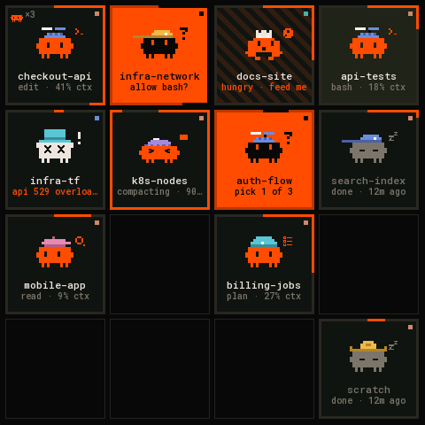
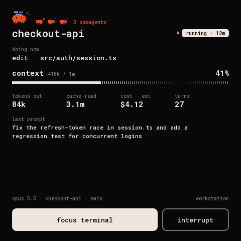
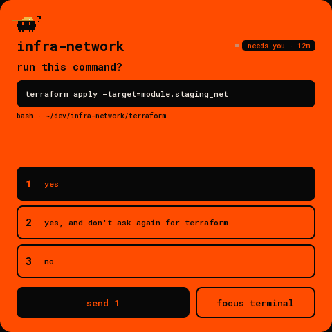
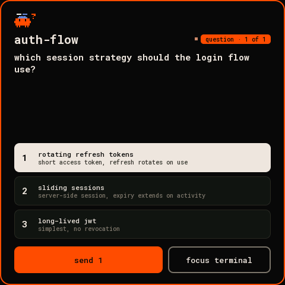
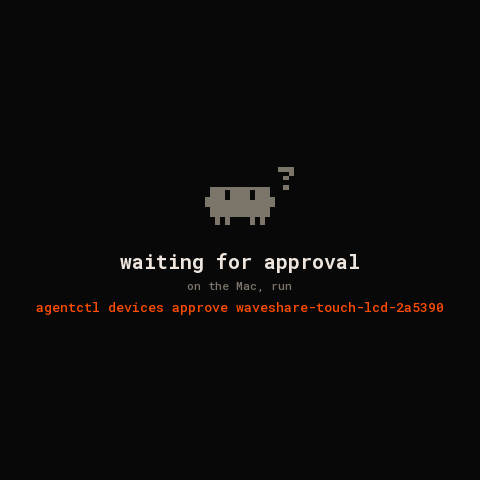

# waveshare-touch-lcd-4: the deck on a 4″ touch panel

The deck's 4×4 board on a [Waveshare ESP32-S3-Touch-LCD-4](https://www.waveshare.com/wiki/ESP32-S3-Touch-LCD-4)
(480×480 ST7701 LCD, GT911 touch), over USB with [Deck Link](../../../docs/link/protocol.md). It looks
like the desk panel and the web board.

| grid | card | permission | question | approval |
|---|---|---|---|---|
|  |  |  |  |  |

(Rendered on the host from `docs/fixtures/state.json` by `firmware/panel-core/tools/render_docs.sh`.
Every screen is in `docs/`.)

The board is the same size as the 4″ desk panel (720×720) at 480×480, so it draws the desk panel's
Flutter UI with every size times 2/3 (`layout_big.h`).

- **Grid.** The deck's 4×4 board with square tiles by slot, paged (`DeckGrid`, `AgentTile`).
  - Each tile shows the critter with its pose and hat, the title, a status line, the context along
    the border, the tool chip, and the subagent critter.
  - Orange means it needs you; stripes mean a finished turn you haven't looked at.
  - Swipe or tap the page bars to change page; BOOT goes to the next page.
- **Card.** Tap a tile for the desk panel's overview:
  - the critter and its subagents, the title, the tool chip and the status pill;
  - doing now;
  - context with the tick bar;
  - tokens out, cache read, cost, turns;
  - the last prompt;
  - model, folder and branch.

  The button row underneath:
  - **focus terminal**;
  - **interrupt** while the agent runs;
  - otherwise **stop**, which arms on the first tap ("tap again to stop", for 3 s);
  - once the agent has exited, resume and remove.

  Focus and interrupt need scope `act`; stop, resume and remove need `admin`.
- **Prompts.** One layout for permissions and questions: the question, the command or detail, the
  options with their hint lines. Tap one to choose it (the primary is chosen to start with), then
  **send**. **Focus terminal** sits beside it. A permission is the orange card; a question is dark
  with the orange border.
- **Back.** Swipe right, or press BOOT.
- **Other screens.** Waiting for approval (with the command), connecting to the deck, deck offline,
  no agents.
- **Backlight.** Dims when every agent is idle and nobody has touched the screen for 30 s.

## Connect it

```sh
pio run -d firmware/devices/waveshare-touch-lcd-4 -t upload --upload-port /dev/cu.usbmodem<…>
agentctl link add /dev/cu.usbmodem<…>
agentctl devices approve waveshare-touch-lcd-4-<id>      # the screen shows the name
agentctl devices scope waveshare-touch-lcd-4-<id> act    # answer, focus, interrupt; admin to stop
```

It subscribes to every agent with all fields (`TILE | CARD | PROMPT | NUMBERS`) and keeps up to 64 in
PSRAM. The Hello says: display 480×480 colour, inputs TOUCH and BUTTON.

## Hardware

The board has no wiring of its own. Pins below are from Waveshare's BSP
(`esp32_s3_touch_lcd_4` 3.0.0) and their Arduino demos:

| part | pins |
|---|---|
| ST7701 RGB | DE 40, VSYNC 39, HSYNC 38, PCLK 41; R 46 3 8 18 17; G 14 13 12 11 10 9; B 5 45 48 47 21 |
| ST7701 init (3-wire SPI) | CS 42, SCK 2, SDA 1; Arduino_GFX `st7701_type1_init_operations` |
| I²C | SDA 15, SCL 7: GT911 touch 0x5D, IO expander, RTC 0x51 |
| IO expander | V4: CH32V003 at 0x24 (power, LCD and touch reset, backlight PWM); V1–V3: TCA9554 at 0x20 |
| BOOT | GPIO0 |

The panel is mounted upside down relative to its scan order, so the firmware turns the frame and the
touch by 180°. The backlight PWM on the CH32V003 is inverted (0 is brightest), as in Waveshare's BSP.
V1–V3 boards can only switch the backlight on and off.

`pio run -e debug` builds the same firmware with one-line notes on the USB port (which expander and
touch it found, frame time, Deck Link rx / bad / overflow counters, memory); the deck ignores them.

## Code

`src/main.cpp` is only the board: display, touch, expander, backlight. The layout, the touch UI and
Deck Link are shared with the other panels in [`firmware/panel-core`](../../panel-core)
(`layout_big.h`, `specBig480()`).
